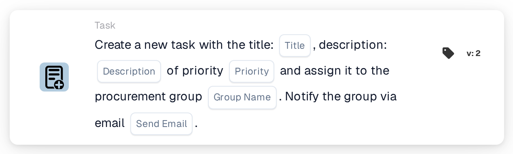
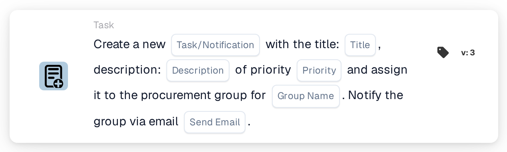

# Create a New Task and assign it to Procurement Group

<figure><figcaption>
Version 2
</figcaption></figure>

<figure><figcaption>
Version 3
</figcaption></figure>

## **Purpose:**

The **"Create Task for Procurement Group"** workflow card creates a new task dynamically assigned to the procurement group specified in the configuration. This task can be assigned with different priority levels, and an optional email notification can be sent to inform the group about the task. This card ensures that the right team is alerted based on workflow conditions.

## **Components of the Card:**

1. **Title**
   * **Description:** Specifies the title of the task.
   * **Detail:** This field identifies the task being created, providing a concise title for easy identification.
2. **Description**
   * **Description:** Provides further details about the task.
   * **Detail:** This field is used to describe the task’s objective and any necessary context or instructions.
3. **Priority**
   * **Description:** Defines the urgency of the task.
   * **Options:**
     * **High:** Task requires immediate attention.
     * **Medium:** Task is important but not urgent.
     * **Low:** Task can be handled at a later time.
4. **Group Name**
   * **Description:** Specifies the procurement group to whom the task will be assigned.
   * **Detail:** This field designates the procurement group responsible for the task. It ensures the task is directed to the right team.
5. **Email Notification**
   * **Description:** Configures whether an email notification should be sent to the assigned procurement group.
   * **Options:**
     * **True:** Sends an email notification to the procurement group.
     * **False:** No email notification is sent.

## **Functionality:**

* **Condition Evaluation:**\
  The card only executes its action if both the **"When"** and **"And"** evaluate as true.
* **Task Creation:**\
  The card creates a new task, assigning it to the procurement group defined in the "Group Name" field. This task will include the specified title, description, and priority level.
* **Email Notification:**\
  If the email notification option is set to true, an email is sent to the procurement group informing them about the task.

## **Setup and Configuration:**

* **Define Task Details:**\
  Enter the task's title, description, and priority level.
* **Select Procurement Group:**\
  Choose the procurement group that will be responsible for the task.
* **Enable Email Notification:**\
  Specify whether an email notification should be sent to the group upon task creation.

## **Conclusion:**

The "Create Task for Procurement Group" workflow card ensures that tasks are automatically assigned to the appropriate procurement group with defined priorities. This card can also notify the group via email to ensure tasks are attended to promptly, improving workflow efficiency and task management.

<!-- workflow-card-practical-example-20261021 -->

## Practical example

**When to use:** Ask the purchasing team to review an invoice exception.

**Configuration:** Select `Demo Procurement`, title `Review order variance`, description and priority.

**Expected result and counterexample:** A task is created for the selected procurement group. Check the task assignee and description; creation alone does not confirm the variance has been resolved.

This is an illustrative configuration and expected outcome. Use fields, users and groups configured in your test organization; it is not a claim that this example was executed.
