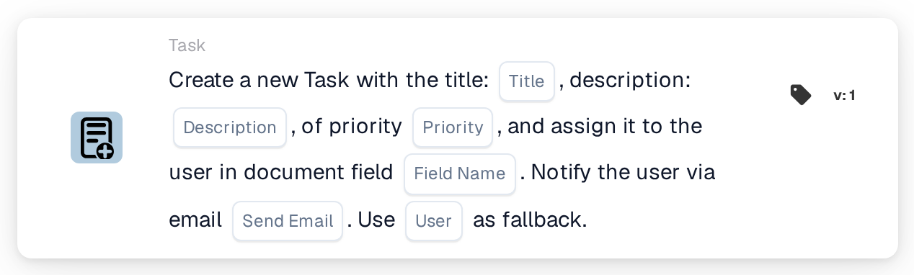
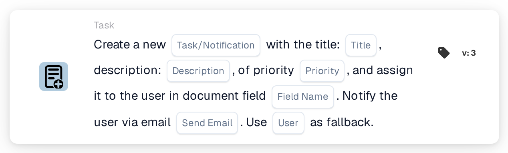

# Create a New Task and assign it to the User in Document Field

<figure><figcaption>
Version 1
</figcaption></figure>

<figure><figcaption>
Version 3
</figcaption></figure>

## **Purpose:**

The **"Create Field-Based Task or Notification"** workflow card is used to create tasks or notifications dynamically assigned to users identified within specific document fields. This card provides an optional fallback mechanism to ensure smooth workflow execution even when the document field does not specify a valid user.

## **Components of the Card:**

1. **Title**
   * **Description**: Specifies the task or notification title.
   * **Detail**: Used to name and identify the task or notification being created.
2. **Description**
   * **Description**: Provides additional details about the task or notification.
   * **Detail**: Ensures the recipient understands the purpose and context of the task or notification.
3. **Priority**
   * **Description**: Defines the urgency of the task or notification.
   * **Options**:
     * **High**: Requires immediate attention.
     * **Medium**: Important but less urgent.
     * **Low**: Can be addressed at a later time.
4. **Field Name**
   * **Description**: Specifies the document field that will be used to assign the task or notification.
   * **Detail**: The field selected will dynamically determine the user to whom the task or notification will be assigned. If the field is empty or invalid, the task or notification will be assigned to the fallback user selected from the dropdown list.
5. **Email Notification**
   * **Description**: Configures whether the assigned user is notified by email.
   * **Options**:
     * **True**: Sends an email notification to the assigned user.
     * **False**: No email notification is sent.
6. **Fallback User**
   * **Description**: Allows the selection of a user from a dropdown list to assign the task or notification when no valid user is found in the document field.
   * **Detail**: Ensures the task or notification is assigned even if the document field is empty or invalid.

## **Additional Components in Version 3:**

1. **Notification Type**
   * **Description**: Specifies whether the card creates a task or a notification.
   * **Options**:
     * **Task**: Creates a task assigned to the specified user.
     * **Notification**: Sends a notification instead of creating a task.

## **Functionality:**

* **Condition Evaluation**:\
  The card only executes its action if both the **"When"** and **"And"** evaluate as true.
* **Task or Notification Creation**:
  * Assigns the task or notification to the user identified in the document field.
  * In Version 3, allows creating either a task or a notification.
* **Fallback Mechanism**:\
  If the document field does not identify a valid user, the card assigns the task or notification to the fallback user selected from the dropdown list.
* **Email Notification**:\
  Sends an email notification to the assigned user if configured to do so.

## **Setup and Configuration:**

1. **Define Task or Notification Details**: Enter the title, description, and priority.
2. **Select the Document Field**: Choose the field that specifies the user for task or notification assignment.
3. **Enable Email Notification**: Specify whether an email notification should be sent to the assigned user.
4. **Select Fallback User**: Choose a fallback user from the dropdown list for assignment if the document field does not identify a valid user.
5. **Specify Notification Type (Version 3)**: Indicate whether the card creates a task or notification.

## **Conclusion:**

The **"Create Field-Based Task or Notification"** workflow card streamlines task and notification management by dynamically assigning responsibilities based on document fields. Its fallback user mechanism and enhanced options in Version 3 provide flexibility, ensuring tasks or notifications are always assigned, even when document data is incomplete.

<!-- workflow-card-practical-example-20261021 -->

## Practical example

**When to use:** Create a review task for the user named in document data.

**Configuration:** Select `reviewer_name`, fallback user `Demo Reviewer A`, title `Review invoice` and priority.

**Expected result and counterexample:** A resolvable user in the field receives the task. An empty or unresolvable field uses the configured fallback; test both paths.

This is an illustrative configuration and expected outcome. Use fields, users and groups configured in your test organization; it is not a claim that this example was executed.
