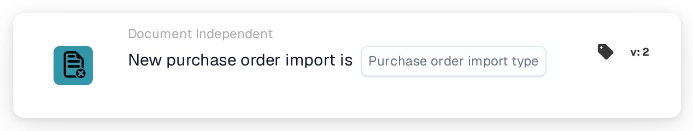

# Purchase order import

<figure><figcaption>
Version 2
</figcaption></figure>

## Purpose:

This workflow card starts a workflow (trigger) when a purchase order is imported into DocBits. It can react to newly created purchase orders, to updates of existing purchase orders, or to both. The workflow runs without a document, so it can be used to inform people or to call other systems whenever purchase order data arrives.

## Components of the Card:

1. **Purchase order import type**
   * **Description:** Defines which kind of import starts the workflow.
   * **Options:**
     * **a new purchase order.** The purchase order did not exist before and was created by the import.
     * **an update to an existing purchase order.** An existing purchase order was updated by the import.

     Both options can be selected.

## Functionality:

* **When the workflow starts:** When a purchase order from the ERP system is processed by the purchase order import, the system records whether it was new or an update. It then starts all enabled document-independent workflows of the organization (except webhook and scheduled workflows) and passes this information, together with the purchase order ID and purchase order number, to the workflows. This only happens if the workflow module is active for the organization and there are active workflows. A purchase order that is skipped because the incoming version is not newer than the stored one does not start workflows.
* **Condition Evaluation:** The card checks whether the import type passed to the workflow is one of the types selected on the card.
* **Action Execution:**
  * **True Condition:**\
    If the import type matches a selected option, the workflow continues with the next cards.
  * **False Condition:**\
    If the import type does not match, or the workflow was started by another document-independent event (for example a supplier status change), the card is not met and the steps after it are not run.
* **Missing Data:** If no import type is selected on the card, the card does not evaluate the condition. It reports the missing input (or an error) in the workflow log, and the steps after it are not run.

## Setup and Configuration:

* The card can be added from the **WHEN** bucket, category **Document Independent**. Then one or both import types are selected, the further conditions and actions are added, and the workflow is saved and enabled.

## Conclusion:

The "Purchase order import" card lets workflows react as soon as purchase order data is created or updated, without waiting for a document. This keeps follow-up processes in step with the purchase orders coming from the ERP system.
