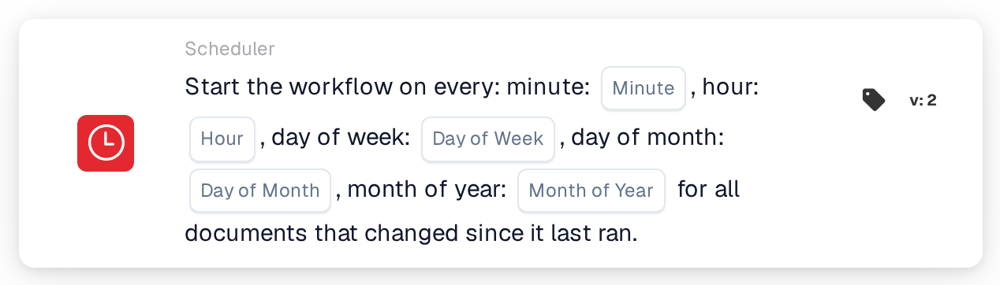

# Scheduled workflow start

<figure><figcaption>
Version 2
</figcaption></figure>

## Purpose:

This workflow card starts a workflow (trigger) on a time schedule, similar to a cron job. At each scheduled time, the workflow is run for all documents that have changed since the previous run. This is useful for regular processing such as nightly checks, periodic reminders or follow-ups that should not run immediately on every document change.

## Components of the Card:

1. **Minute**
   * **Description:** The minute(s) of the hour at which the workflow starts.
   * **Detail:** Cron-style value, for example `0`, `30`, `0,30` or `*/15`. Empty means every minute (`*`).
2. **Hour**
   * **Description:** The hour(s) of the day at which the workflow starts.
   * **Detail:** Cron-style value, for example `6` or `8-18`. Empty means every hour (`*`).
3. **Day of Week**
   * **Description:** The weekday(s) on which the workflow starts.
   * **Detail:** Cron-style value, for example `1-5`. Empty means every weekday (`*`).
4. **Day of Month**
   * **Description:** The day(s) of the month on which the workflow starts.
   * **Detail:** Cron-style value, for example `1` or `1,15`. Empty means every day (`*`).
5. **Month of Year**
   * **Description:** The month(s) in which the workflow starts.
   * **Detail:** Cron-style value, for example `1` or `1-6`. Empty means every month (`*`).

## Functionality:

* **Time zone:** All times are in UTC, the time zone of the DocBits servers. For example, 6:00 UTC is 8:00 in Central European Summer Time.
* **When the workflow starts:** When the workflow is saved and enabled, a schedule entry is created from the five fields. If the workflow is disabled or deleted, the schedule entry is removed. At each scheduled time, the system:
  * looks for documents of the organization that were modified, saved or changed status since the workflow last ran,
  * starts the workflow separately for each of these documents in the background, and
  * remembers the time of this run as the starting point for the next one.

  Documents that have reached the workflow execution limit are skipped. If the workflow is disabled while the documents are being processed, the remaining documents are not run.
* **Condition Evaluation:** The card checks whether the workflow was started by the schedule.
* **Action Execution:**
  * **True Condition:**\
    When the workflow is started by the schedule, the card is met and the workflow continues with the next cards.
  * **False Condition:**\
    When the workflow is started in any other way, for example by a document trigger, a webhook or a variable change, the card is not met and the steps after it are not run.
* **Only one schedule per workflow:** In the Advanced Workflow Builder, if a workflow contains several schedule cards, only the first one is used for the schedule.
* **Saving:** If the schedule entry cannot be updated when saving, the workflow is still saved and a warning is shown. Saving the workflow again retries the update.

## Setup and Configuration:

* The card can be added from the **WHEN** bucket, category **Scheduler**. Then the time fields are filled in; fields that are left empty mean "every". For example, minute `0`, hour `6`, day of week `1-5` and the other fields empty start the workflow at 6:00 UTC on weekdays. After that, the further conditions and actions are added, and the workflow is saved and enabled.

## Conclusion:

The "Scheduled workflow start" card runs workflows at fixed times instead of on every event. Because each run only picks up the documents that changed since the previous run, regular processing stays focused on new work.
