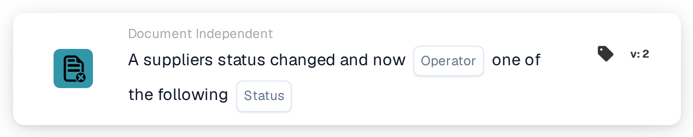

# Supplier status changed

<figure><figcaption>
Version 2
</figcaption></figure>

## Purpose:

This workflow card starts a workflow (trigger) when the status of a supplier changes, for example when a supplier is approved or rejected. The workflow runs without a document, so it can be used to notify people or to start follow-up steps in supplier onboarding.

## Components of the Card:

1. **Operator**
   * **Description:** Defines whether the new supplier status should be one of the selected statuses or none of them.
   * **Options:**
     * **Is:** The condition is true if the new status is one of the selected statuses.
     * **Is Not:** The condition is true if the new status is not one of the selected statuses.
2. **Status**
   * **Description:** The supplier statuses the new status is compared with.
   * **Options:** One or more of:
     * **Approved**
     * **Pending AP Approval**
     * **Pending Approval**
     * **Pending Registration**
     * **Rejected**

## Functionality:

* **When the workflow starts:** A supplier status change in the supplier management starts all enabled document-independent workflows of the organization (except webhook and scheduled workflows) and passes the new status to them. This happens, for example, when a new supplier is invited (status pending registration), when a supplier is sent for approval, approved or rejected, or when supplier details are saved with a different status. The status has to be one of the supplier statuses configured for the organization; otherwise no workflow is started. Workflows are only started if the workflow module is active for the organization and there are active workflows.
* **Condition Evaluation:** The card compares the status passed to the workflow with the statuses selected on the card.
* **Action Execution:**
  * **True Condition:**\
    With **Is**, the new status is one of the selected statuses. With **Is Not**, it is not. The workflow continues with the next cards.
  * **False Condition:**\
    If the condition is not met, the card is not met and the steps after it are not run.
* **Note on "Is Not":** A purchase order import also starts all document-independent workflows, including workflows with this card. A purchase order import passes no supplier status, so with **Is Not** a purchase order import also makes the card true and the workflow runs. Combining **Is Not** with further conditions can help to limit the workflow to supplier events.
* **Missing Data:** If no status is selected on the card, the card does not evaluate the condition. It reports the missing input (or an error) in the workflow log, and the steps after it are not run.
* **Invalid Operator:** If the operator is neither **Is** nor **Is Not**, the card reports a card setup error in the workflow log.

## Setup and Configuration:

* The card can be added from the **WHEN** bucket, category **Document Independent**. Then the operator and one or more statuses are selected, the further conditions and actions are added, and the workflow is saved and enabled.

## Conclusion:

The "Supplier status changed" card connects supplier management with workflows. Approvals, rejections and other status changes can directly trigger notifications and follow-up steps, so supplier onboarding does not depend on manual checks.
