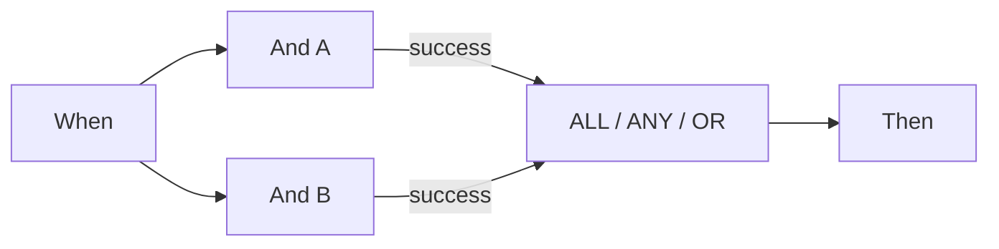

# P0: Connect Wait ALL, Wait ANY and OR correctly

ALL requires a matching connected output from **every distinct source**. ANY and OR require at least one matching source. Connecting both green and orange from one source still counts as one source. OR does not create an exclusive branch or cancel other actions. ANY does not promise that the fastest branch wins.

The inspected scheduler first waits for all incoming predecessors. If an unselected branch leaves a predecessor unreachable, normal execution skips the stalled merge. Test mode can evaluate it using the available results. **A green partial test therefore does not prove that a document run will continue through the same graph.**

For two mandatory checks, actually execute both and connect their required outputs to ALL. For alternative routes in this version, use the direct common Then completion card in the v2 case study. That convergence is for mutually exclusive routes; it is not a barrier for several actions executing together.

Inspect the source, connected output, selected output and actual reachability separately. A source error remains an overall error even if ANY/OR subsequently succeeds. In the inspected code an unsatisfied ALL also carries an error detail; its orange color alone is insufficient evidence.

## Cards and example parameters

These values describe individual card parameters, not an importable complete workflow. Replace YOUR_* with your own test selections. The designer manages the hidden caller ID. Catalog: Dev, DocFlow 2.10.38, 21 October 2026; check available versions and entitlements in your own organization.

`node_type`: `all`, `any`, `or`

## Business test cases

| Case | Input / setup | Expected outcome |
| --- | --- | --- |
| MERGE-01 | A=success; B=success | ALL/ANY/OR: join=success |
| MERGE-02 | A=success; B=failed_condition; B→failed_condition: — | ALL: join=failed_condition, workflow=error; ANY/OR: join=success, workflow=failed_condition |
| MERGE-03 | A=success; B=error | ANY/OR: join=success; workflow=error |
| MERGE-04 | A=success; B=unreachable | test: evaluate; scheduler: skip |
| MERGE-05 | A→success + A→failed_condition; B→success | sources=2 |

## Evidence and limits

Selected card and node outcomes were checked with synthetic data in Advanced Test. Responses are in the training kit. Document actions are simulated; these tests do not establish a persisted document run or external delivery.

[Continue learning](../workflow-learning-path.md) · [Training kit](../workflow-training-kit.md)
