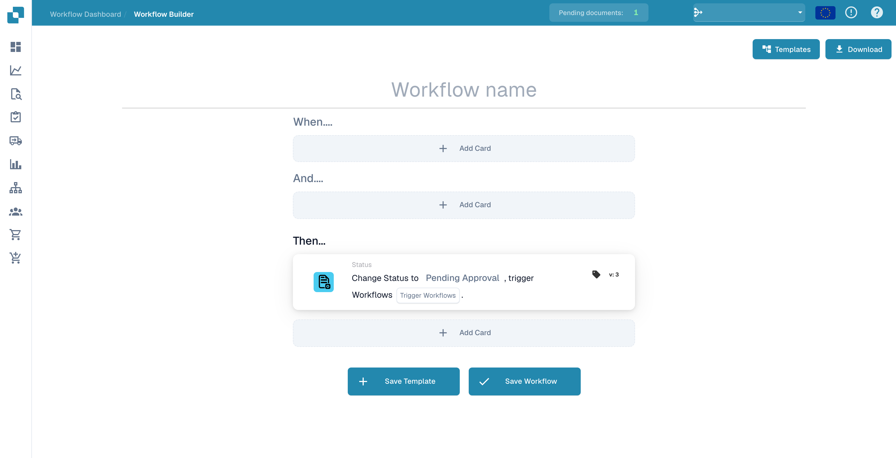
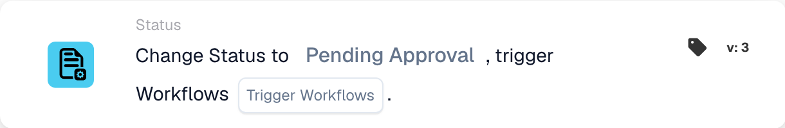
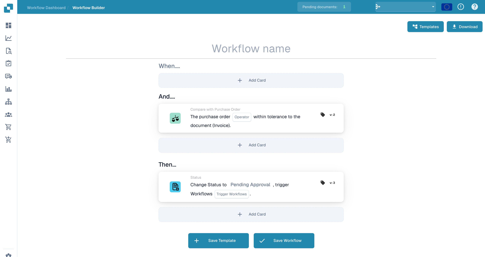
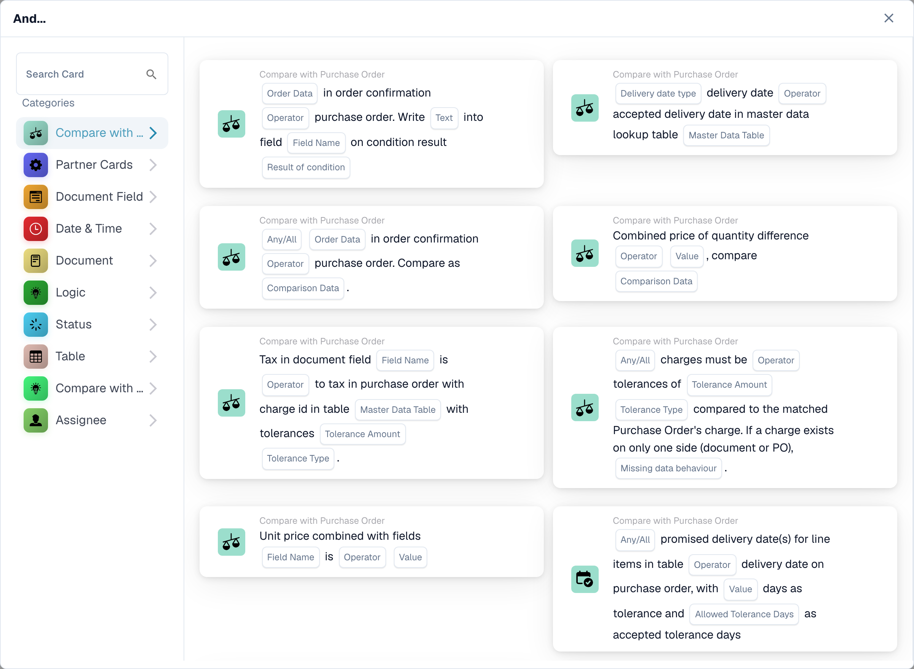
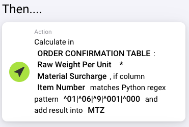

# Assignment & Status — Worked Examples

To keep an overview, you can give the workflows different headings so that you can immediately know what task this workflow is about.

Create a new Workflow: Click on + ADD WORKFLOW

.png>)

You can use these workflows (Test 1,2,3) to automatically assign various documents to the right employee in the company.

.png>)

If an invoice or other document exceeds a certain total amount that requires prior review and approval, these documents can be immediately assigned to the correct person.

<figure><figcaption></figcaption></figure>

**Test 1: Logic Card**

When: **Assignee is:** Intake reviewer

And: **Document type is:** Invoice

Then: **Assign document to:** Invoice reviewer

.png>)

**Test 2: Logic Card**

When: **Assignee is:** Intake reviewer

And: **Document type is:** Delivery Note

Then: **Assign document to:** Delivery-note reviewer

.png>)

**Test 3: Logic Card**

**When:** **Assignee is:** Intake reviewer

**And:** **Document type is:** Order Confirmation

**Then:** **Assign document to:** Order reviewer

.png>)

It is also possible, if the document is not assigned to a single person, to assign it to a specific employee from the start.

<figure><figcaption></figcaption></figure>

For an easier overview of what should happen to a document, you can set the status for incoming documents in this workflow. This workflow makes it possible to immediately see whether there is, for example, a pending approval.

**Test 4: Logic Card**

**When:** **Document type is:** Delivery Note

**And:** **Assignee is:** Intake reviewer

**Then:** **Change Status to:** Pending Approval

<figure><figcaption>
Unsaved workflow draft for changing a document status.
</figcaption></figure>

.png>)

**Test 5: Logic Card**

When: **Document type is:** Invoice

And: **Assignee is:** Invoice reviewer

Then: **Change Status to:** Pending Second Approval

<figure><figcaption></figcaption></figure>

.png>)

If an invoice or other document exceeds a certain total amount that requires prior review and approval, these documents can be assigned to the right person immediately.

.png>)

**Test 6: Logic Card**

When: **Assignee is:** Intake reviewer

And: Docfield **total\_amount** is **Greater than 500**

Then: **Assign document to:** Approval owner

<figure><figcaption></figcaption></figure>

.png>)

It is also possible to enter the status into the workflow, so the assigned person can immediately see what status this document is and what should happen next with it.

**Test 7: Logic Card**

**When:** **Assignee is:** Intake reviewer

**And:** Docfield **total\_amount** is **Greater then 500**

**Then:** **Assign document to:** Approval owner

**Change Status to:** Pending Approval

<figure><figcaption>
Status-change action in an unsaved workflow draft.
</figcaption></figure>

<figure><figcaption></figcaption></figure>

For example, if certain or important information is missing from a document, but is important and must be included for further processing, you can set up the workflow so that these documents are immediately forwarded to the buyer and a substitute (replacement).

<figure><figcaption></figcaption></figure>

**Test 9:**

The Workflow with these logic cards is designed to automatically verify that the quantity, unit price, or discount detailed in an order confirmation matches the corresponding figures in the purchase order. This verification ensures consistency and accuracy between what was ordered and what the supplier confirms to deliver.

You can give these documents a specific status or assign them to a specific employee.

<figure><figcaption>
Unsaved workflow draft with a purchase-order comparison condition.
</figcaption></figure>

<figure><figcaption>
Purchase-order comparison card in the English workflow picker.
</figcaption></figure>

**Logic Card: Quantity or Unit Price or Discount Match**

This logic card is designed to automatically verify that the quantity, unit price, or discount detailed in an order confirmation matches the corresponding figures in the purchase order. This verification ensures consistency and accuracy between what was ordered and what the supplier confirms to deliver.

**Trigger Condition**

The logic is activated when any of the following conditions are met in an order confirmation relative to the original purchase order:

* **Quantity**: The quantity of items ordered matches the quantity confirmed by the supplier.
* **Unit Price**: The price per item agreed upon matches the supplier's confirmation.
* **Discount**: Any discounts applied are consistent between the purchase order and the order confirmation.
* **Define Comparison Parameters**: Set up the specific fields (quantity, unit price, discount) that the logic card will check for a match.
* **Automate Verification**: Configure the system to automatically compare these details upon receipt of an order confirmation.
* **Customize Alerts**: Decide on the workflow for handling discrepancies, including customization of alerts for manual review.

This logic card is vital for ensuring that the details of an order confirmation align with the original purchase order, safeguarding the integrity of the procurement cycle.

**Test 10:**

If you have a different calculation for surcharges, or only have them on some items, you can use the generic table calculation cards, some of them also allow to filter for regular expressions.

<figure><figcaption></figcaption></figure>

Above is a calculation example for MTZ with a filter for item numbers starting with 01, 06, 9, 001 or 000.

With a manual setup it’s advised to split calculations that depend on new columns into a separate workflow. To continue with the calculation you can use the Run Workflow card.

**Run Workflow**

<figure><figcaption></figcaption></figure>

With this card you can specify the name of a workflow that is to be run after the current workflow if its conditions are met and after previous then cards of the current workflow. While it prioritises runnable, active workflows, it also allows you to run deactivated workflows if the document fulfills the workflows conditions.

### **Adding calculated surcharges into an existing column** 

<figure><figcaption></figcaption></figure>

If you want to add all surcharges as a negative discount into the discount column, you can use the calculation card. There might be entries in this column, you can set it as one of the variables on the card, have the MTZ subtracted from it and add the result back into this column. In case there are empty fields (surcharges only for some items) it will assume a 0 for its calculation

**Notify user to authorize the order confirmation in DocBits**

After calculating the surcharges you might want to notify a specific user to authorize the order confirmation. For this you can use the notification card

<figure><figcaption></figcaption></figure>

Depending on settings, the user gets assigned a new task in DocBits and optionally an email to notify them of their new task.
