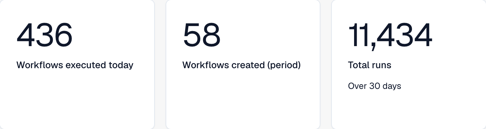
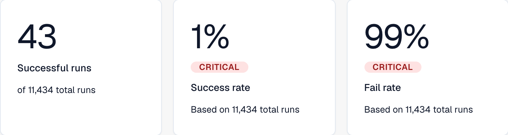
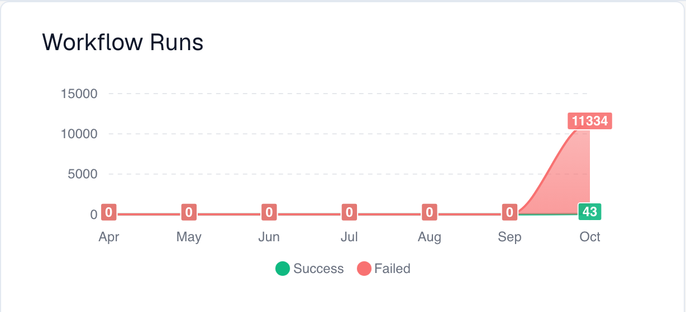
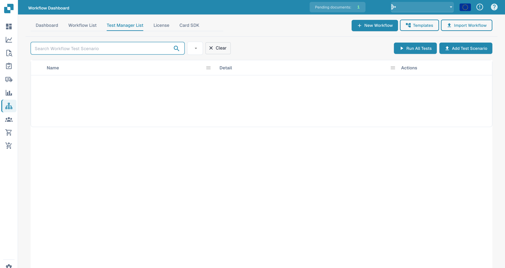

# Dashboard

The **Workflow Dashboard** is the home of the workflow area. It shows how your workflows are performing — run totals, success and fail rates, a runs-over-time chart and recent activity — and gives you access to the workflow list, the test manager and the Card SDK.

The partial views below show volume metrics, run outcomes and the runs chart. Recent activity and navigation controls are outside these crops.

<figure><figcaption>
Volume metrics: workflows executed today, workflows created during the selected period, and total runs.
</figcaption></figure>

<figure><figcaption>
Run outcomes: successful runs, success rate and fail rate, including the displayed run-count context.
</figcaption></figure>

<figure><figcaption>
Workflow runs over the seven displayed months, with Success and Failed series shown separately.
</figcaption></figure>

## Tabs

* **Dashboard** — run metrics (illustrated above) and recent activity.
* **Workflow List** — every workflow with its type, execution order and trigger. Create a new one with **New Workflow**.
* **Test Manager List** — test scenarios that validate your workflows; run them with **Run All Tests**.
* **License** — workflow licensing information.
* **Card SDK** — build and upload custom workflow cards (see [Card SDK](card-sdk.md)).

The toolbar also offers **Templates**, which opens the [Workflow Templates](standard-workflow-builder/#workflow-templates) library, and **Import Workflow**, which imports a workflow from a JSON file.

The **Test Manager** lets you save test scenarios per workflow and run them together, so you can confirm your workflows still behave correctly after changes:

<figure><figcaption>
Workflow test-scenario list.
</figcaption></figure>

## Next steps

* Build a linear automation with the **Standard Workflow** builder.
* Build a branching flow with the **Advanced Workflow** builder.
