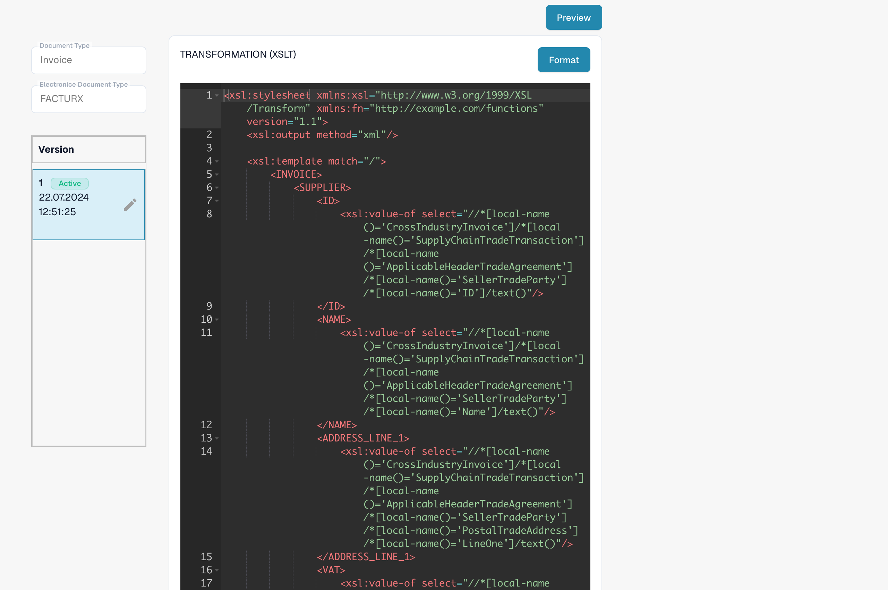

# Configure DocBits with Claude or Codex

Describe the result you want, let the assistant read the current configuration, review its proposal, then apply the agreed change. DocBits MCP provides tools for this in Claude and Codex. The assistant uses the permissions of your connected DocBits account; configuration changes require the appropriate administrator permissions.

This guide explains a configuration procedure. It does not report a completed customer fix or a successful export test.

## 1. Connect to the right organization

Use the [endpoint matrix and sign-in guide](setup-and-configuration.md) to choose your region and environment. These commands use **EU sandbox**; replace the URL if your test organization uses another endpoint. Run the commands on the host where the assistant runs, sign in and approve DocBits access in the browser.



```bash
claude mcp add --transport http docbits https://eu.sandbox.api.docbits.com/v3/mcp
claude mcp login docbits
```


```bash
codex mcp add docbits --url https://eu.sandbox.api.docbits.com/v3/mcp
codex mcp login docbits
```



In the Codex app, use its MCP settings or the configuration shared with the CLI on the same host. For Claude Desktop, use a remote custom connector when your plan supports it and enter the same HTTP endpoint. Start a new conversation if the tools are not visible. Current client instructions: [Codex MCP](https://developers.openai.com/codex/mcp) and [Claude MCP](https://code.claude.com/docs/en/mcp).

Start with this prompt:

```text
Read only. Check the connected DocBits environment and organization with
get_api_info and get_current_user. List the available configuration tools.
Show the organization ID and API host, without tokens or key previews.
Do not change settings or process documents.
```

If the organization is still unresolved, read the relevant configuration and verify the `org_id` in the response. Stop if it is not the intended organization. Tool names may have a client/server prefix. Use the tools and argument schemas actually advertised by your connection.

## 2. Change a simple setting

For example, ask:

```text
Find the QR-code extraction setting for this test organization with
find_setting. Show its exact setting_key and current value. If there are
several matches, ask which one I mean. If the setting is writable through
apply_setting, preview enabling it. Show current_value and proposed_value;
wait for my confirmation before calling confirm_setting_change.
```

`apply_setting` only creates a preview. After you confirm that specific proposal, `confirm_setting_change(preview_id)` saves it. Read the setting back and keep the returned `undo_id`; `undo_setting_change` can reverse the change within the returned time limit. Previews normally expire after 5 minutes and undo after 15 minutes. If the value changed meanwhile or the preview expired, create and review a fresh preview.

For supported structured changes, the equivalent sequence is `preview_settings_action` → `confirm_settings_action` → `undo_settings_action`. Read the advertised action types first. If a setting has no supported write action, ask for its `app_path` and complete the change in DocBits. Do not substitute an undocumented preference key or a broad `set_preference` call.

## 3. Diagnose a credit note stored as Invoice

A Custom eDocs Transformation can output a constant `<INVOICE_TYPE>Invoice</INVOICE_TYPE>` even when the original XML says credit note. This is the configuration scenario behind the [credit-note troubleshooting guide and real DocBits video](../../administration-and-setup/settings/global-settings/document-types/edi/credit-note-recognized-as-invoice.md).

```text
Read only. For the supplied original XML and document ID, identify the eDoc
family, syntax, version/profile and original type code. List the Custom and
Default attributes. Read effective and default TRANSFORMATION and
EXTRACTION_PATHS with get_edoc_attribute_source. Record attribute_id,
active_version and active_value_id, and read the version history.
Trace TypeCode -> transformed XML -> invoice_type -> stored field/export
preview and any later scripts. Show evidence and uncertainties.
Do not activate, delete, restart, approve or export anything.
```

Use the **exact detected format label**, rather than a guessed ZUGFeRD or Factur-X version. The technical `doc_type_key` may still be `INVOICE`; the business value being investigated is `invoice_type`.

| Read | MCP tool |
| --- | --- |
| Custom and Default attributes | `list_edoc_custom_attributes` |
| Effective or default source and active IDs | `get_edoc_attribute_source`, with `source: "effective"` or `"default"` |
| Version history, including drafts | `list_edoc_attribute_versions`, with `include_values: true` when needed |
| Stored fields, logs, export preview | `get_extracted_fields`, `get_document_logs`, `get_export_preview` |

For a historical document, today's active version does not establish which version ran then. Retain that uncertainty if the logs do not establish it. A PDF preview is not proof of the stored type or exported amounts.

<figure><figcaption><p>Read-only development example: the DocBits source/version editor. Read your own effective source and active value through MCP; this image does not demonstrate a saved change.</p></figcaption></figure>

## 4. Preview the smallest correction

```text
Propose the smallest change to our existing Custom Transformation so code
381 becomes Credit Note. Preserve all other mappings and existing supported
credit-note codes. Do not classify 383 or 384 as Credit Note. Show the diff.
Preview the candidate on our test documents without saving it and show the
transformed INVOICE_TYPE and relevant amounts. Report what remains untested.
```

For an **existing organization-owned attribute**, call `preview_edoc_custom_xslt` with the full candidate source:

```json
{
  "attribute_id": "<custom_attribute_id_from_response>",
  "candidate_value": "<complete_candidate_xslt>",
  "doc_id": "<test_document_id_in_this_org>"
}
```

Replace every placeholder with a value from your own responses; XSLT/JSON values must contain the complete source, correctly JSON-escaped. This tool uses an existing document in the same organization. It returns transformed **XML** for `TRANSFORMATION`, extracted fields/tables for `EXTRACTION_PATHS`, or a **PDF** for `PREVIEW`. It does not save the candidate. To compare with the default Transformation, preview the default source as another candidate against the same custom attribute and document.

`compare_edoc_extraction` compares **EXTRACTION_PATHS** and requires a custom Extraction Paths attribute. It is not a comparison of two Transformations. Do not create an unnecessary override just to use that tool.

If there is no Custom attribute, stop before creating one in production: `create_edoc_custom_attribute` creates an **immediately active** first version and has no draft-only flag. Prepare and test a new override in a test organization, or use the DocBits editor's supported preview/creation flow. Shared defaults remain shared; do not attempt to change them globally.

## 5. Save a draft, then activate deliberately

After reviewing the diff and candidate output, reread the active source. If it changed during the work, compare again before proceeding. Save an existing Custom attribute with `update_edoc_custom_attribute`:

```json
{
  "attribute_id": "<custom_attribute_id_from_response>",
  "new_value": "<complete_reviewed_xslt>",
  "activate": false
}
```

Always pass `activate: false` for this draft step; the tool's default is `true`. Record the returned version value ID and confirm in `list_edoc_attribute_versions` that the old version remains active. A saved draft does not affect the normal pipeline.

Ask the administrator to confirm the specific organization, attribute, diff and version after the tests. Activate with `activate_edoc_attribute_version`:

```json
{
  "attribute_id": "<custom_attribute_id_from_response>",
  "draft_id": "<value_id_of_reviewed_version>"
}
```

`draft_id` is the version's **value ID**, not the version number or attribute ID. Reread the effective source and version history to confirm that exact value is active. eDocs activation uses these tools directly; it does not use the generic settings `preview_id` flow. Use IDs read from the target environment; sandbox IDs cannot be reused in production.

## 6. Verify classification, amounts and export

`test_electronic_document` dry-runs the **currently active** configuration without saving a document. It has no candidate or draft selector. With remote HTTP MCP, send the original XML as `file_content_base64` with `file_name`; a local `file_path` on your computer is not accessible to the remote server. To test the full candidate pipeline, first activate it explicitly in the test organization. Candidate XSLT preview alone does not test later scripts or an export.

| Original code | Expected check |
| --- | --- |
| 380 | Invoice remains Invoice |
| 381 | Credit note becomes Credit Note |
| 261 | Preserve credit-note behavior where the format/mapping supports it |
| 383 | Debit note must not become Credit Note merely because it adjusts an invoice |
| 384 | Corrected invoice must not become Credit Note merely because it corrects an invoice |

Check extracted custom fields, line items, totals and the organization's negative-sign setting as well. Process a **new test document** in an isolated test organization with automatic exports controlled, then compare stored `invoice_type`, dashboard and `get_export_preview`. An actual target-system export needs a separately agreed test. Neither a dry-run nor an export preview proves successful ERP delivery.

`validate_all_edocs` dry-runs the server's available fixtures; `verify_electronic_documents` **uploads and processes** fixtures. Neither substitutes for your representative documents and downstream checks. If fixtures/tools are unavailable, test supplied samples instead.

## 7. Roll back and handle old documents separately

To roll back, call `activate_edoc_attribute_version` with the previously recorded `active_value_id` as `draft_id`, then verify the effective source again. Do not delete the whole custom override to fix one field: that discards other mappings and falls back to the default.

Do not bulk-restart historical documents. Restarting can remove extracted data and export logs and repeat approvals or exports. Review export status, approvals and manual edits for each document before deciding how to correct it.

For other configuration questions, start with `find_setting` or `run_config_checks` and ask the assistant to show the supported action or UI path. Keep the before/after proposal, test results, active value IDs and rollback reference with your change record.
