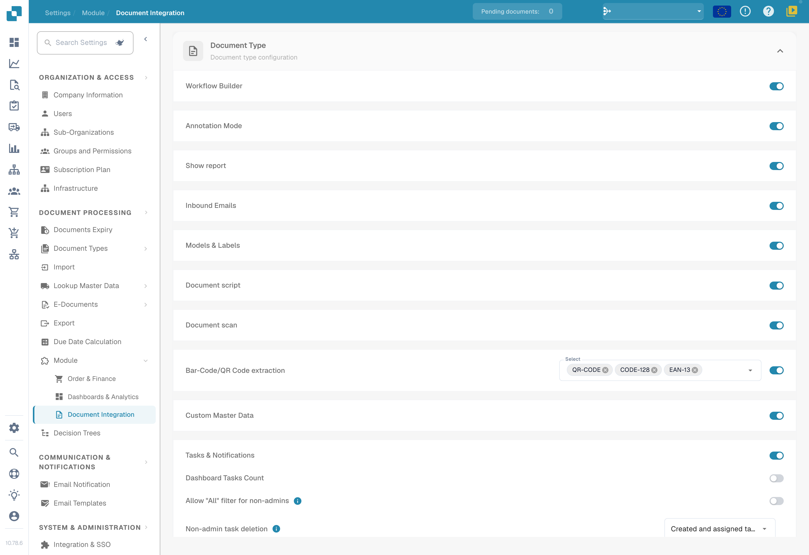
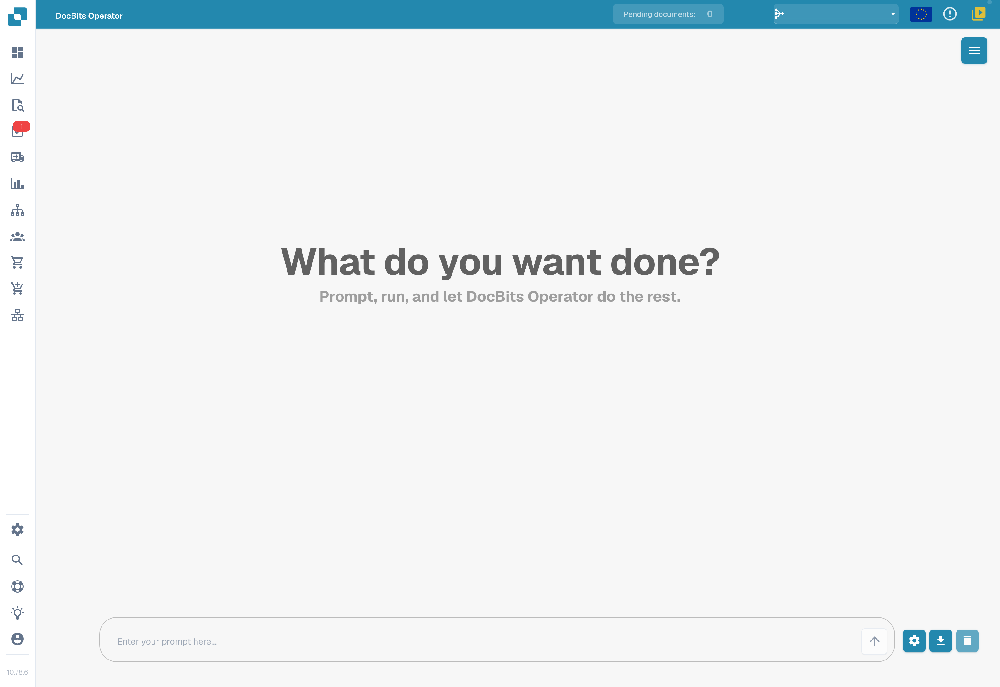
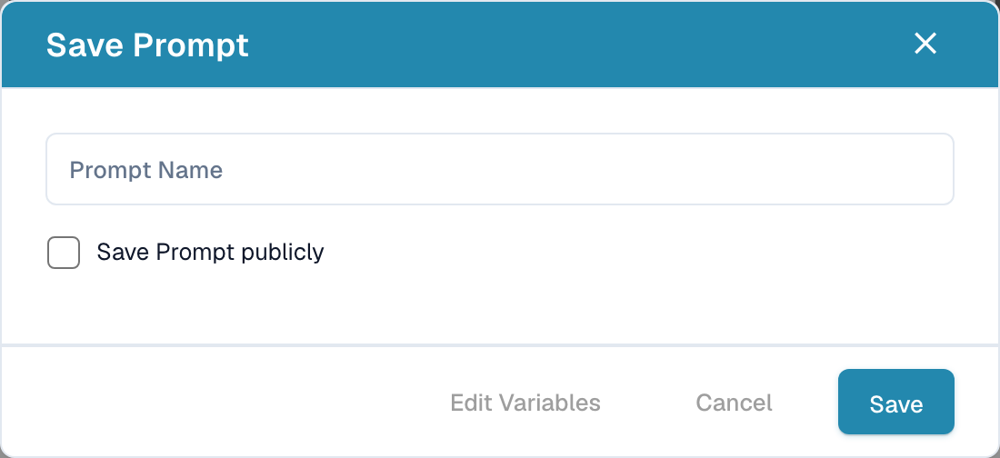

# DocBits Operator

DocBits Operator performs tasks from user instructions. An instruction describes the steps, while variables supply the data required for a particular run.

## Enable and open

1. Open **Settings → Module → Document Integration**.
2. Scroll to **DocBits Operator** and enable the feature if you have the required permissions.
3. Open **DocBits Operator** from the application's main navigation.

<figure><figcaption>
Document-integration modules: scripts, document scanning, barcode extraction and custom master data.
</figcaption></figure>

## Enter an instruction

Use the input at the bottom of the screen to describe the expected result and the steps to take. Write variables in braces, such as `{invoice_number}` or `{url}`. The gear button opens the window for defining variable names and values.

<figure><figcaption>
English DocBits Operator interface with an empty instruction field. No task was started.
</figcaption></figure>

The arrow starts execution. The download icon opens the prompt-saving dialog, and the trash icon clears the conversation. Opening the save dialog does not save a template.

See the [prompt-writing guide](prompt-writing-guide.md) for examples.

## Save an instruction

Enter a **prompt name** in the save dialog. The public-sharing option controls sharing of the template. When preparing a shared template, use variable names in the instruction and supply the values required for each run before execution.

<figure><figcaption>
Empty English prompt-saving dialog. No values were entered and the final Save button was not clicked.
</figcaption></figure>

When enabled, the variable-editing button opens the variable definitions. The save button saves the template. Use the cross in the upper-right corner to close the dialog without saving.

In the illustrated version, **Cancel** closes this dialog without saving. **Edit Variables** can be disabled for an empty prompt; enter the intended instruction and variables before using it.

## Saved instructions

The menu in the upper-right corner opens the saved-prompt sidebar. It has separate sections for organization and public prompts, together with search by name.

Organization prompts have run, edit and delete icons. In the public section, the arrow runs the selected template. Supply its variable values before running it.

## Execution controls

During execution you can pause, resume, cancel or take control. Pausing stops further steps while you inspect the current state. Resuming continues the work; cancelling ends the run. Taking control lets you interact manually with the browser view.

<figure><figcaption>
Example resume and stop icons.
</figcaption></figure>

## Detail view

The expand button opens the execution detail view. Use it to follow the actions, current step and Operator messages, and to access the execution controls.

<figure><figcaption>
Expand icon for the detail view.
</figcaption></figure>
