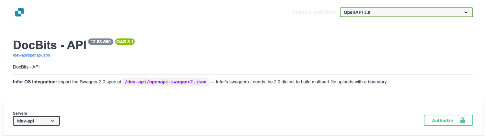
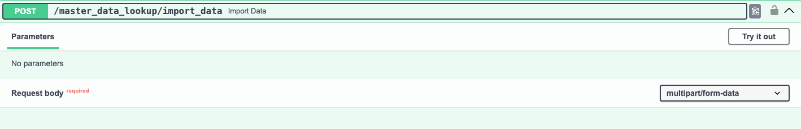
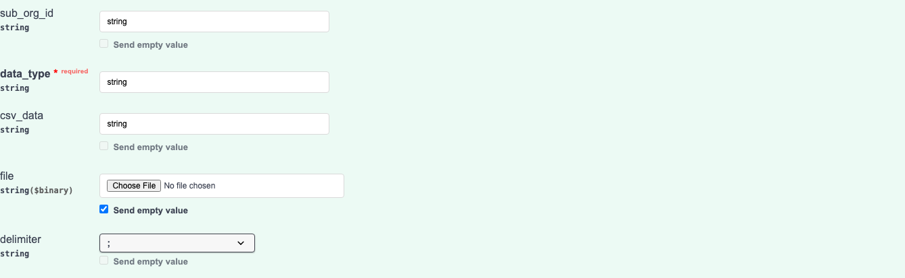
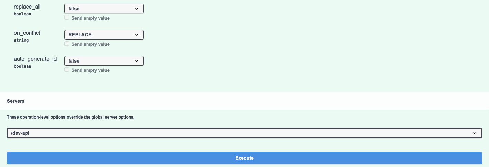

# Importing Supplier and Purchase Order Data into DocBits from CSV Files

## Overview

This page describes how to prepare a CSV import of Supplier or Purchase Order data in DocBits.

**Important:** Before importing any data, it is crucial to **review the .csv file thoroughly** to ensure data accuracy and proper configuration. Importing incorrect data can lead to inconsistencies. Refer to the [**CSV Specifications for Purchase Order**](importing-supplier-and-purchase-order-data-into-docbits-from-csv-files.md#csv-specifications-for-purchase-order) or [**CSV Specifications for Supplier**](importing-supplier-and-purchase-order-data-into-docbits-from-csv-files.md#csv-specifications-for-supplier) sections for details on required and optional fields. Confirm the accepted columns and validation rules for your API version before using a production dataset.

**Validation:** Use the lists below as a preparation checklist. Confirm required fields, additional fields and representative rows for your deployment; these lists are not a guarantee that every invalid row rejects the entire file. Review the response and independently verify the intended records.

## Generall Requirements:

**Date Format:**

All dates provided in the .csv sheet **must** adhere to the following format:

YYYY-MM-DD HH:MM:SS

**Required Fields:**

Prepare and validate the baseline identifiers listed below. Do not rely on an import request to validate the completeness or business correctness of your CSV for you.

### CSV Specifications for Purchase Order

**Baseline fields to prepare and validate**

* `purchase_order_number`

**Fields which can be included**

* `warehouse_id`
* `location_id`
* `supplier_id`
* `supplier_name`
* `header_total_amount`
* `order_date`
* `requested_shipment_date`
* `promised_delivery_date`
* `payment_terms_code`
* `total_amount`
* `buyer_contact_id`
* `buyer_contact_name`
* `order_last_modified_by`
* `order_last_modified_on`
* `ship_to_party_id`
* `ship_to_party_name`
* `ship_to_address_id`
* `disponent_id`
* `disponent_name`
* `extended_amount`
* `extended_base_amount`
* `extended_report_amount`
* `canceled_amount`
* `canceled_base_amount`
* `canceled_reporting_amount`
* `geo_code`
* `preview_path`
* `type_code`
* `type_description`
* `custom_field_1`
* `custom_field_2`
* `custom_field_3`
* `custom_field_4`
* `custom_field_5`
* `status`
* `line_number`
* `sub_line_number`
* `item_id`
* `supplier_item_id`
* `description`
* `note`
* `quantity`
* `open_quantity`
* `confirmed_quantity`
* `received_quantity`
* `received_base_mou_quantity`
* `promised_delivery_date`
* `requested_ship_date`
* `unit_of_measure`
* `unit_code_price`
* `unit_price`
* `unit_price_per`
* `extended_amount`
* `total_amount`
* `currency`
* `status`
* `buyer_id`
* `buyer_name`
* `geo_code`
* `delivery_method`

### CSV Specifications for Supplier

**Baseline fields to prepare and validate**

* `customer_number`
* `supplier_number`
* `supplier_name`
* `country_code`

**Fields which can be included**

* `address_id`
* `address_1`
* `address_2`
* `address_3`
* `address_4`
* `country_main_division`
* `town_city`
* `zip_code`
* `supplier_phone`
* `supplier_vat`
* `payment_term_id`
* `payment_method_code`
* `buyer_person_reference_id`
* `buyer_person_reference`
* `supplier_category`
* `supplier_group`
* `discount_term`
* `discount_term_description`
* `bank_id`
* `custom_field_1`
* `custom_field_2`
* `custom_field_3`
* `custom_field_4`
* `custom_field_5`
* `custom_field_6`
* `custom_field_7`
* `custom_field_8`
* `custom_field_9`
* `custom_field_10`
* `status`
* `account_id`
* `financial_partner_id`
* `financial_partner_name`
* `iban`
* `currency`

## Access Endpoint

### Choose the environment and organization

1. Open the API reference for the environment you intend to use. The production reference is [https://api.docbits.com/](https://api.docbits.com/); use your approved test environment for test data. Check the API version and **Servers** value before preparing a request.
2. For an authorized import, click **Authorize** and use the API key supplied for the intended organization and user. Never copy a key into a screenshot, a CSV file or a shared example. For credential setup, see [Integration](https://docs.docbits.com/administration-and-setup/settings/global-settings/integration).

The four images below are genuine English views of the Dev API reference, version **12.83.550**, with server **/dev-api**. No API key or CSV was supplied and **Execute** was not clicked. The visible `string` values are Swagger-generated examples, not valid organization IDs or prepared import data.

<figure><figcaption>
Check the reference version and server first. This is the Dev reference with no authorized credentials.
</figcaption></figure>

### Open the import operation

1. Find **POST /master_data_lookup/import_data** and expand it.
2. Click **Try it out** to enable the local request form. This step alone does not execute an import. Use **Cancel** to leave edit mode without sending the import.

<figure><figcaption>
The import operation accepts a multipart form-data request body. Try it out enables the form; it does not send the import.
</figcaption></figure>

### Prepare the request body

* **sub_org_id:** Enter the intended, authorized sub-organization ID when the import belongs to a sub-organization. Otherwise remove the generated `string` example and deliberately leave the field empty using the form's **Send empty value** control as appropriate. Empty does not identify a test organization or limit an organization-wide replacement.
* **data_type:** Enter `supplier` or `purchase_order` for the workflows described on this page. Replace the generated `string` example; the field is required.
* **file / csv_data:** This guide uses a CSV file. Clear the generated example from **csv_data** before choosing the file: nonempty `csv_data` is processed before the file in the reviewed importer. Select your checked CSV in **file** and confirm that its filename is displayed. Do not leave the screenshot's example values as your request.
* **delimiter:** Select the actual delimiter in your CSV explicitly: comma (`,`) or semicolon (`;`). Inspect the first rows in a plain text editor. Do not assume the form's initial semicolon selection matches the file or the server fallback.

<figure><figcaption>
The upper request fields before any input or file upload. The visible string examples must be replaced or cleared for an actual request; no file is chosen here.
</figcaption></figure>

### Review replacement and conflict options

These option descriptions reflect the reviewed importer. Confirm replacement scope and conflict behavior for the API version you will use; the reference views do not verify those effects.

* **replace_all:** The declared default is `false`. With `true`, the selected data type's existing records are removed before loading the CSV. The replacement scope is the organization, with a sub-organization filter when one is supplied. Check that scope explicitly before using replacement; an empty sub_org_id can cover the selected data type across the organization. With `false`, existing records are handled according to **on_conflict**.
* **on_conflict:** Choose `IGNORE` to leave matching existing Supplier or Purchase Order records unchanged, or `REPLACE` to update them from the CSV. The declared default is `REPLACE`. This option does not protect records from the earlier **replace_all** removal step.
* **auto_generate_id:** Leave this `false` and provide the required business identifiers in your CSV. The optional auto-generation flag is not used by the reviewed Supplier and Purchase Order importers; do not rely on it to create missing supplier or purchase-order numbers.

<figure><figcaption>
The lower form and Execute button in their existing displayed state. No option was changed and Execute was not clicked; this image is not an import result.
</figcaption></figure>

Only after the target environment, organization, sub-organization scope, CSV and options have been checked and the import is authorized, click **Execute**. Review the response and verify the intended records before continuing with further imports. For purchase orders, see the [Purchase Order Dashboard](https://docs.docbits.com/end-user-and-partner-section/end-user-section/purchase-order-dashboard). These screenshots demonstrate the controls; they do not establish an executed import or complete CSV-data validation.
