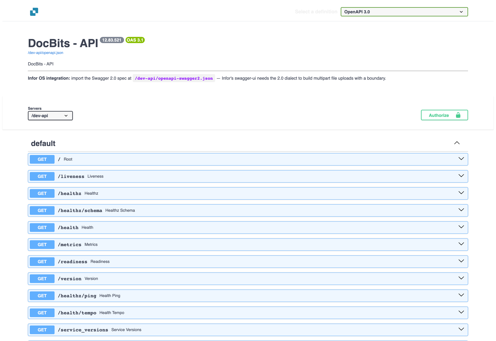
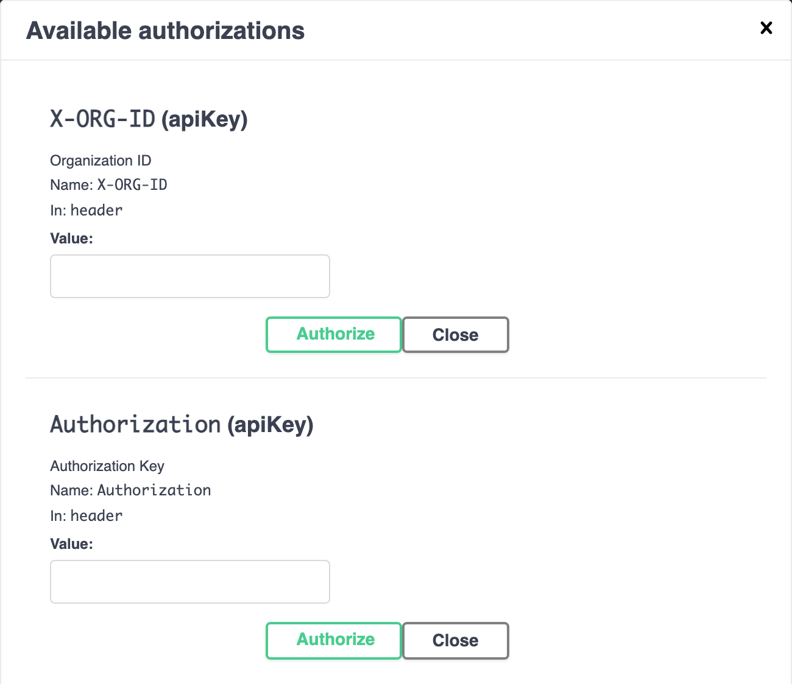
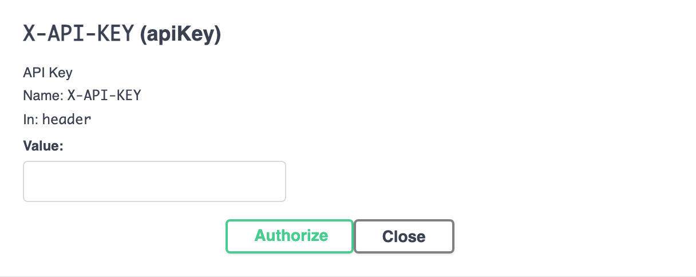

# Postman for DocBits

Use Postman to send HTTP requests to the DocBits API. Begin with a read-only request in an environment you are authorized to use. Keep credentials in private variables or a vault, and use separate Postman environments for testing and production.

## 1. Choose the API environment and base URL

Open the interactive API documentation for your organization’s environment, such as the [Sandbox API documentation](https://sandbox.api.docbits.com/docs) or [Production API documentation](https://api.docbits.com/docs). Use the current operation paths and the **Servers** value shown there.

A relative server path belongs after the API origin. In the [Dev documentation illustrated here](https://eu.dev.api.docbits.com/docs), the server is `/dev-api`, so the corresponding base URL is `https://eu.dev.api.docbits.com/dev-api`. Other environments can have a different server value.

<figure><figcaption><p>Current Dev API documentation. This is a native API documentation view, not a Postman application screenshot.</p></figcaption></figure>

Create a Postman environment variable named `base_url` and give it the complete base URL for your chosen environment, including its server path. Select that environment before sending a request. Postman’s [environment guide](https://learning.postman.com/docs/use/send-requests/variables/managing-environments/) explains how environment variables are selected and used.

## 2. Send a read-only first request

Create a request with method **GET** and URL `{{base_url}}/version`. In the request’s **Authorization** tab, select **No Auth**, then choose **Send**.

For the illustrated Dev environment, the checked request was:

```http
GET https://eu.dev.api.docbits.com/dev-api/version
```

This endpoint returned HTTP 200 without an API key. It checks API reachability and returns version information; it does not verify access to an organization’s documents or users. Check the response status and body. If the request fails, confirm the selected environment, origin and server path before adding credentials.

## 3. Use the credentials required by the operation

Open the operation you intend to use and read its parameters and authorization information. The API specification includes these distinct header schemes:

| Header | Purpose |
|--------|---------|
| `X-ORG-ID` | Identifies the target organization when required. |
| `Authorization` | Carries the authorization value required by the relevant authentication mechanism. |
| `X-API-KEY` | Carries an API key for operations that use that scheme. |

These headers are not interchangeable. The global **Authorize** dialog lists available schemes; it does not mean every operation needs all of them. Additional schemes can be specific to particular operations.

<figure><figcaption><p>The organization and authorization header sections, with no values entered.</p></figcaption></figure>

For an operation that uses an API key, select **Authorization → API Key** in Postman. Set **Key** to `X-API-KEY`, use a private secret for **Value**, and select **Header** under **Add to**. See Postman’s [API key authorization instructions](https://learning.postman.com/docs/use/send-requests/authorization/authorization-types/#api-key) and [vault secret guide](https://learning.postman.com/docs/use/postman-vault/use-vault-secrets/). Add `X-ORG-ID` in **Headers** if the operation requires it. Obtain the appropriate credentials and organization value from your administrator.

<figure><figcaption><p>The API key section of the Dev API documentation. No key was entered and the form was not submitted.</p></figcaption></figure>

## 4. Build further requests from the current specification

Use the operation’s exact HTTP method, path, required parameters and request body schema. For file uploads, select the body type required by that operation, such as multipart form data when specified. Do not infer current fields from screenshots of an older API version.

Start with an authorized read-only **GET** operation. **POST**, **PUT** and **DELETE** can change data; use them only for the intended, authorized task. A successful `/version` response does not demonstrate that an authenticated request, upload or data change will succeed.

The current Dev documentation, its empty authorization controls and the unauthenticated `/version` response were checked. No API key, organization data or document was used. Authenticated reads, uploads, user creation, updates and deletions were not executed, and no request was tested in the Postman application.
