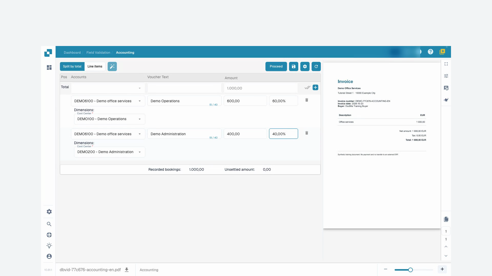
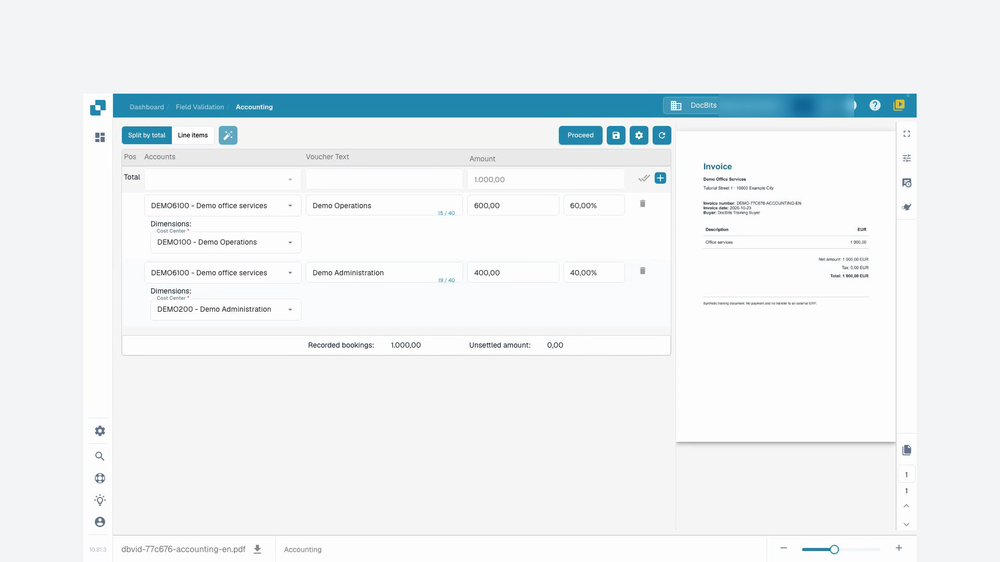

# Accounting for Cost Invoice and Indirect Sales

## Introduction

Welcome to the Accounting for Cost Invoice and Indirect Sales module! This module is designed to help you efficiently manage and reconcile your financial transactions within your ERP system. With features like automatic data extraction, document matching, and detailed tracking, you can ensure that your financial records are accurate and up-to-date.

<figure><figcaption></figcaption></figure>

## Getting Started

To start using the accounting module, make sure you have the necessary permissions set up by your system administrator. You will need access to both the cost accounting and sales accounting modules within the ERP system.

## System Requirements

* Access to the cost accounting and sales accounting modules within the ERP system.
* Appropriate user permissions for viewing and processing financial documents.

## Key Features

1. **Automatic Data Extraction**: Automatically extracts and interprets data from digital invoices and other documents.
2. **Data Comparison**: Compares extracted invoice data against existing purchase order data.
3. **Match Verification**: Verifies matches based on predefined rules and tolerances.
4. **Discrepancy Reporting**: Identifies and reports any discrepancies between invoices and purchase orders.
5. **Audit Trail**: Maintains a log of all actions for compliance and review.
6. **Document Training**: Train the system to recognize new documents with minimal effort, typically only once.
7. **Amount Splitting**: Split amounts by department for detailed financial tracking.
8. **Ledger Account Definition**: The APS (Accounting and Procurement System) team can define the ledger account once the data is extracted.

## User Interface

The accounting module interface typically includes the following components:

* **Dashboard**: Overview of invoice and sales status, and recent activity.
* **Search and Filter Tools**: Capabilities to search and filter invoices and sales records.
* **Matched Records**: Section displaying successfully matched records.
* **Discrepancies**: Section showing records with discrepancies needing review or action.
* **Reports**: Access to detailed reports and export options.

## Step-by-Step Guide to Using the Accounting Module

### 1. Access the Accounting Module

Navigate to the accounting module from the main menu of your ERP system.

### 2. Import or Access Invoices

* **Automated Import**: If your system is set up for automated data capture, invoices will be imported automatically into the system.
* **Manual Upload**: If necessary, manually upload invoice files into the system using the provided interface.

### 3. Review Automatically Matched Invoices

* Review invoices that have been automatically matched with purchase orders.
* Verify the details of the match, including item numbers, quantities, and prices.

### 4. Handle Discrepancies

* Access the Discrepancies section to review any invoices that could not be automatically matched.
* Manually adjust quantities or prices as needed, or flag the invoice for further review.

### 5. Manual Matching

For invoices not automatically matched:

* Use the search and filter tools to find the corresponding purchase order.
* Manually verify and match the invoice to the purchase order.

### 6. Train the System

* For new document types, train the system to recognize them by providing a sample.
* Typically, you only need to train the system once for it to accurately recognize similar documents in the future.

### 7. Record Bookings

* Navigate to the "Line items" tab to view and record bookings for each invoice.
* Allocate the amounts to the appropriate accounts, cost centers, and dimensions specific to Infor LN/M3.

#### **Example: Booking a Cost Invoice**

1. **Select Line Item**: Choose the line item for the cost invoice.
2. **Assign Account**: Assign the appropriate account, such as "71200 - Non-Operating Expense".
3. **Set Dimensions**: Set additional dimensions like cost center, product group, and project.
4. **Split Amount**: If necessary, split the amount by department for more detailed tracking.
5. **Enter Amount**: Enter the amount for the line item.

### 8. Define Ledger Accounts

* Once the data is extracted, the APS team can define the ledger accounts.
* This ensures that each transaction is recorded under the correct account for accurate financial reporting.

### 9. Generate Reports

* Access the "Reports" section to generate detailed reports on financial transactions.
* Use export options to save reports for further analysis or record-keeping.

### Example Usage

1. **Uploading Documents**: Users can upload various documents (invoices, delivery notes, etc.) to the system.
2. **Automatic Matching**: The system automatically matches the uploaded documents with existing purchase orders.
3. **Reviewing Matches**: Users can review the matches, verify details, and see status indicators.
4. **Resolving Discrepancies**: Any mismatches or discrepancies are highlighted for the user to manually review and correct.
5. **Exporting Data**: Matched data can be exported for further processing or record-keeping.

## Video tutorial: Splitting an Expense Invoice

The presenter and voice are synthetic. The recording shows the actual DocBits test interface with synthetic training invoices.


Splitting an Expense Invoice


[Watch with subtitles and chapter navigation](https://docbits-videos.fra1.cdn.digitaloceanspaces.com/settings-assistant/cost-invoice-accounting-customer/v1/en.html)

Some native product labels may remain in another language. Technical field IDs are preserved.

First, I check our original training invoice. The supplier, invoice number, and amount must match the document. In this example, it's one thousand euros with zero tax. The invoice has no purchase order.

I open the accounting section and work with the total amount split. The available general ledger accounts and cost centers were previously set up by our administrator. I only select values that make business sense for this invoice.

Using the split function, I create two sub-lines. DocBits starts with an even distribution here. For our example, though, I need sixty and forty percent. The original invoice total remains one thousand euros.

For both sub-lines, I select the prepared general ledger account for office services. The first line belongs to the operations cost center, and the second to administration. The cost center is a mandatory field in this example. I also add a meaningful voucher text.

In the first line, I enter sixty percent and confirm with Enter. I wait until the amount shows six hundred euros. Then I confirm forty percent in the second line and wait for four hundred euros. This is how I check each recalculation before moving on.

Now I check the two amounts, general ledger accounts, and cost centers together. Six hundred plus four hundred equals one thousand euros. The recorded total must also show one thousand euros, and the remaining balance must be zero. I resolve any mismatched totals before saving.

<figure><figcaption>
Cost centres with a reconciled EUR 1,000 total
</figcaption></figure>

I save the allocation and wait for confirmation. Then I reload the invoice. Both cost centers, the percentages, and the amounts are still there. I also check the total and the remaining balance after reloading.

<figure><figcaption>
Allocation saved and verified after reopening
</figcaption></figure>
