# AI Table

The **AI Extracted table** is the line-item table that DocBits reads with AI when a supplier has no trained table rules. It appears on the validation screen below the header fields. This page explains every control around it: how to fix a wrong column, how to give the AI instructions, how to test a change before you keep it, how to see what the AI did, what the Assistant can and cannot do for you, and who is allowed to save what.

## Video series

Short videos for everyday users. Watch them in order, or jump to the one you need.

### 1. Read the AI table



What you see on the validation screen and what each icon, column and button does. About 1.5 minutes.

### 2. Fix a column and teach DocBits



How to pick the right column, give the AI instructions, test a change, and keep it for the next invoices. About 1.7 minutes.

### 3. Three typical problems



One column fills three fields, a wrong unit price, and extra rows for freight and surcharge. What you see, what to write, how to check. About 1.7 minutes.

### 4. Discount, tax and zero-quantity lines



Discount and tax missing on Canadian and British invoices, and lines that were not shipped. About 1.4 minutes.

### 5. What the AI already reads correctly



Five unusual invoice layouts that DocBits reads right without any help, and what to do first.

### 6. The Assistant and who can change what



How the Assistant helps with the AI table, how to suggest an improvement, and what only admins can change.

## When you get the AI table

* An admin has switched on **AI Table extraction** (Settings → Document Processing → Classification and Extraction, see [Settings for admins](./#settings-for-admins)). If it is off, the table area shows _AI Table will display here. Enable in …_.
* The supplier has **no saved rules**. As soon as someone trains the supplier's table and saves the rules, the saved rules replace the AI table for that supplier. The rows then appear in the **Extracted table** tab and the **AI Extracted table** tab is greyed out with the tooltip _Table AI Deactivated: A custom-trained table is in use._
* Exception: columns marked **Use AI** in the table-column settings are filled by the AI even for suppliers with saved rules, see [Use AI per column](./#use-ai-per-column).

Which AI tier reads the table (Fast, Full, Nexus) is set per organization and can be overridden per supplier, see [Supplier-Specific AI Model](../validation-screen/supplier-specific-ai-model-for-field-and-table-extraction.md).

## The AI table at a glance

<figure>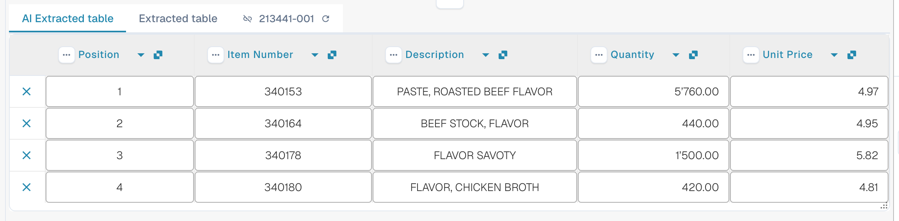<figcaption>
The two tabs, the AI Extracted table and its column headers.
</figcaption></figure>

* **Tabs.** _AI Extracted table_ is what the AI read. _Extracted table_ is the classic table from trained rules. The AI tab opens by default when the document has an AI table.
* **Column header.** Each column shows its name, a small **origin** symbol (hover it: _AI · mapping_, _AI · synonym_ and so on tell you how the AI matched the column), a **three-dots** menu and, for a mapped column, a **name button** you can click to change which column it is.
* **Row buttons.** The **x** at the start of a row removes that row. Right-click a row for _Select as additional cost_ / _Remove as additional cost_.
* **Footer toolbar.** The icons at the bottom of the screen add or hide columns and rows, see [Footer toolbar](./#footer-toolbar).
* **AI instructions card** below the table: prompt, extra columns, **Test change**, **Apply**, **Save as training**, **Delete**, **Export**, see [Give the AI instructions](./#give-the-ai-instructions).


The column controls only work when you can edit the document. If they are greyed out, the document is read-only or locked in another session. When the red banner says the document is locked by your own user in another session, **Unlock** takes the lock over.


## Change a column

### Pick the right column (remap)

Use this when a value sits in the wrong column, for example the net amount is in _Total amount_ or _Quantity_ is empty although the invoice has it.

1. Click the **column name** in the header.
2. Pick the configured table column the values really belong to.

<figure>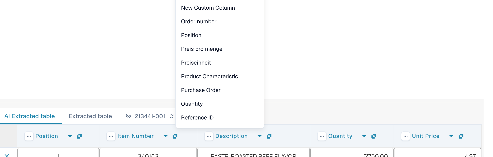<figcaption>
Click the column name and pick the column it should be. The list shows every configured table column.
</figcaption></figure>

DocBits reformats the table at once, for this document only. If the column you picked is already used by another column, a dialog _Remap "…"?_ warns that the other column will become unmapped. Confirm to continue; the other column then shows the error icon _Select a column to map from dropdown_ so you can pick a column for it too.

### The three-dots menu

<figure>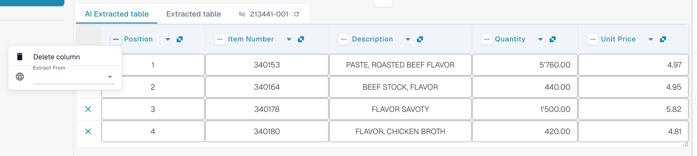<figcaption>
The three-dots menu of a column.
</figcaption></figure>

| Entry                 | What it does                                                                                                                                                                                                        |
| --------------------- | ------------------------------------------------------------------------------------------------------------------------------------------------------------------------------------------------------------------- |
| **Delete column**     | Hides the column. A confirmation says _Modifications will be discarded_; choose **Done**. The table is rebuilt without the column. Use **Restore Table Column** in the footer toolbar to bring hidden columns back. |
| **Disable column**    | For a column you added yourself: hides it without re-running the AI.                                                                                                                                                |
| **Amount Formatting** | Only for amount columns. Choose how numbers are read (decimal and thousand separators). **Auto** lets DocBits decide.                                                                                               |
| **Extract From**      | Tells the AI to take the value from the line **Above** or **Below** the column label. Leave it empty if the value is in the normal place.                                                                           |

### Footer toolbar

<figure><figcaption>
The table icons in the footer of the validation screen, left to right.
</figcaption></figure>

| Icon (tooltip)                                            | What it does                                                                                                                                                                                                  |
| --------------------------------------------------------- | ------------------------------------------------------------------------------------------------------------------------------------------------------------------------------------------------------------- |
| **Go to table extraction view**                           | Opens the classic table training. If the document has an AI table, DocBits warns: _Table is already extracted by AI. Do you want to train manually? In future AI table will not extracted for this supplier_. |
| **Add empty mapped columns**                              | Opens **Columns settings** to add configured columns that the AI did not fill, so you can type the values by hand.                                                                                            |
| **Show non mapped columns** / **Hide non mapped columns** | Shows or hides the columns the AI returned that are not mapped to a configured column. By default they are hidden. This only changes the view of this document.                                               |
| **Block table extraction for this supplier**              | Switches table extraction off for the supplier.                                                                                                                                                               |
| **Delete table**                                          | Clears the table in the editor.                                                                                                                                                                               |
| **Add new table column**                                  | Adds a custom column. Admins only.                                                                                                                                                                            |
| **Add new table row**                                     | Adds an empty row.                                                                                                                                                                                            |
| **Ignore table validation**                               | Ignores the table validation for this document.                                                                                                                                                               |
| **Restore Table Column**                                  | Brings back every column you deleted.                                                                                                                                                                         |

<figure>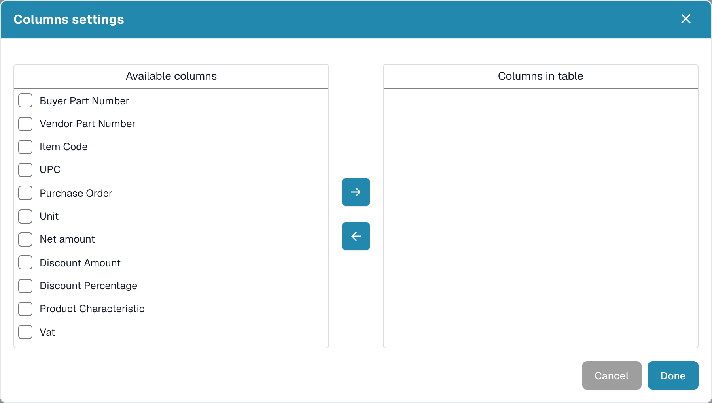<figcaption>
Columns settings: move columns from <em>Available columns</em> to <em>Columns in table</em> with the arrow buttons, then choose <strong>Done</strong>.
</figcaption></figure>

## Give the AI instructions

Under the table the **AI instructions** card tells the AI what to do differently. It has two inputs and four buttons you will use all the time.

<figure>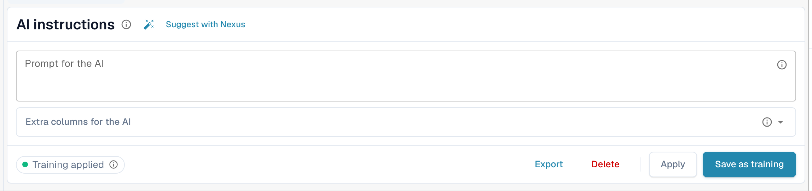<figcaption>
The AI instructions card.
</figcaption></figure>

* **Prompt for the AI.** Write one instruction per line, in plain language. Type **@** to insert a column name, so the AI knows exactly which column you mean.
* **Extra columns for the AI.** Pick columns the AI must return in addition to the usual ones.
* **Training status.** The chip shows **Training applied** when a saved training was used in the last run, or **No training applied**.

<figure><figcaption>
Type <strong>@</strong> in the prompt to pick a column. As soon as something changed, <strong>Test change</strong> appears next to <strong>Apply</strong>.
</figcaption></figure>


A changed prompt makes the AI read the table again, and it can change every column, not only the one you had in mind. Check the whole table afterwards.


### Suggest with Nexus

Not sure what to write? Click **Suggest with Nexus**. DocBits looks at this document's extraction and proposes instructions or extra columns. Nothing is applied until you click **Insert** (adds the line to your prompt) or **Add column**.

<figure>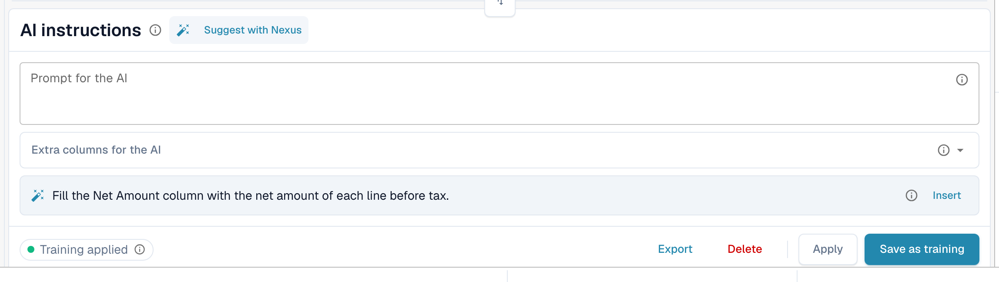<figcaption>
A suggestion from Nexus. <strong>Insert</strong> copies it into the prompt.
</figcaption></figure>

If your organization has switched the AI advisor off, DocBits tells you so instead of suggesting.

### Test, apply, save: what each button does

| Button                                      | What happens                                                                                                                                                                                      | Stored for the next documents? |
| ------------------------------------------- | ------------------------------------------------------------------------------------------------------------------------------------------------------------------------------------------------- | ------------------------------ |
| **Test change**                             | Runs your change and shows a comparison. **Nothing is written**, not to the document and not as a rule.                                                                                           | No                             |
| **Apply**                                   | Re-reads the table with your changes and puts the result into this document in the editor. It becomes permanent only when you save the document.                                                  | No                             |
| **Save as training** (tooltip _Save Rules_) | Stores the prompt, extra columns, column mapping, hidden columns, amount formats and **Extract From** settings for this supplier layout. The next documents of this layout are read the same way. | Yes                            |
| **Delete** (tooltip _Delete Rules_)         | Deletes the saved table rules of this supplier layout, with no extra confirmation, and runs the AI again without them. It also removes classic table training saved for the same layout.          | Removes them                   |
| **Export**                                  | Downloads the table as a CSV file.                                                                                                                                                                | No                             |


Header remaps, **Delete column**, **Amount Formatting**, **Extract From** and **Restore Table Column** behave like **Apply**: they rebuild the table for this document right away and are saved with the document, not as a rule. Only **Save as training** teaches DocBits for the next documents.


If the document already has lines matched to a purchase order, Apply and Save warn that **you may lose PO connections**. Choose **Done** to continue and match again afterwards.

<figure><figcaption>
The <strong>Test change</strong> dialog compares the new result with the table you see now.
</figcaption></figure>

The **Test change** dialog counts what would change: changed cells, added columns, missing columns and reassigned columns. Each cell is marked **Added**, **Changed**, **Missing**, **Reassigned** or **Unchanged**. At the bottom the dialog lists the evidence for the run: _Effective hints_, _Selected training_, _Column policy_ and _Request overrides used_. Choose **Apply result to this document** to take it over (then save the document), or **Discard** to throw it away. If you change the prompt after testing, the result is marked stale and you must test again.

After **Save as training** DocBits tells you the training is used on the next reprocessing; the current run did not use it yet. Check on the next document of the supplier that the chip says **Training applied**.

## See what the AI did

Four buttons under the table explain the extraction.

<figure>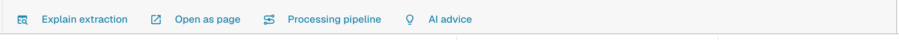<figcaption>
The explain buttons.
</figcaption></figure>

* **Explain extraction** opens _How the AI table arrived at its values_: the document, the AI extraction (tier, number of raw columns and rows), the mapping to your structure and the result per column with the origin of each column.
* **Open as page** shows the same explanation in its own window.
* **Processing pipeline** lists the processing steps of the document and where it stopped.
* **AI advice** asks Nexus how the extraction can get better and lists concrete recommendations, for example _Enable structured output_ or _Add an instruction tag for Net Amount_. It is advice only; you decide.

<figure><figcaption>
Explain extraction: four steps from document to result.
</figcaption></figure>

<figure><figcaption>
AI advice proposes the next steps.
</figcaption></figure>

<figure>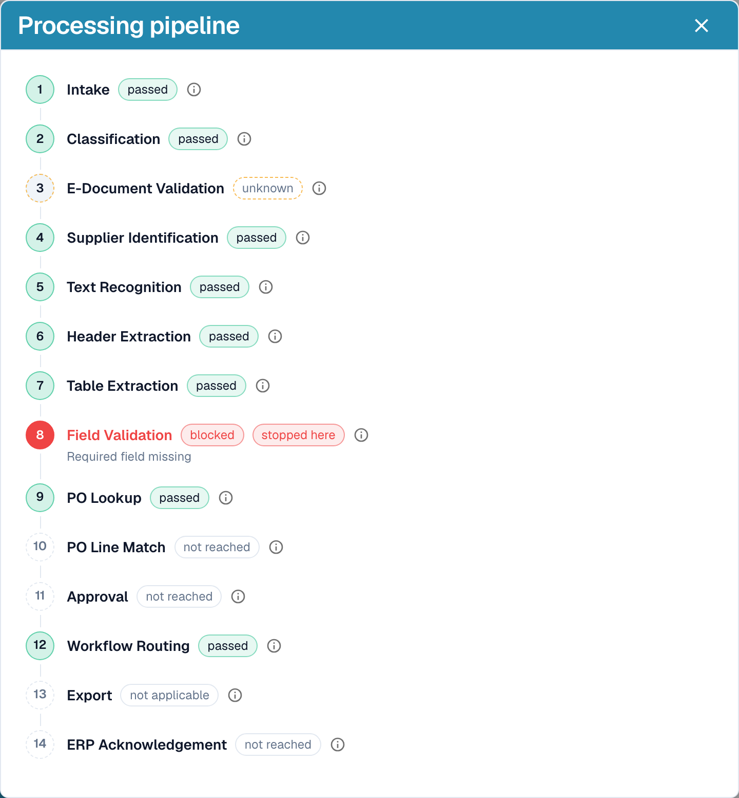<figcaption>
The processing pipeline shows where a document stopped, here at field validation.
</figcaption></figure>

These explanations belong to the **Analytics Dashboard** module. Without the module licence, or when your role has no access to the Analytics tab, DocBits tells you what to ask your admin for (activate the module under Settings → Modules, or grant the tab to your role under Settings → Roles).

## Practical examples

| Situation                                                                     | What to do                                                                                                                                                                                                                                          |
| ----------------------------------------------------------------------------- | --------------------------------------------------------------------------------------------------------------------------------------------------------------------------------------------------------------------------------------------------- |
| A value is in the wrong column, for example _Unit price_ sits in _Net amount_ | Click the column name and map it to the right column. Then **Save as training** if the supplier always prints it like this.                                                                                                                         |
| A column stays empty in every row, for example _Discount_                     | Add the column under **Extra columns for the AI**, or write an instruction with the wording the invoice uses, such as _Fill the Discount Amount column from the column called "Rabatt" on the invoice._ Check with **Test change**, then **Apply**. |
| The AI does not know what to do (nothing in the prompt)                       | Click **Suggest with Nexus** and insert what fits.                                                                                                                                                                                                  |
| A price must be divided or rounded                                            | Write the rule in the prompt, for example _The unit price is the net amount divided by the quantity_.                                                                                                                                               |
| Amounts are read with the wrong separators (1.234,50 versus 1,234.50)         | Open the column's three-dots menu, choose **Amount Formatting** and pick the right format.                                                                                                                                                          |
| The label sits below the value                                                | Three-dots menu → **Extract From** → **Below**.                                                                                                                                                                                                     |
| A column is not needed for this supplier                                      | Three-dots menu → **Delete column**. **Save as training** keeps it hidden for the supplier.                                                                                                                                                         |
| A row is wrong or missing                                                     | Remove it with the **x**, or add one with **Add new table row** and type the values.                                                                                                                                                                |
| The same corrections are needed again and again                               | Use **Save as training** so the next documents of this supplier come out right. For complex layouts [train the table](../../../administration-and-setup/setup/document-training/training-line-fields-table-training/) instead.                      |


Not every wrapped description line can be repaired with an instruction. If lines of one item are split into several rows, edit the rows or use the classic table training.


## The Assistant and the AI table

Click the **Assistant** (lamp icon next to Save on the validation screen) to ask questions about the document.

<figure><figcaption>
The Assistant lists the open problems and offers questions to ask.
</figcaption></figure>

**What the Assistant does for tables.** It can take you to a table cell, and, if you may edit the document, set a table cell value or add a table row. This works in the AI Extracted table as well as in the Extracted table. It also answers questions such as _What is still missing?_ and _What can I improve?_.

<figure><figcaption>
Ask <em>What can I improve?</em> to get a short list of what to fix next.
</figcaption></figure>

**What it does not do.** The Assistant does **not** change AI instructions, extra columns, column mapping or training. For that use the **AI instructions** card (**Suggest with Nexus**, **Test change**, **Apply**, **Save as training**). Admins can ask _Is the AI set up correctly?_ to see settings advice, for example about combining AI table reading with saved table rules.

### Suggest a rule to your admin

Many problems come from a **field**, not from the table: an email that is always required but empty, a date in the wrong format, a supplier ID that needs a lookup. For those, anyone who can open the document can send a proposal through the Assistant:

1. Ask _What can I improve?_ or open a finding card in the Assistant.
2. If you are an admin, the card offers **Apply**. If you are not, it says _An administrator can review this proposal._ and shows **Suggest improvement**. Click it.
3. DocBits shows _Your suggestion was sent to the administrators._ If someone sent the same suggestion before, your request is counted on it instead of creating a second one.
4. The card then shows **Requested**, later **Implemented** or **Declined** (with the reason, if the admin gave one).

The proposal can be a **transformation rule**, a **validation rule** or a **lookup**. You send it from the document, and the server builds the rule draft itself from the problem it found, so you do not write anything. The number of suggestions is limited to 20 per user and hour.


You cannot propose **AI table instructions, column mapping or training** this way. If a table needs a fix, correct it on the document and tell an admin, or ask your admin to **Save as training** on a document of that supplier. Admins can save rules; see [Who can do what](./#who-can-do-what).


**What the admin sees.** Admins are notified with a task and an email. They open **Touchless Intelligence** and find the proposal under **Open improvements** (tab _Open_, history in _History_). A click opens the drawer _Improvement suggestion_ with example documents and a preview. The admin can **Approve** or **Reject**. When approving, **Switch on right away** decides whether the new rule is active at once; without it the rule is created inactive and the admin switches it on in the rule list. Rejecting asks for a reason and an optional note for the requesters. See [Touchless Intelligence](../../../administration-and-setup/analytics-dashboard/touchless-intelligence/).

<figure>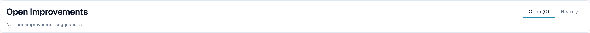<figcaption>
Admins find proposals under <strong>Open improvements</strong>.
</figcaption></figure>

## Who can do what

| Action                                                                                                            | Who                                                                                                                                                                             |
| ----------------------------------------------------------------------------------------------------------------- | ------------------------------------------------------------------------------------------------------------------------------------------------------------------------------- |
| Remap a column, **Delete column**, **Amount Formatting**, **Extract From**, **Test change**, **Apply**, edit rows | Everyone who can edit the document                                                                                                                                              |
| **Save as training**                                                                                              | Everyone who can edit, unless the organization setting **Save extraction rules (Admin only)** is on. Then only organization admins can save rules; others get an error message. |
| **Add new table column**                                                                                          | Admins                                                                                                                                                                          |
| Suggest a rule through the Assistant                                                                              | Everyone who can open the document                                                                                                                                              |
| Approve or reject a suggestion                                                                                    | Admins                                                                                                                                                                          |
| **Explain extraction**, **AI advice**                                                                             | Users whose role has access to the Analytics Dashboard module                                                                                                                   |

## Settings for admins

Open **Settings → Document Processing → Document Types → Classification and Extraction**, tab **General**, section **Extraction**.

<figure>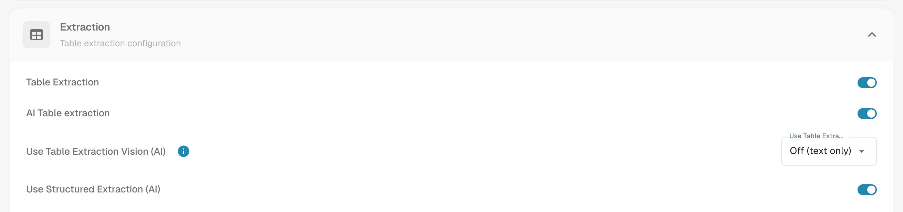<figcaption>
The switches that decide whether the AI table exists.
</figcaption></figure>

* **Table Extraction** switches the classic table on.
* **AI Table extraction** switches the AI table on or off for the organization.
* **Use Structured Extraction (AI)**: the AI returns the table in a fixed structure that maps straight onto your configured columns instead of copying the supplier's headers. Column names then always match your configuration; a column the supplier prints but you have not configured is not extracted.
* **Save extraction rules (Admin only)**: when on, only organization admins can save and export extraction rules.

<figure>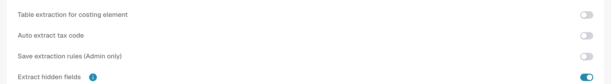<figcaption>
<strong>Save extraction rules (Admin only)</strong> controls who can use <strong>Save as training</strong>.
</figcaption></figure>

### Use AI per column

Each table column has a **Use AI** flag (Settings → Global Settings → Document Types → [Table Columns](../../../administration-and-setup/settings/global-settings/document-types/table-columns/)). With the flag on, the AI fills that column even when the supplier has saved rules; the other columns keep coming from the rules. Typical use: a free-text description column that trained rules capture badly.

The AI then guesses that column from the whole row. If it consistently puts the wrong value there, for example the line total into _Charges_, switch **Use AI** off for that column or add an instruction that tells the AI what the column is.

## Related pages

* [AI Table Tags and instructions](ai-table-tags.md)
* [Training Line Fields / Table Training](../../../administration-and-setup/setup/document-training/training-line-fields-table-training/)
* [Supplier-Specific AI Model](../validation-screen/supplier-specific-ai-model-for-field-and-table-extraction.md)
* [Which Extraction Path Was Used?](../../../overview-and-basics/faq/document-processing/which-extraction-path-was-used.md)
* [Touchless Intelligence](../../../administration-and-setup/analytics-dashboard/touchless-intelligence/)
