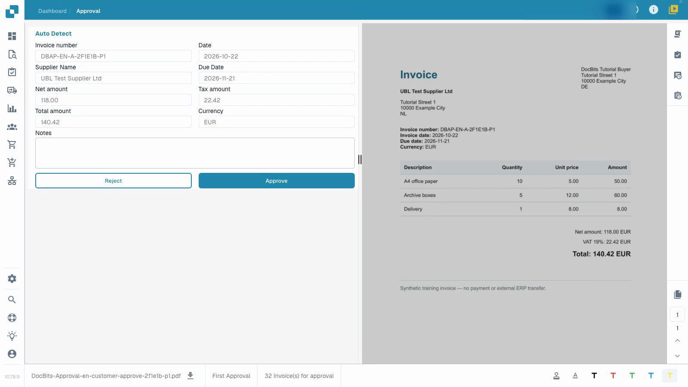
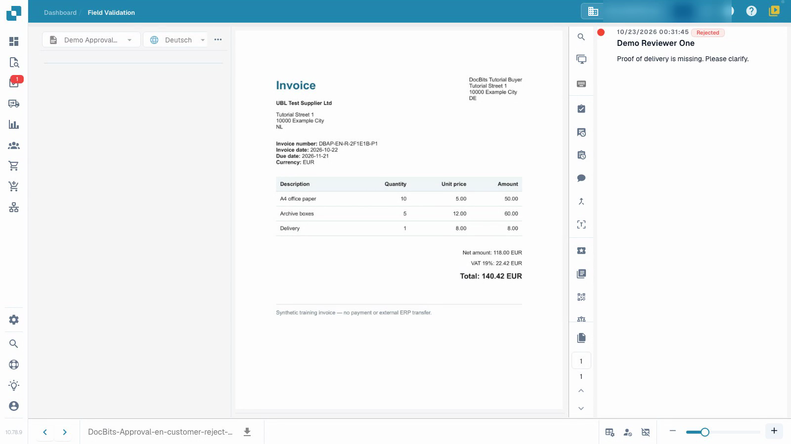

# Approve or reject an invoice

Follow an ordinary reviewer checking an invoice, recording a decision and verifying the saved result.


Approve or reject an invoice


[Watch with subtitles](https://docbits-videos.fra1.cdn.digitaloceanspaces.com/settings-assistant/invoice-approval-customer/v1/en.html)

The recording shows the real application. Option wording may vary with the deployed version.

Use approval to record your business decision on an invoice that has already been validated. You need access to the document and permission for its current approval stage. The video uses an ordinary reviewer account, prepared synthetic invoices and a fictional female presenter.

## Review and decide

1. Open the invoice assigned to you and check the current approval stage.
2. Compare the invoice number, supplier, dates and total with the original. Review the line items and tax as well. Technical validation does not replace your business review.
3. Record a clear review note. Approve a correct invoice, or reject it with a specific reason when it needs clarification. Wait for the operation to complete.
4. Reopen the document and inspect its approval history. Check the reviewer, time, decision and full note against what you intended.

<figure><figcaption>
Populated invoice values compared with the original before approval.
</figcaption></figure>

<figure><figcaption>
Saved rejection and its recorded reason after reopening the invoice.
</figcaption></figure>

## Check the next stage

When a second approval is configured, your first approval leaves the invoice waiting for another authorized reviewer. It is not yet fully approved. A rejection needs business clarification; correction and resubmission follow your configured process.

An approval-history entry does not prove that data reached an ERP system. In this isolated example, the retrieval channel has no external ERP target. The technical status `pending_data_fetch`, when displayed, means that the document is waiting for data retrieval.

## Related pages

- [Validation screen](validation-screen/README.md)
- [Document tasks](tasks.md)
