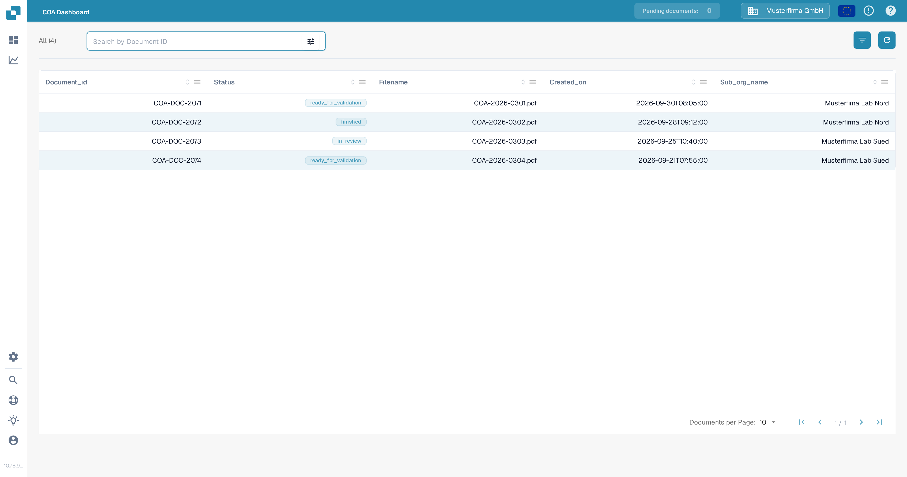

# COA Dashboard

The COA (Certificate of Analysis) Dashboard gives you a compact list view of all certificate-of-analysis documents in your organization. It shows each certificate with its key metadata so you can find and open quality documents quickly.

<figure><figcaption>The COA Dashboard lists all certificate-of-analysis documents with their status, filename, creation date and sub-organization.</figcaption></figure>

## Before you start

The COA Dashboard is only available when the `COA_DASHBOARD` preference is enabled for your organization. If the dashboard has not been activated yet, the page shows an "Action not allowed" message instead of the document list. There is currently no self-service toggle for this preference in the settings; please contact DocBits support to have it activated (see [Technical Support in DocBits](technical-support-in-docbits/README.md)).

## Table columns

The dashboard shows the following columns:

| Column | Content |
| --- | --- |
| Document_id | The unique document identifier of the certificate. |
| Status | The current document status, shown as a colored badge (for example ready for validation, finished, in review). |
| Filename | The file name of the uploaded certificate document. |
| Created_on | The date and time when the document was created. |
| Sub_org_name | The sub-organization the document belongs to. |

You can sort each column with the arrow icons in the column header and rearrange the columns by drag-and-drop. The column arrangement is saved per user, and the columns icon next to the search bar opens the column settings where you can show or hide columns (see also [Change Document Columns](dashboard/change-document-columns.md)).

## Search and filters

Use the search bar at the top of the dashboard to search by document ID. The search starts automatically as you type. Click the filter icon (sliders) next to the search bar to narrow the list further by status, and use **Clear filters** in that menu to remove the active filters. The **All (n)** counter above the table resets all filters and shows every certificate again.

The refresh button next to the column settings reloads the list with the current filters.

## Pagination

Below the table you can set how many documents are shown per page (10, 20, 25 or 50) and navigate between pages with the page controls. Changing the page size or page resets to the first page when you enter a new search.

## Opening a document

Click any row in the table to open the document: the dashboard navigates to the validation screen for that certificate (`/certificate-of-analysis/:id`), where you can validate the extracted fields, assign barcodes to fields, and save or export the document (see [Validation Screen](validation-screen/README.md)).

## Related pages

* [Dashboard](dashboard/README.md) - general dashboard overview and tools.
* [Filtering Documents](dashboard/filtering-documents.md) - how filters and saved filter badges work across dashboards.
* [Validation Screen](validation-screen/README.md) - what you can do with a certificate after opening it.
