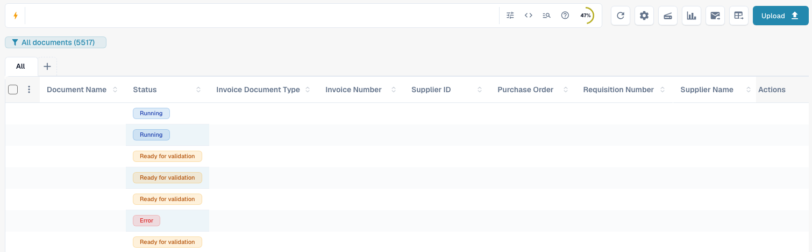
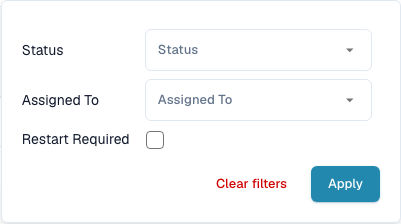
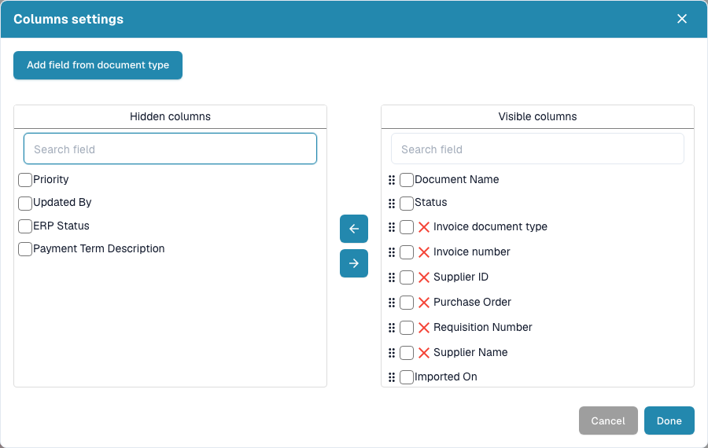
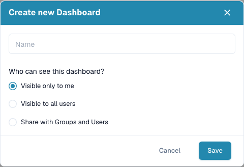
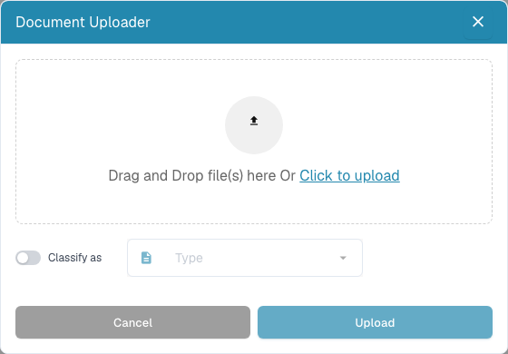

# Dashboard

The dashboard is your daily worklist in DocBits. Find imported documents, check their status, open them for validation and organize the work with your team.


The controls you see depend on your permissions, the document status and the modules enabled for your organization. Some controls described here may be unavailable. On narrower desktop windows, additional toolbar actions appear under **More**.


<figure><figcaption>
The current dashboard: search and tools at the top, saved views and document types below, and the document table. Document values are hidden for privacy.
</figcaption></figure>

## Search in everyday work — video

This short example starts at the desk of a fictional customer in Austin, Texas. The US English DocBits interface then fills the screen: type part of a file name, press Enter, and check the result. The second example shows how to include document content when the full-text search module is enabled.



[Open the example with US English narration](https://docbits-videos.fra1.cdn.digitaloceanspaces.com/settings-assistant/dashboard-search-customer/v1/en.mp4) · [English captions (VTT)](https://docbits-videos.fra1.cdn.digitaloceanspaces.com/settings-assistant/dashboard-search-customer/v1/en.vtt) · [English transcript](https://docbits-videos.fra1.cdn.digitaloceanspaces.com/settings-assistant/dashboard-search-customer/v1/en.txt)

The customer and office are AI-generated. The actions and search results are real recordings from the DocBits test account.

## Start your daily work

1. Check the active organization and, if available, the suborganization.
2. Select a document type or leave **All** selected.
3. Use the search and filters to find your documents.
4. Check **Status** and **Assigned To**, then open the document row to review it.
5. Refresh the list after processing or importing documents.

## Search and filter documents

Enter a document name, invoice number or other business value in the search box and press **Enter**. Use the filter icon inside the search box for **Status**, **Assigned To** and **Restart required**, then choose **Apply**. Remove individual filter badges or use **Clear filters** when a document seems to be missing. Document-type tabs and saved views also narrow the list.

The search toolbar also provides structured search chips, a raw query view and a **Fields & Syntax** help dialog. Copy field names and examples from that dialog; keep technical field names unchanged when changing the UI language. Advanced search features depend on the search capabilities enabled for your organization.

With full-text search enabled, the content-search menu controls a plain-text search: **Automatic** searches business fields first and uses document content when those fields have no matches; **Include document content** includes content matches; **Fields only** restricts the search to fields. A content-result badge explains when results came from document content. A `+` after a result count indicates a limited result window; narrow the search for a more precise result set.

When the separate date-range control is shown, choose a preset or a custom import-date range. It is hidden when fulltext search is enabled; use the available date fields in the search bar instead.

<figure><figcaption>
Filter by status, assignee and whether a restart is required.
</figcaption></figure>

## Read and arrange the document table

Each row represents a document. Depending on your column configuration, it shows its name, status, document type, invoice data, supplier, assignee, dates and amounts. Click a sortable column header to change the order. Scroll horizontally to see more columns and use the page controls and **Documents per Page** at the bottom to move through the results.

If grouping is available, select a grouping field above the table. For date fields, choose day, week or month. Open a group to see its documents, or remove the grouping to return to the flat list.

Use the **+** next to the document-type tabs to show additional tabs. The tabs can be reordered by dragging. Removing a tab changes your view; it does not delete documents.

Open the gear icon and the column-settings button to choose visible columns, move columns between the hidden and visible lists, and drag visible columns into order. You can also add fields from a document type. See [Change document columns](change-document-columns.md).

<figure><figcaption>
Column settings let you choose and order the information shown in the table.
</figcaption></figure>

## Understand status and document actions

Processing statuses show steps such as OCR, classification or export. **Ready for validation** means the document is ready for review; approval statuses indicate that an approval step is pending. **Exported** means the document’s export has completed. For **Error**, click the error status to inspect the available error details.

If processing times are available, hover over a status to see the phases and their durations. A duplicate icon appears for documents with possible duplicates; open it to compare the related documents.

Open a document row to work in the validation screen. Use the row's **Actions** menu for the operations allowed for that document, such as assignment, download, history or restarting processing. Available download variants depend on the document and can include annotations or electronic invoice formats.

Select the checkboxes for several documents and open the menu in the table header for permitted bulk actions, such as assignment, merging, restart, restart export or deletion. Check the selection and confirmation carefully. These actions can change documents; saving a view only changes how the worklist is displayed.

## Save a personal dashboard

Open the blue view badge below the search box and choose **Create New Dashboard**. Give the view a name and choose whether it is private, visible to all users or shared with selected groups and users. Save the filters, sort order and columns you need for recurring work.

Select a saved view from the same menu. Save later changes with **Save Dashboard Changes** when the view is yours and has changed. A view shared with you cannot be overwritten by you; create your own view instead. Sharing a view does not grant additional access to documents. See [Personal dashboards](personal-dashboards.md).

<figure><figcaption>
Create a named dashboard and choose who can see it.
</figcaption></figure>

## Upload documents and use the toolbar

Choose **Upload**, drop files into the dialog or select them from your computer, then start the upload. If available, use **Classify As** to choose the document type explicitly. Otherwise, DocBits classifies the imported files automatically.

The other toolbar buttons refresh the list, open advanced settings, start a scanner, show status statistics, start the configured email import or request a CSV/Excel table export. Scan and export require the relevant configuration. Table export is separate from exporting a document to your ERP. For a saved dashboard, save column changes before requesting an export because the export uses the saved column configuration. See [Dashboard tools](dashboard-tools.md).

<figure><figcaption>
Upload files and optionally choose their document type before importing.
</figcaption></figure>

## If a document or control is missing

Check the organization, active view, document type, search text and filter badges first. Refresh the list and check further result pages. If a control is still unavailable, ask your administrator to check your permissions and enabled modules.

**Ctrl/Cmd + K** opens the global quick search. **Ctrl/Cmd + Q** refreshes the dashboard and **Ctrl/Cmd + H** opens help. The gear menu contains the keyboard-shortcut reference. An organization-wide pending-document counter, when shown, is an administrator indicator; it is not your personal task count.

Use Ctrl on Windows/Linux and Cmd on macOS for the shortcuts below. Browser or operating-system shortcuts may take priority.
