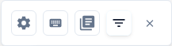
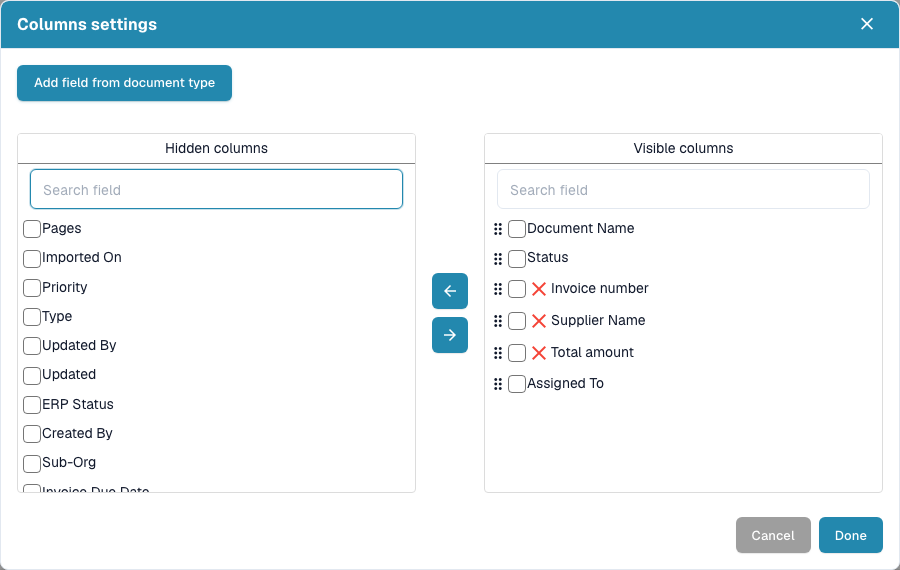
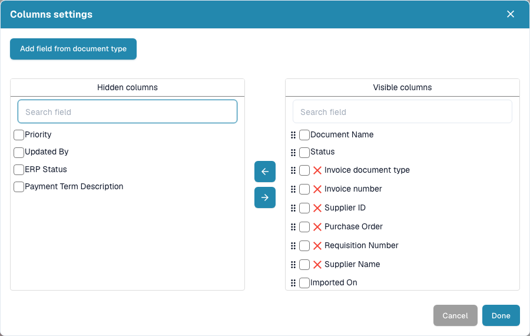

# Change Document Columns

1. Open the gear icon beside the dashboard search.
2. Open the column-settings button.
3. Search the hidden or visible column list. Select columns and use the arrows to move them between the lists.
4. Drag the handles in the visible list to set the column order.
5. Optionally choose **Add Field from Document Type**, select a document type and add the fields you need.
6. Choose **Done** to apply the column configuration.

When working in your own saved dashboard, also save its changes before requesting a table export. The exported columns come from the saved view. Close or cancel the dialog to leave without applying edits. Column availability can depend on the document type and organization configuration.

<figure><figcaption>Open the gear menu and choose the column-settings icon. Its tooltip is <strong>Set Table columns for organization</strong>.</figcaption></figure>

<figure><figcaption>The current Columns settings dialog provides separate hidden and visible lists and searches. Use Cancel to leave without applying changes.</figcaption></figure>

<figure><figcaption>
Column settings let you choose and order the information shown in the table.
</figcaption></figure>
