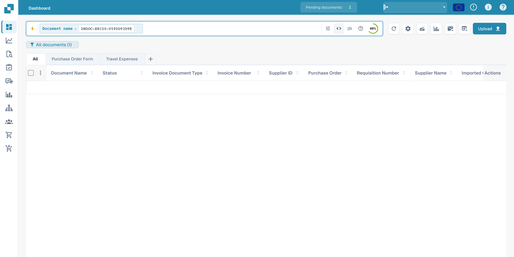
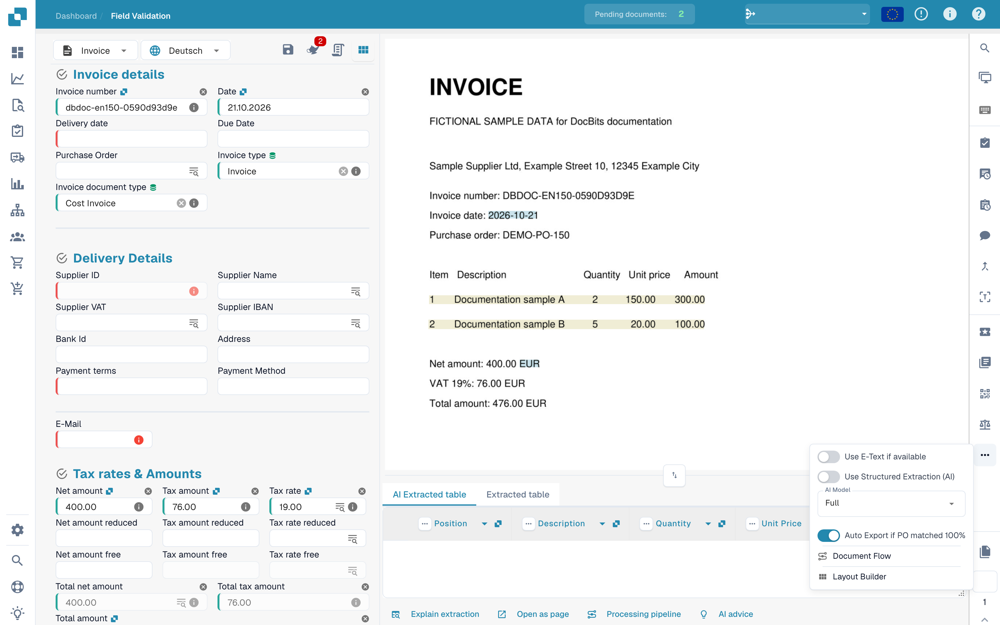
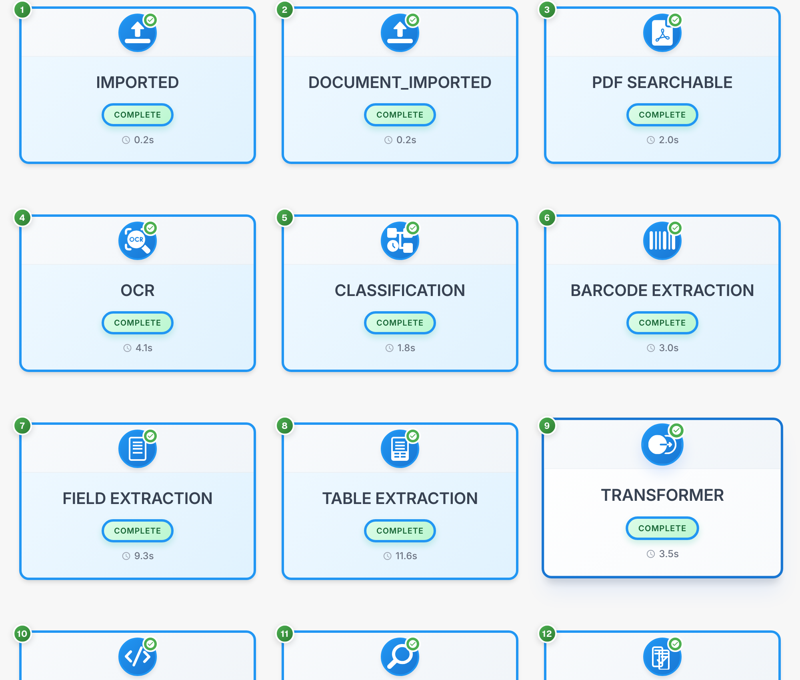

# Document Flow

**Document Flow** shows a document's processing steps. Numbered cards identify their order, status and duration. This example uses a fictional invoice.

## Find the document and open its flow

Find the document in the dashboard first. The image shows the search for the synthetic example; document values in the table are hidden.

<figure><figcaption>
Find the synthetic example document in the English dashboard; document values are hidden.
</figcaption></figure>

Open the document in **Field Validation**. Open **More options** in the right-hand action bar and select **Document Flow**.

<figure><figcaption>
More options menu in English field validation with Document Flow available.
</figcaption></figure>

## Read the process cards

Each card represents a step, such as **Imported**, **OCR**, **Classification** or **Field Extraction**. Follow the numbers and scroll to see later steps.

<figure><figcaption>
Process cards for a fictional invoice; technical status codes remain unchanged.
</figcaption></figure>

Technical identifiers and status codes such as `DOCUMENT_IMPORTED` and `COMPLETE` remain unchanged. `COMPLETE` identifies a completed step.

## Inspect a step

Select a process card to inspect its details and available logs.

| Detail | Meaning |
| --- | --- |
| Module | Processing component used for the step |
| Status | Current state of that step |
| Duration | Recorded processing time |
| Logs | Available technical task messages |

For a waiting or failed step, inspect its messages before restarting processing.
