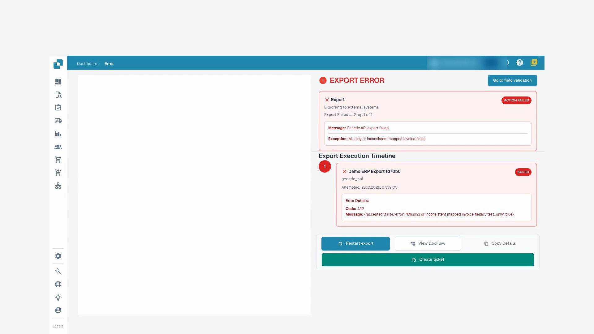
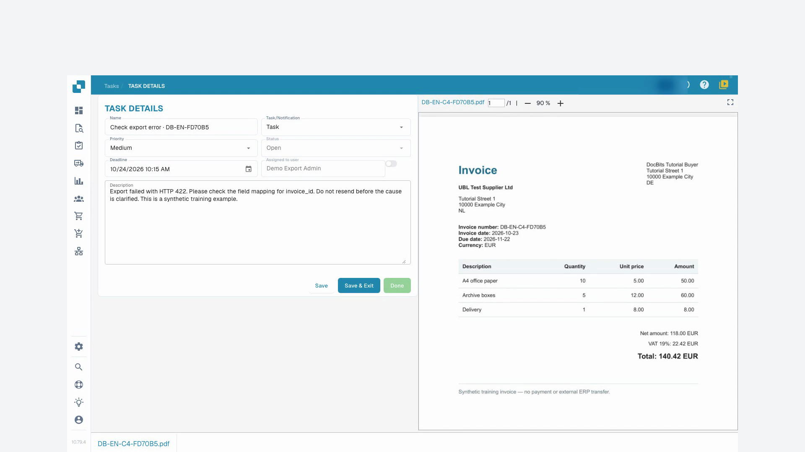

# Document Status

Processing statuses show steps such as OCR, classification or export. **Ready for validation** means the document is ready for review; approval statuses indicate that an approval step is pending. **Exported** means the document’s export has completed. For **Error**, click the error status to inspect the available error details.

If processing times are available, hover over a status to see the phases and their durations. A duplicate icon appears for documents with possible duplicates; open it to compare the related documents.

Open a document row to work in the validation screen. Use the row's **Actions** menu for the operations allowed for that document, such as assignment, download, history or restarting processing. Available download variants depend on the document and can include annotations or electronic invoice formats.

Select the checkboxes for several documents and open the menu in the table header for permitted bulk actions, such as assignment, merging, restart, restart export or deletion. Check the selection and confirmation carefully. These actions can change documents; saving a view only changes how the worklist is displayed.

For searching, document actions and saved views, return to the [dashboard guide](README.md).

## Video tutorial: Resolve blocked invoices


Resolve blocked invoices


[Watch with subtitles and chapter navigation](https://docbits-videos.fra1.cdn.digitaloceanspaces.com/settings-assistant/blocked-invoices-customer/v1/en.html)

Some native product labels may remain in another language. Technical field IDs are preserved.

I open the invoice in the field validation. In this example, the invoice number is missing. The other values are already filled out. I compare them with the original before I change anything.

Now I enter the invoice number and leave the field. After that, I save the invoice. I wait for the feedback and reload the document. This way I can see if the correction really persists.

The number is still there after opening it again. The required field error is resolved. However, saving does not mean that the invoice has been approved or exported to the ERP.

For a second invoice, the list shows an export error. I open the status and read the details. The test receiver rejected the submitted data with error code 422. The technical mapping needs to be checked here. I do not just restart the export multiple times.

<figure><figcaption>
Export error and the receiver’s response
</figcaption></figure>

In the document tasks, I create a clear handoff task for our test administrator. I include the error code and ask them to check the invoice number in the mapping. For this training, I switch email off.

After reloading, I verify that the task is saved and assigned to the right person. The task remains open until the cause is clarified. Creating a task is not yet a successful export.

<figure><figcaption>
Saved handoff assigned to the administrator
</figcaption></figure>
