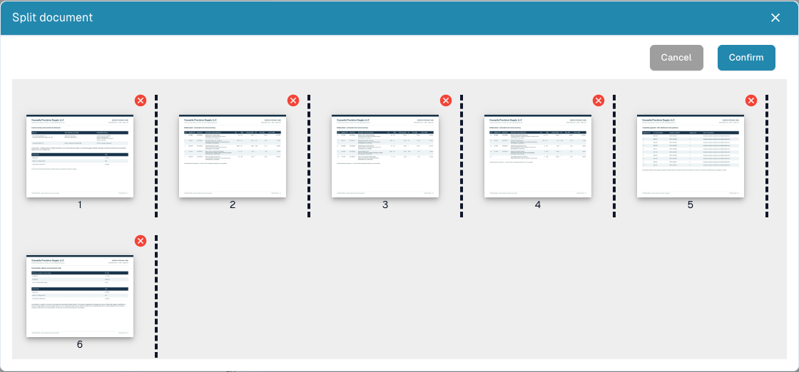

# Split a PDF and organize its pages

Use manual splitting when one uploaded PDF contains several independent documents. For example, a ten-page file contains an invoice on pages 1–3, another on pages 4–7 and a delivery note on pages 8–10. Keep each business document separate.

<figure><figcaption>
Page thumbnails, separators and removal controls before any split is submitted.
</figcaption></figure>

## Before you start

You need permission to edit the document and a file with more than one page. Keep the original available. Resolve a document lock with the responsible colleague before editing.

## Split the file

1. Open the document from the dashboard and inspect every page.
2. In the viewer, open **More options → Split document**.
3. Check the numbered thumbnails. Select the separators after the last page of each intended document. In the example, place separators after pages **3** and **7**.
4. If needed, drag thumbnails into the correct order. Review the resulting order and check the separators again.
5. Remove a page with its **red cross** only when it should be excluded. A blank separator can be unnecessary; a tax breakdown or attachment may be essential.
6. Choose **Confirm**, read the confirmation and choose **Proceed** when the page groups are correct. **Cancel** leaves without submitting the split.
7. Back on the dashboard, open each resulting document. Verify first and last page, page count, document type and extracted values before continuing.

## Verify and troubleshoot

Account for every original page: it must belong to one intended document or be deliberately excluded. Splitting does not establish successful extraction, approval or ERP export. Check each resulting document separately.

If the option is missing, check page count, permissions, lock and status. With no separator, reorder or removal selected, the dialog can report that no change was requested. After an error, inspect the dashboard before repeating an operation whose outcome is uncertain.

See [Document Merging](document-merging.md) for combining documents and [Classification and Extraction](../../../administration-and-setup/settings/document-processing/classification-and-extraction/README.md) for automatic barcode splitting.
