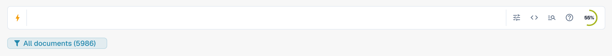
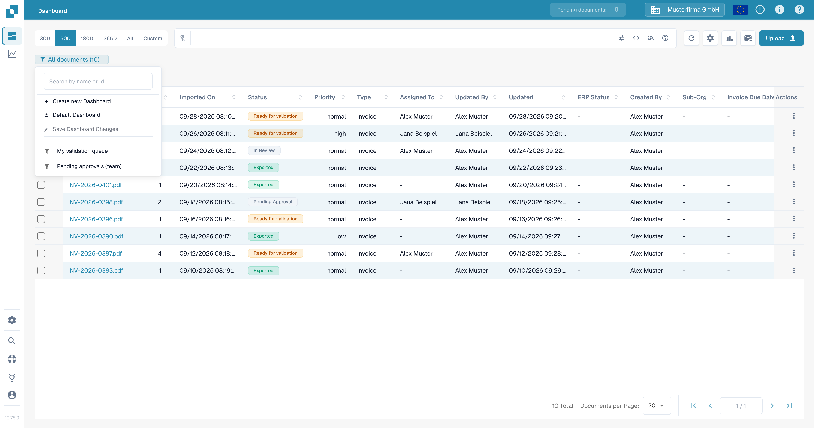
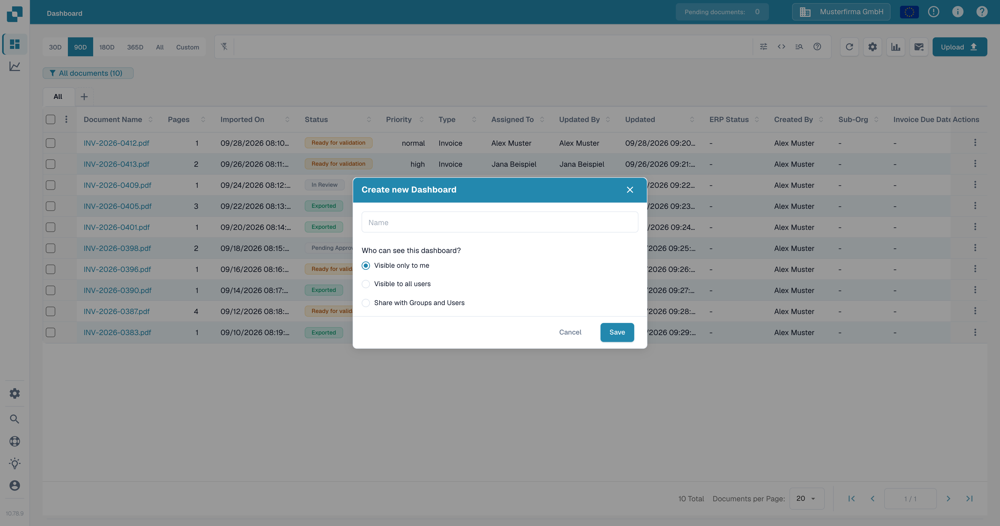
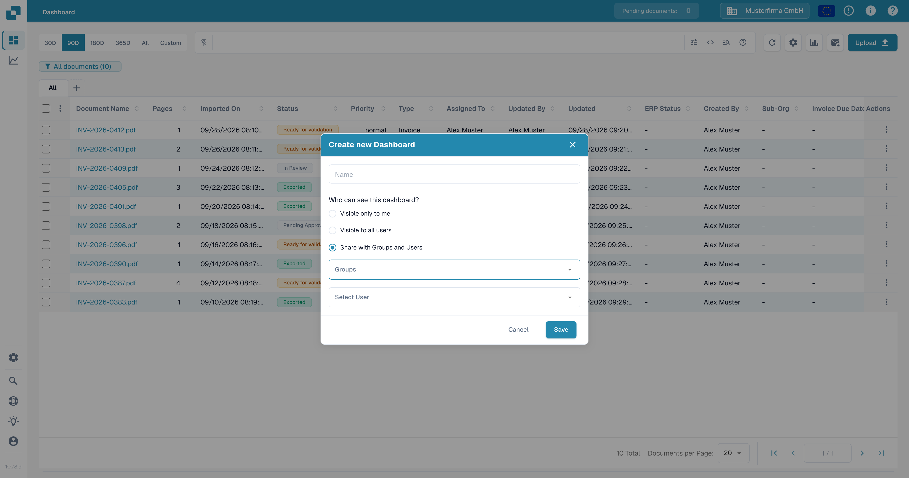
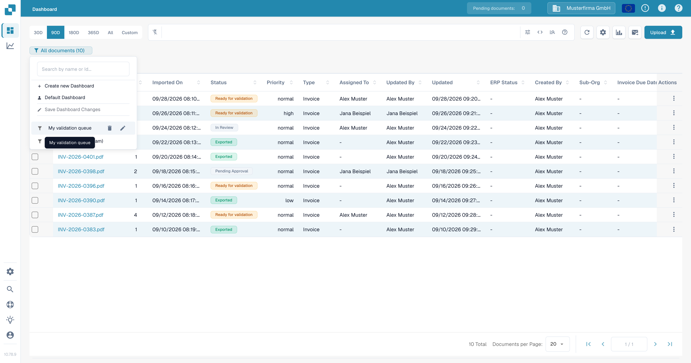
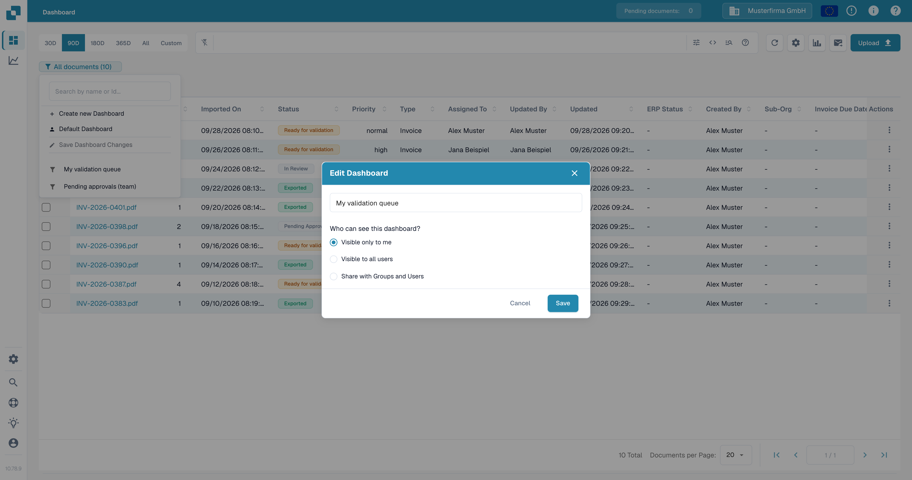

# Personal Dashboards

A saved dashboard is a named view of your worklist: the search, filters, document type, sort order and visible columns. Opening it restores all of that at once, so recurring work does not have to be set up again. A dashboard only changes how documents are shown — it never changes the documents themselves.

## Create a dashboard

1. Build the view you want to keep. Type your search in the search bar, apply **Smart filters** from the field picker, use the **Filters** panel, pick a document type tab, sort the table and adjust the columns.

   <figure><figcaption>
The saved view is exactly what the search bar and table show at the moment you save it.
</figcaption></figure>

2. Open the view badge below the search box. It shows the active view and how many documents currently match it, such as **All documents (5986)**.
3. Choose **Create new Dashboard**.

   <figure><figcaption>
The badge menu: three actions first, then your saved dashboards.
</figcaption></figure>

4. Enter a clear name and choose who can use the view:
   * **Visible only to me** keeps the view private.
   * **Visible to all users** makes it available to everyone in your organization.
   * **Share with Groups and Users** adds two selectors, **Groups** and **Select User**, so you can name specific groups or individual people.

5. Choose **Save**. The badge switches to the new dashboard and shows its name and document count.

<figure><figcaption>
Name the view and choose its visibility.
</figcaption></figure>

<figure><figcaption>
Choosing <strong>Share with Groups and Users</strong> adds the Groups and Select User selectors.
</figcaption></figure>

The visibility setting controls who can **use** the view. It does not grant access to documents: each person still sees only the documents their own permissions allow.

## Switch, update or remove a view

Use the view badge to switch to a saved dashboard or to return to **Default Dashboard**, the unsaved view of all documents. The dashboard you open last stays active when you reload the page.

After changing a loaded dashboard — including changes to columns only — **Save Dashboard Changes** becomes available in the badge menu. Select it to store the change under the same name. It stays unavailable when nothing has changed or when the dashboard belongs to somebody else; a shared view cannot be overwritten, so create your own instead.

## Rename or reshare a dashboard

Hover over a dashboard you own in the badge menu to reveal its **edit** and **delete** controls. Select the **pencil** icon to open **Edit Dashboard**, where you can change the name or the visibility. The dialog shows the same three options as when the dashboard was created.

<figure><figcaption>
Hovering a dashboard you own reveals its edit and delete icons.
</figcaption></figure>

<figure><figcaption>
The Edit Dashboard dialog.
</figcaption></figure>

## Delete a dashboard

Select the **trash** icon for a dashboard you own and confirm with **Delete**. Removing a view does not delete the documents it pointed at. A dashboard that somebody else shared with you can be opened and used, but not edited or deleted from your account.
