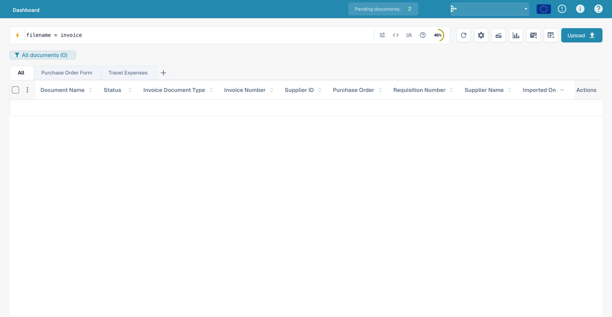
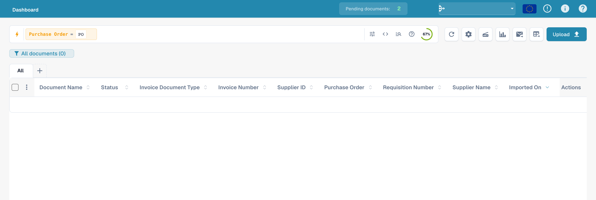
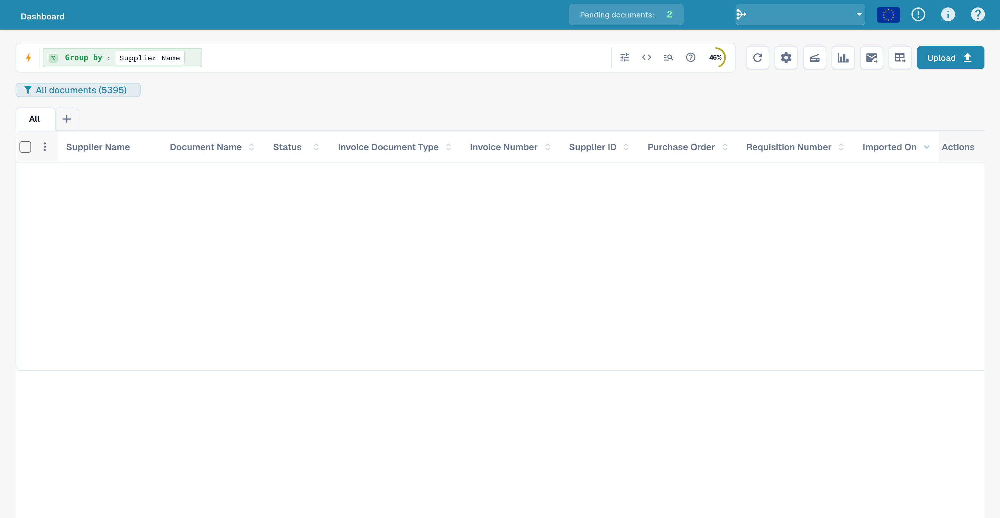
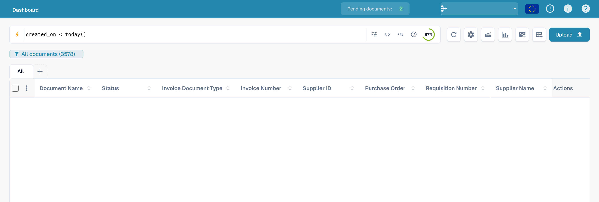
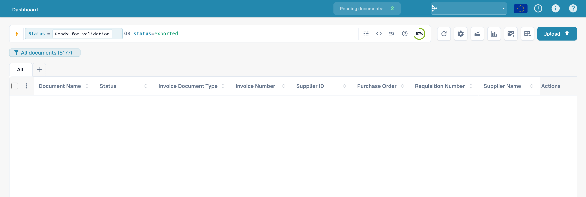
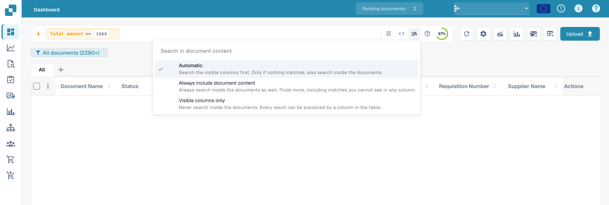
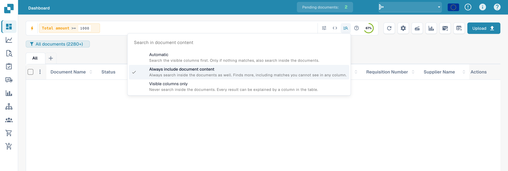
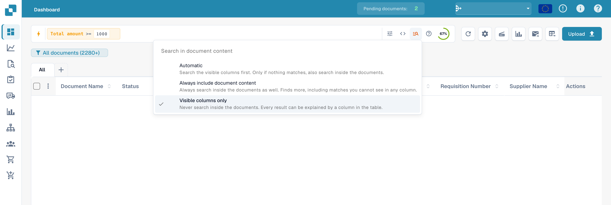

# Quick Search

**Quick Search** is the fastest way to find documents on the Dashboard. You
type what you're looking for — a name, a status, an amount, a date — and the
document list filters instantly.

This guide is organised the way the search is built up:

1. **Standard fields** — the columns every document has (document name, status,
   dates). Always available.
2. **Fulltext fields** — extracted content (supplier, purchase order, invoice
   number, amounts, line items). Available when fulltext search is enabled.
3. **Operators, shortcuts & recipes** — the full reference once you're
   comfortable.

> You don't have to memorise anything: click the search bar and pick a field and
> value from the list — Quick Search builds the query for you. The examples below
> also show the typed form so you can copy them directly.

<figure><figcaption><p>Quick Search in the English dashboard.</p></figcaption></figure>

---

## How the search bar works — chips, toolbar & raw view

Before the fields themselves, it helps to know how the bar is laid out.

### Conditions become chips

As you complete a condition (a field, an operator and a value) Quick Search turns
it into a **chip** — a coloured pill inside the bar — and starts a fresh one. A
chip shows the **field**, the **operator** and the **value**, with a **×** to
remove it. Chips are colour-coded by where the data lives:

| Chip colour | Field type |
|-------------|------------|
| **Blue** | Standard column (document name, status, dates) |
| **Orange** | Fulltext / extracted field (supplier, amount, invoice number) |
| **Purple** | Vector (semantic) search |
| **Green** | OCR text search |

Click a chip to edit it (it expands back to text); click **×** to delete it.
Several chips combined read as **AND** by default.

### The toolbar

At the right-hand end of the bar:

- **ⓘ Help** — opens the in-app **Dashboard Search — Fields & Syntax** reference
  listing every field, operator and shortcut available in your workspace.
- **Filters (tune)** — a quick panel for the common Status / User / Restart
  filters, with **Clear filters** and **Apply**.
- **Index ring** — a small progress ring showing how much of your fulltext index
  is built (only shown when fulltext search is enabled).

### Standard vs. raw view

The bar normally shows your query as chips (**standard view**). Switch to **raw
view** to see and edit the query as plain text (e.g.
`status=ready_for_validation AND supplier_name=Test`) — useful for copying,
sharing, or typing a long query directly. Your query survives the switch and is
remembered when you reload the Dashboard.

---

## Part 1 — Standard fields

Standard fields are the document's own columns. They are **always available**,
whether or not fulltext search is switched on.

### Find documents by name

The document name is the most common search. There are three ways to match it —
all **case-insensitive**:

#### `=` → starts with

```
filename=invoice
```

Finds documents whose name **starts with** "invoice". Matching ignores case, so
all of these match `filename=invoice`:

```
Invoice.pdf   iNVoice.pdf   iNvoiCE.pdf   INVOICE.pdf
Invoice.xml   iNVoice.xml   iNvoiCE.edi   …
```

It does **not** match `XYZ_Invoice.pdf` (there "invoice" is in the middle — use
`:` for that).

<figure><figcaption><p>Entering a document-filename query.</p></figcaption></figure>

#### `:` → contains (anywhere)

```
filename:invoice
```

Use `:` to match the word **anywhere** in the name — `2026_Invoice.pdf`,
`vietnam_einvoice_sample.xml`, `scan_invoice_copy.pdf`.

<figure><figcaption><p>Search for part of a filename: filename:invoice.</p></figcaption></figure>

#### `="…"` → starts *or* ends with

```
filename="invoice"
```

Quotes make `=` match names that **start or end** with the value — handy for a
leading code or a file ending.

> **The three in one line:** `=` → starts with · `:` → contains · `="…"` →
> starts or ends with. All ignore upper/lower case. You can see this summarised
> any time via the **help icon** in the search bar (next section).

### Find documents by status

```
status=ready_for_validation
```

Status is a fixed list, so `=` is an **exact** match and the bar offers a value
picker when you type `status=`.

<figure><figcaption><p>Filter by the technical status ready_for_validation.</p></figcaption></figure>

### Find documents by date

```
created_on>2026-05-25
```

Use `>`, `<`, `>=`, `<=` for date ranges. You can also use **relative** dates:
`today()`, `today()-7` (last 7 days), `today()+30` (next 30 days).

<figure><figcaption><p>Search for documents created after 25 May 2026.</p></figcaption></figure>

### Find documents by invoice sub-type

```
invoice_sub_type="Cost Invoice"
```

Invoice sub-type is a fixed list (for example **Cost Invoice** or **Purchase
Invoice**), so `=` is an **exact** match and the bar offers a value picker when
you type `invoice_sub_type=`. Use `invoice_sub_type!="Cost Invoice"` for
everything except that sub-type.

---

## Part 2 — Fulltext fields

Fulltext fields search the **extracted content** of your documents — supplier,
purchase order, invoice number, amounts, line items. They appear in **orange**
and are available when **fulltext search is enabled** for your organisation. The
matching rules are exactly the same as for standard text fields
(`=` starts-with, `:` contains, `="…"` starts-or-ends).

### Find documents from a supplier

```
supplier_name=Test
```

Starts-with on the extracted supplier name. Use `supplier_name:Example` to match
anywhere, or `supplier_name:"Sample Supplier"` to quote a value with spaces.

<figure><figcaption><p>Example supplier query: supplier_name=Test.</p></figcaption></figure>

### Find documents by purchase order

```
purchase_order=PO
```

Starts-with on the extracted PO number — great for a PO prefix.

<figure><figcaption><p>Example purchase-order query: purchase_order=PO.</p></figcaption></figure>

### Find documents by amount

```
total_amount>5000
```

Use `>`, `<`, `>=`, `<=`, or `between 100 and 500` for a span.

<figure><figcaption><p>Search for a total amount greater than 5000.</p></figcaption></figure>

For a window, use `between`:

```
total_amount between 1000 and 5000
```

This is shorthand for `total_amount>=1000 AND total_amount<=5000`.

<figure><figcaption><p>Limit the total amount to the range from 1000 to 5000.</p></figcaption></figure>

### Find what's missing

```
supplier_name=""
```

`=""` means "this field is **not set**"; `supplier_name!=""` means "has any
supplier".

<figure><figcaption><p>Search for documents with an empty supplier name.</p></figcaption></figure>

The same presence check works on any field — for example documents still
missing an AP assignment code:

```
ap_assignment_code=""
```

<figure><figcaption><p>Search for documents without an AP assignment.</p></figcaption></figure>

---

## Smart Filters — one click

At the top of the Quick Search dropdown (click into the search bar) you'll find
**Smart Filters**: ready-made searches you apply with a single click. Each one
is just a shortcut for a query you could also type yourself:

| Smart Filter | Finds | Same as typing |
|--------------|-------|----------------|
| ⚠️ **Overdue** | Past their due date | `invoice_due_date<today()` |
| 🕐 **Due soon** | Within the next 7 days | `invoice_due_date<=today()+7` |
| 👤 **Assigned to me** | Items waiting for your action | `assigned_to=<you>` |
| 📅 **Today's inbox** | Imported today | `imported_on>=today()` |
| 📋 **Pending validation** | Ready to be validated | `status=ready_for_validation` |
| 🧾 **Electronic documents** | E-invoices (XML, ZUGFeRD, EDI) | `is_edoc=true` |
| ✅ **Full PO match** | Fully matched to a purchase order | `po_match_status=full_matched` |
| ➗ **Partial PO match** | Partially matched to a purchase order | `po_match_status=partial_matched` |
| 📉 **Under PO match** | Quantity or unit price under the purchase order | `po_match_status=under_matched` |

The three **PO match** filters and the fulltext fields require fulltext search
to be enabled for your organisation.

<figure><figcaption><p>Quick-search query and filter help.</p></figcaption></figure>

---

## Grouping results

Instead of a flat list, you can **group** the results by any field — supplier,
status, document type, sub-organisation, or a date bucket. Add a grouping from
the search bar:

```
group by supplier_name
```

The list then shows collapsible **group headers**, each with the group's name and
a **count** (e.g. *Sample Supplier (12)*). Click a header to expand or collapse that
group. For date fields you can group by **day, week or month**.

<figure><figcaption><p>Entering a query grouped by supplier.</p></figcaption></figure>

Grouping combines with any filter — `status=ready_for_validation group by
supplier_name` groups only the matching documents. Clicking into a group
**drills down**: it applies that group's value as a filter and returns you to the
flat list for that selection.

---

## Part 3 — Operators, connectors, shortcuts

### The built-in help

The **help icon** in the search bar opens a complete reference of every field,
operator and shortcut available in your workspace — including which fields are
standard vs. fulltext.

<figure><figcaption><p>The built-in <strong>Dashboard Search — Fields &#38; Syntax</strong> help, listing every operator and how values are matched.</p></figcaption></figure>

### How `=` matches, by field type

All text matching ignores case.

| Field type | Example | `=` means |
|------------|---------|-----------|
| Text (name, supplier, purchase order) | `filename=invoice` | **starts with** |
| Text, anywhere | `filename:invoice` | **contains** |
| Text, start *or* end | `filename="invoice"` | **starts or ends with** |
| Status / type / PO match (fixed lists) | `status=finished` | **exact** |
| Identifiers (invoice number, supplier id) | `invoice_number=INV-100` | **exact** |
| Number | `total_amount>5000` | range (`> < >= <= between`) |
| Date | `created_on>2026-01-01` | range + `today()±N` |

### Operators

| Operator | Meaning |
|----------|---------|
| `=` | starts-with (text) / exact (list, number, date) |
| `:` | contains (text, anywhere) |
| `="…"` | starts-with or ends-with (text) |
| `!=` | the opposite of `=` |
| `>` `<` `>=` `<=` | greater / less than |
| `between … and …` | inclusive range |
| `field=""` / `field!=""` | is empty / is set |
| `today()`, `today()-7`, `today()+30` | relative dates |

### Connectors

Combine conditions with **AND** (both true), **OR** (either), **NOT**, and
parentheses `( … )` for grouping:

```
status=ready_for_validation AND supplier_name=Test
(status=error OR status=failed) AND created_on>today()-1
```

<figure><figcaption><p>Combine status and supplier predicates with AND.</p></figcaption></figure>

### Shortcuts

Shorter phrasings for the same queries — use whichever reads better:

| Shortcut | Same as | Description |
|----------|---------|-------------|
| `total_amount gt 5000` | `total_amount>5000` | Word aliases for comparison operators (`gt`/`gte`/`lt`/`lte`/`eq`/`ne`) |
| `due_date > today` | `due_date>today()` | Bare `today` / `yesterday` / `tomorrow` |
| `imported_on this_week` | `imported_on>=today()-7 AND imported_on<=today()` | Relative periods (`this_week`, `last_week`, `this_month`, …) |
| `ap_assignment_code is empty` | `ap_assignment_code=""` | Whether a field has any value |
| `status:open` | `status=ready_for_validation` | Friendly status label (`open`/`closed`/`failed`/`done`) |
| `total_amount not between 100, 200` | `total_amount<100 OR total_amount>200` | Value outside a window |
| `status in (finished, error)` | `status=finished OR status=error` | Match any value from a list |
| `not status=finished` | `status!=finished` | Negate any predicate |
| `filename contains rechnung` | `filename:rechnung` | String match (`contains`/`starts_with`/`ends_with`) |
| `total_amount > 5k` | `total_amount>5000` | Currency suffix `k` (×1 000), `M` (×1 000 000) |
| `overdue` | `invoice_due_date<today() AND status!=finished` | Unpaid invoices past due |
| `#INV-1234` | `invoice_id:INV-1234` | Twitter-style prefix for invoice id |
| `@User` | `assigned_to:User` | Twitter-style prefix for assignee |
| `$5000+` | `total_amount>=5000` | `$` prefix for amount thresholds |

### Query examples

The images show the entered queries in the English interface. Document data is hidden. A picture of a filter bar does not establish a particular result count.

#### Word comparison operator

```
created_on gt 2026-05-25
```

<figure><figcaption><p>Use the gt comparison operator in a date query.</p></figcaption></figure>

#### Before today

```
created_on < today()
```

<figure><figcaption><p>Compare created_on with today().</p></figcaption></figure>

#### From a specified creation date

```
created_on >= 2026-06-01
```

<figure><figcaption><p>Filter by a creation date on or after 1 June 2026.</p></figcaption></figure>

#### Without an assignee

```
assigned_to is empty
```

<figure><figcaption><p>Search for documents without an assignee.</p></figcaption></figure>

#### Status filter

```
status=ready_for_validation
```

<figure><figcaption><p>Example status query in Quick Search.</p></figcaption></figure>

#### Outside a date range

```
created_on not between 2026-06-01 and 2026-06-15
```

<figure><figcaption><p>Search for a creation date outside the specified range.</p></figcaption></figure>

#### Alternative statuses

```
status=ready_for_validation OR status=exported
```

<figure><figcaption><p>Combine two technical document statuses with OR.</p></figcaption></figure>

#### Exclude a supplier predicate

```
NOT supplier_name=Test
```

<figure><figcaption><p>Exclude a supplier predicate with NOT.</p></figcaption></figure>

#### Part of a filename

```
filename:invoice
```

<figure><figcaption><p>Find filenames containing a search term.</p></figcaption></figure>

#### Invoice-number query

```
invoice_number=INV
```

<figure><figcaption><p>Example query using invoice_number.</p></figcaption></figure>

#### Empty assignee

```
assigned_to=""
```

<figure><figcaption><p>Filter by an empty assignee: assigned_to=&quot;&quot;.</p></figcaption></figure>

#### Currency query

```
currency=EUR
```

<figure><figcaption><p>Search for documents in euros: currency=EUR.</p></figcaption></figure>

#### Due date before today

```
invoice_due_date<today()
```

<figure><figcaption><p>Search for a due date before today().</p></figcaption></figure>

#### Amount threshold

```
total_amount>=1000
```

<figure><figcaption><p>Filter by a total amount of at least 1000.</p></figcaption></figure>

## Include document content

The **Search in document content** menu controls whether Quick Search also searches document content. This choice is separate from technical query prefixes such as `vector:`, `ocr:` or `ai:`.

### Automatic

Search the visible columns first. If nothing matches, search inside documents where the organization has the required search features.

<figure><figcaption><p>Automatically include document content in Quick Search.</p></figcaption></figure>

### Always include document content

Include document content explicitly. The necessary search features must be available to your organization.

<figure><figcaption><p>Always include document content in Quick Search.</p></figcaption></figure>

### Visible columns only

Limit the search to columns visible in the dashboard.

<figure><figcaption><p>Limit Quick Search to visible columns.</p></figcaption></figure>

### Recipes

| You want… | Type this |
|-----------|-----------|
| Ready to validate, fully matched | `status=ready_for_validation AND po_match_status=full_matched` |
| This supplier, this week | `supplier_name=Test AND created_on>today()-7` |
| High-value overdue invoices | `total_amount>5000 AND invoice_due_date<today()` |
| Two suppliers at once | `supplier_name=ExampleA OR supplier_name=ExampleB` |
| Errored docs from today | `(status=error OR status=failed) AND created_on>today()-1` |
| Electronic credit notes | `is_edoc=true AND sub_doc_type=CREDIT_NOTE` |
| By purchase-order prefix | `purchase_order=PO-2026` |

> Orange (fulltext) fields require **fulltext search** to be enabled for your
> organisation. A literal `%` or `_` in a value is treated as a normal character.
