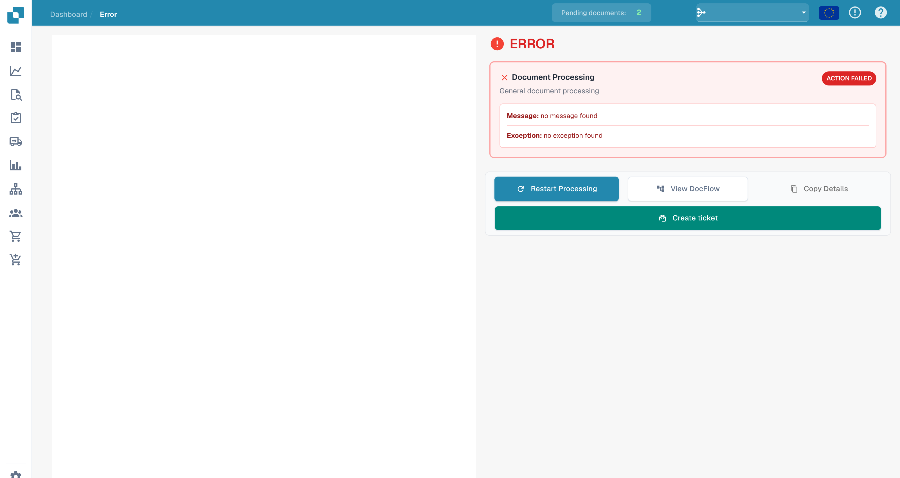
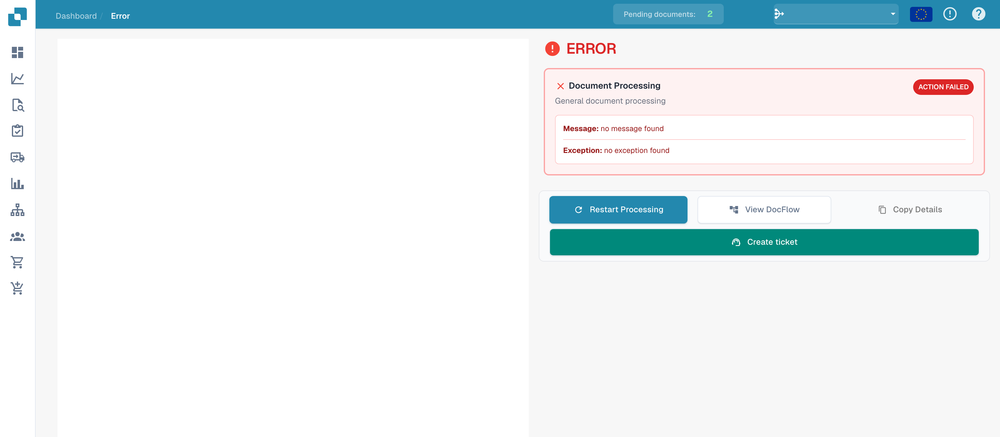

# Error view

When document processing fails, the **Error** view supports diagnosis. It shows the affected processing step, **Message** and **Exception** where details are available.

## Read the details

<figure><figcaption>
Message and Exception sections of the error view without a stored detail message.
</figcaption></figure>

This example explains the interface without a stored error message. The placeholders `no message found` and `no exception found` are not a diagnosis of a specific incident. For an actual failure, inspect the available messages and [Document Flow](dashboard/document-flow.md).

## Available actions

<figure><figcaption>
Error-view actions; the example has no stored error details.
</figcaption></figure>

| Action | Purpose |
| --- | --- |
| **Restart Processing** | Start processing again after checking or correcting the cause. |
| **View DocFlow** | Inspect the processing steps and their states. |
| **Copy Details** | Copy available technical details for diagnosis. |
| **Create ticket** | Prepare a support request for the document. |

Document and preview controls depend on whether the document can be loaded successfully. The older PDF toolbar is not a reliable part of this error view.

If the error returns, give support the document ID, exact message, time and steps already taken. Review technical details for confidential information before sharing them. See [User Support](ressources-and-support/user-support.md).
