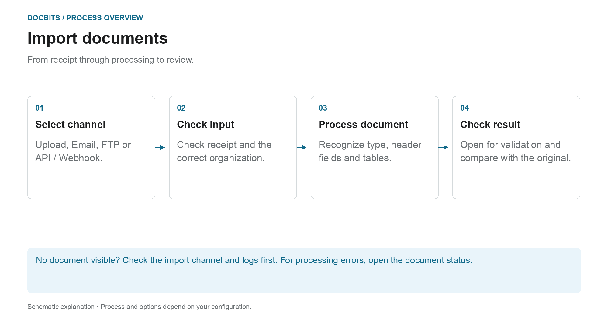

# How to Import Documents

## From receipt to a document ready for review

<figure><figcaption>
From receipt through processing to review. The diagram is schematic; the active settings of your organization determine the actual behavior.
</figcaption></figure>

First select the import route. Successfully sending an email or submitting an API request does not prove that the document has been fully processed. Check its receipt in DocBits and then its document status.

1. **Select import channel:** Use manual upload for individual files or a set-up automatic channel for regular inputs.
2. **Check receipt:** Locate the document in the correct organization. For incoming emails, check the import logs if necessary; do the format and sender rules support the attachment?
3. **Wait for processing:** DocBits processes the document according to the document type and active settings. For PDFs, OCR or existing PDF text can be used; electronic documents can provide structured data. Not every import goes through the same extraction path.
4. **Open the result:** Once the document is ready for validation, compare the recognized values with the original. Importing a document does not approve it or export it to the ERP.

### Find the right import route

| Input | Instructions |
| --- | --- |
| Upload individual documents | [Manual import](manual-import.md) |
| Connect mailbox or forward emails | [Email import](email/README.md) |
| Retrieve files via a set up FTP channel | [FTP](ftp.md) |
| Transfer documents from an application | [Webhook / API](webhook.md) |

**If something is missing:** Check the input channel first. If the document already exists in DocBits, [Document status](../dashboard/document-status.md) and [Document flow](../dashboard/document-flow.md) help to find the affected processing step.


DocBits Import Tutorial: Upload Documents, Drag & Drop + Manual vs Automatic Classification


A guide to uploading documents to DocBits.

