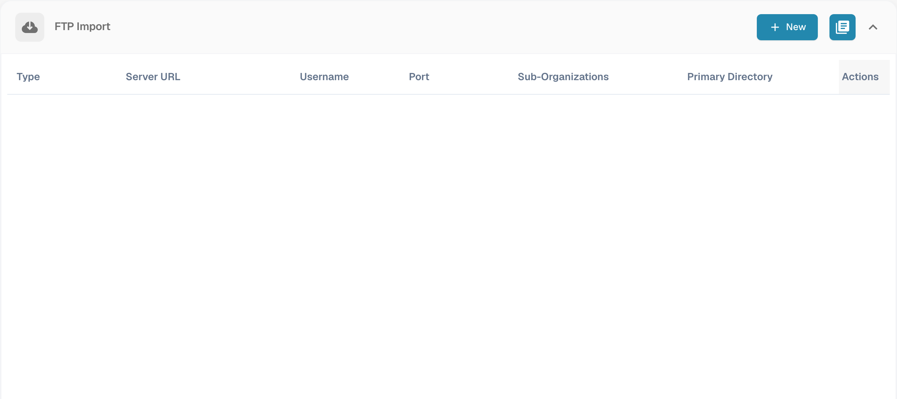
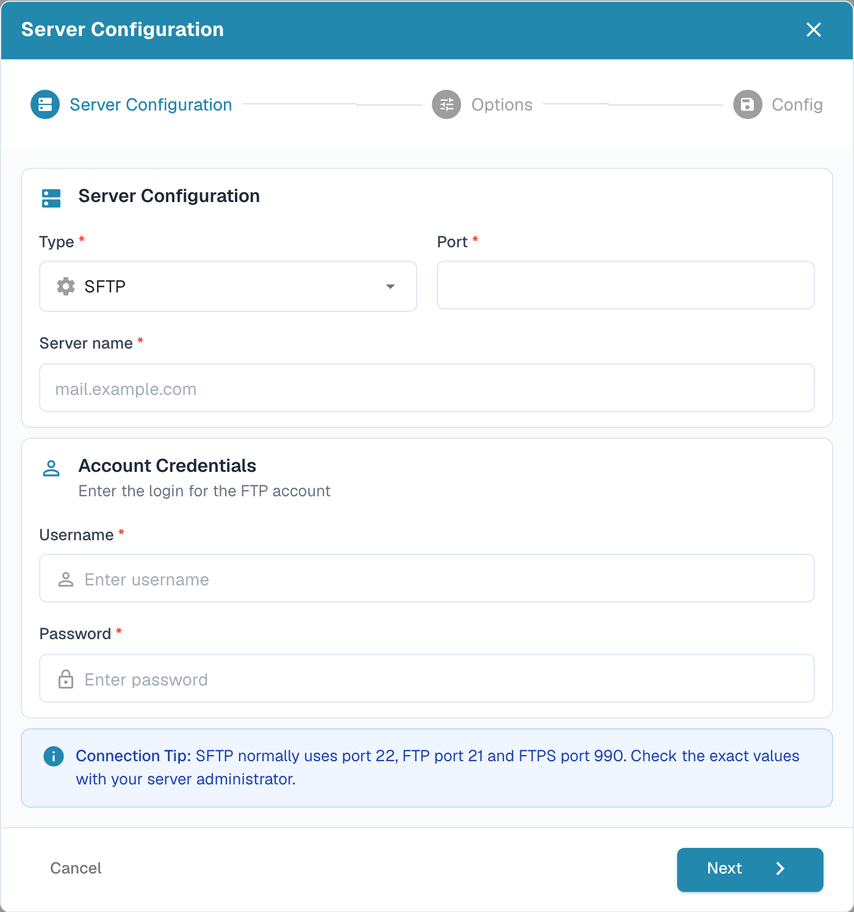

# FTP and SFTP import

Automatic import requires approved server details and an import folder accessible to the connection account.

## Create a connection

Open **Settings → Import** and select **New** in **FTP Import**.

<figure><figcaption>
English FTP connection overview with connection details hidden.
</figcaption></figure>

The wizard starts with **Server Configuration**. Choose the connection type, server name, port and intended account credentials. The connection tip gives common ports; use the values supplied by your server administrator.

<figure><figcaption>
First step of the FTP import wizard: Server Configuration.
</figcaption></figure>

Select **Next** to continue to **Options** and **Config**. Check the complete connection before saving it.

## File archiving

If the connection offers file archiving, configure it in the import options. Specify the archive directory and check that the import account can write to it. Test with a sample file to confirm that successful import produces the intended archive behavior. The old separate archive form has been replaced by the current wizard.
