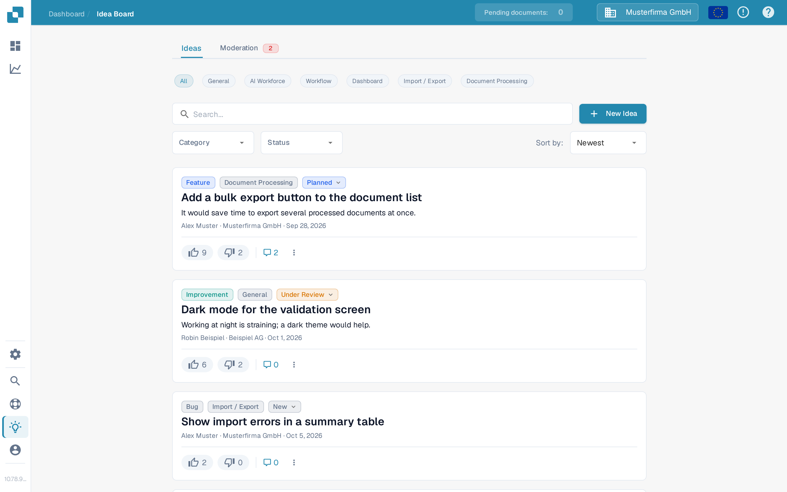
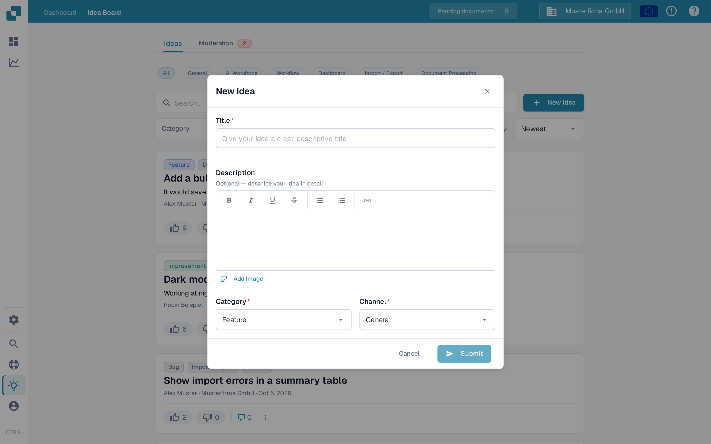
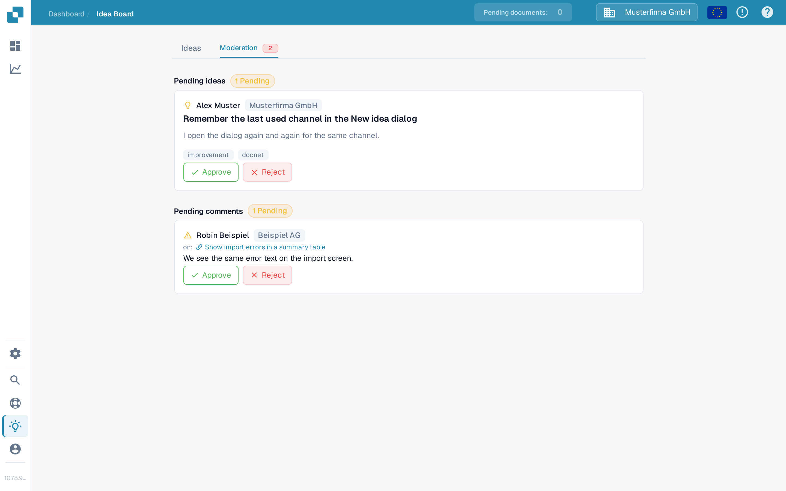

# Idea Board

The Idea Board is the place to submit feature requests, report missing functionality, and vote on what the product team should build next. Ideas are organised by channel and visible to everyone in your organisation, with comments and voting.

## How to access

Open the sidebar and click **Ideas**, or navigate to `/ideas` directly.

<figure><figcaption>
The Idea Board, with channel chips, filters, and idea cards.
</figcaption></figure>

## Channels

A row of channel chips sits at the top of the board: **All**, **General**, **AI Workforce**, **Workflow**, **Dashboard**, **Import / Export**, and **Document Processing**. Click a chip to show only the ideas in that product area; **All** clears the channel filter. Every idea belongs to one channel, shown as a badge on its card. The **AI Workforce** channel collects ideas for the [AI Workforce](../../advanced-functions-and-tools/ai_workforce.md) features.

## Browsing ideas

Each idea is shown as a card with:

* The title and a rich-text description, which can include images.
* Separate **upvote** and **downvote** buttons, each with its own count.
* A category badge — Feature, Improvement, Bug, Integration, or Other.
* A channel badge — General, AI Workforce, Workflow, Dashboard, Import / Export, or Document Processing.
* A status chip — New, Under Review, Planned, In Progress, Done, or Declined.
* The submitter's name and organisation, and a relative timestamp.
* A comments toggle that expands the discussion below the card.

Pagination at the bottom of the list moves between pages.

## Submitting a new idea

Click **New Idea** in the header. The dialog asks for:

* **Title** — a short, descriptive name for the idea.
* **Description** — an optional rich-text editor with bold, italic, underline, strike-through, lists, and links. You can also add images: paste them directly, or use the **Add Image** button to insert one into the description.
* **Category** — pick the closest match. The product team uses this to route ideas.
* **Channel** — the product area the idea belongs to.

Press **Submit** to publish. The idea appears in the list once it has been approved — see [Moderation](#moderation) below.

<figure><figcaption>
The New Idea dialog, with category and channel selectors.
</figcaption></figure>

## Voting

Each idea has separate **upvote** and **downvote** buttons, each with its own count. Click a button to cast your vote, click the same button again to remove it, or click the opposite button to switch. Votes signal demand to the product team and feed the **Hot** and **Top Rated** sort orders.

## Commenting

Open an idea's comment thread to ask questions, add context, or share workarounds. You can upvote or downvote comments (but not your own) and delete comments you posted. The submitter and admins can also delete comments to keep threads on-topic.

## Moderation

If your organisation moderates the Idea Board, an extra **Moderation** tab appears next to **Ideas** at the top of the board. It shows a red badge with the number of items waiting for review.

<figure><figcaption>
The Moderation tab, with one pending idea and one pending comment awaiting review.
</figcaption></figure>

The tab has two sections:

* **Pending ideas** — newly submitted ideas awaiting approval. Each card shows the submitter, the title, the description, and the category and channel badges. Use **Approve** to publish the idea on the board or **Reject** to discard it.
* **Pending comments** — comments awaiting review, shown with the idea they were written on. Use **Approve** to publish the comment or **Reject** to discard it.

Moderators can also act directly in a discussion: the comment menu (three-dot button) on an approved comment offers **Hide for others** to remove it from public view without deleting it.

## Filtering and sorting

Above the list you can combine:

* The **channel** chips.
* A search box matching against title and description.
* A category dropdown.
* A status dropdown.
* A sort selector — **Newest**, **Hot**, or **Top Rated**.

Filters combine, so you can narrow to, say, "Top Rated Improvements that are Under Review" in a few clicks.

## Editing or deleting your own idea

The card menu (three-dot button) lets you edit or delete an idea you submitted.

<mark>The Idea Board is for product feedback, not for incident reports. Use a support ticket for issues that are blocking your work today.</mark>
