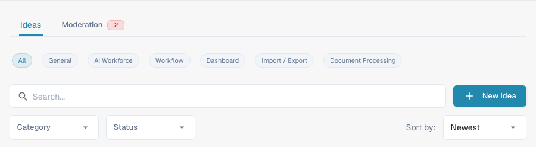
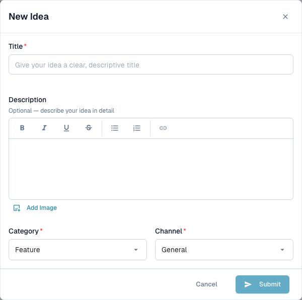
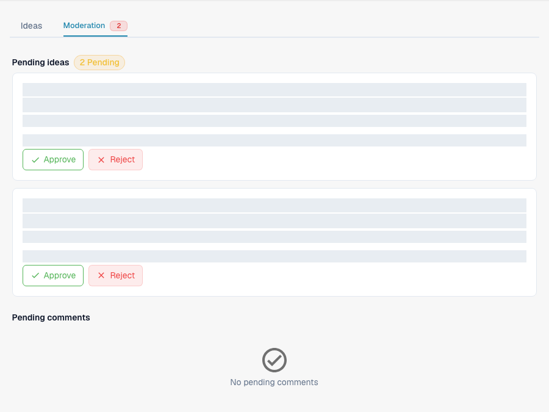

# Idea Board

The Idea Board is the place to submit feature requests, report missing functionality, and vote on what the product team should build next. Ideas are organised by channel, with comments and voting. The board is shared across DocBits organisations: approved ideas and comments can be visible to users in other organisations. Pending or rejected items remain visible to users in the submitting organisation and to moderators. Treat this as a shared product-feedback channel and leave out confidential company, customer and document information.

## How to access

Open the sidebar and click **Ideas**, or navigate to `/ideas` directly.

<figure><figcaption>
The English Idea Board controls, including the AI Workforce channel. Existing ideas and account information are outside this crop.
</figcaption></figure>

## Channels

A row of channel chips sits at the top of the board: **All**, **General**, **AI Workforce**, **Workflow**, **Dashboard**, **Import / Export**, and **Document Processing**. Click a chip to show only the ideas in that product area; **All** clears the channel filter. Every idea belongs to one channel, shown as a badge on its card. The **AI Workforce** channel collects ideas for the [AI Workforce](../../advanced-functions-and-tools/ai_workforce.md) features.

## Browsing ideas

Each idea is shown as a card with:

* The title and a rich-text description, which can include images.
* Separate **upvote** and **downvote** buttons, each with its own count.
* A category badge — for example Feature, Improvement, Integration, or Other. Historical ideas may still display a Bug category.
* A channel badge — General, AI Workforce, Workflow, Dashboard, Import / Export, or Document Processing.
* A status chip — New, Under Review, Planned, In Progress, Done, or Declined.
* The submitter's name and organisation, and a relative timestamp.
* A comments toggle that expands the discussion below the card.

Pagination at the bottom of the list moves between pages.

## Submitting a new idea

Click **New Idea** in the header. The dialog asks for:

* **Title** — a short, descriptive name for the idea.
* **Description** — an optional rich-text editor with bold, italic, underline, strike-through, lists, and links. You can also add images: paste them directly, or use the **Add Image** button to insert one into the description.
* **Category** — pick the closest match: Feature, Improvement, Integration, or Other. Use a support ticket for incidents that are blocking your work.
* **Channel** — the product area the idea belongs to.

Press **Submit** to send the idea. Its visibility depends on its moderation status: it can appear within your organisation while awaiting review; approval makes it visible across the board — see [Moderation](#moderation) below.

<figure><figcaption>
The New Idea dialog before entering a title: Submit is disabled while the title is empty.
</figcaption></figure>

## Voting

Each idea has separate **upvote** and **downvote** buttons, each with its own count. Click a button to cast your vote, click the same button again to remove it, or click the opposite button to switch. Votes signal demand to the product team and feed the **Hot** and **Top Rated** sort orders.

## Commenting

Open an idea's comment thread to ask questions, add context, or share workarounds. You can upvote or downvote comments (but not your own) and delete comments you posted. Board moderators can also delete comments. Ownership of an idea or ordinary organisation-admin status alone does not grant this moderation permission.

## Moderation

If your account has board-moderation access, an extra **Moderation** tab appears next to **Ideas** at the top of the board. This access is reserved for organisation admins of trusted organisations; being an admin of another organisation does not automatically grant it. A red badge appears when there are items waiting for review.

<figure><figcaption>
The Moderation view. Existing queue content and its metadata are masked; the review controls remain visible.
</figcaption></figure>

The tab has two sections:

* **Pending ideas** — newly submitted ideas awaiting approval. Each card shows the submitter, the title, the description, and the category and channel badges. Use **Approve** to make the idea visible across the board or **Reject** to withhold it from that view.
* **Pending comments** — comments awaiting review, shown with the idea they were written on. Use **Approve** to make the comment visible across the board or **Reject** to withhold it from that view.

Rejection does not delete the item: users in the submitting organisation and board moderators can still see it.

Moderators can also act directly in a discussion: the comment menu (three-dot button) on an approved comment offers **Hide for others**. It withdraws the comment from the cross-organisation view without deleting it; users in the submitting organisation and moderators can still see it.

## Filtering and sorting

Above the list you can combine:

* The **channel** chips.
* A search box matching against title and description.
* A category dropdown.
* A status dropdown.
* A sort selector — **Newest**, **Hot**, or **Top Rated**.

Filters combine, so you can narrow to, say, "Top Rated Improvements that are Under Review" in a few clicks.

## Editing or deleting your own idea

The card menu (three-dot button) lets you edit or delete an idea you submitted. Board moderators can also act on other ideas; ordinary users do not gain those permissions simply by belonging to the same organisation.

<mark>The Idea Board is for product feedback, not for incident reports. Use a support ticket for issues that are blocking your work today.</mark>
