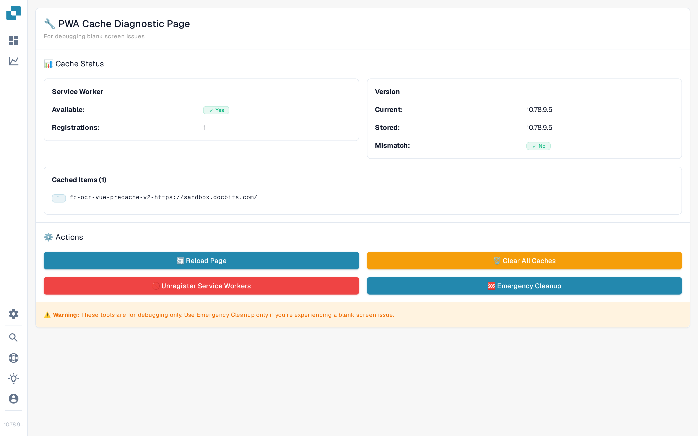

# PWA Cache Status

The **PWA Cache Status** page is a diagnostic tool for administrators. When DocBits is installed as a Progressive Web App (PWA), the browser stores parts of the application in caches and a Service Worker so the app loads quickly and keeps working offline. If these cached files get out of sync with the version DocBits has just deployed — for example right after an update — the app can load old files and end up showing a **blank screen**. This page shows what is currently cached and gives you the tools to clear it, so you can bring a blank or stuck app back to life without losing any documents.

## How to access

The page is intended for administrators and is not linked in the sidebar. There are two ways to open it:

* Open the URL directly: `https://app.docbits.com/debug/pwa-cache-status`
* Press <kbd>Ctrl</kbd> + <kbd>K</kbd> (or <kbd>Cmd</kbd> + <kbd>K</kbd> on macOS) to open [Global Quick Search](global-quick-search.md) and type "PWA Cache Status", then press <kbd>Enter</kbd>.

<figure><figcaption>
The PWA Cache Diagnostic page: status panels at the top, the four maintenance actions below, and a warning that the tools are for debugging only.
</figcaption></figure>

## Reading the status panels

* **Service Worker** — shows whether the browser supports Service Workers (**Available: Yes/No**) and how many Service Worker **Registrations** are currently active. A healthy installation typically shows *Yes* with one registration.
* **Version** — compares the **Current** app version with the **Stored** version the cache was built from. If the two differ, **Mismatch: Yes** tells you the cache is stale and needs to be cleared (DocBits normally clears it automatically on the next start).
* **Cached Items** — lists the names of the caches the browser currently holds (for example `fc-ocr-vue-precache-…`). *No caches found* means nothing is cached at the moment.

## The four actions

| Action | What it does |
|---|---|
| **Reload Page** | Reloads DocBits so the app can fetch fresh files and rebuild its caches. Try this first. |
| **Clear All Caches** | Deletes every cache listed under *Cached Items*. The next reload refetches the application files. |
| **Unregister Service Workers** | Removes the registered Service Workers so they stop serving cached files. They are re-registered on the next visit. |
| **Emergency Cleanup** | Clears all caches **and** unregisters all Service Workers in one step, then reloads the page and stores the current version as the new baseline. Use this when the screen stays blank. |

⚠️ **Warning:** These tools are for debugging only. Use **Emergency Cleanup** only if you're experiencing a blank screen issue. Clearing caches is safe — no documents or settings are stored in them — but the next page load will be slower while everything is fetched again.

## Typical troubleshooting flow

1. Open the PWA Cache Status page and check whether **Version Mismatch** shows *Yes*.
2. Click **Reload Page**. If the app comes back, you are done.
3. If the screen is still blank, click **Clear All Caches** and then **Reload Page**.
4. If it is still blank, click **Emergency Cleanup** — it clears everything, reloads the app and updates the stored version.
5. If none of this helps, collect diagnostics with the **Debug Collector** (<kbd>Ctrl</kbd> + <kbd>Shift</kbd> + <kbd>P</kbd>) and send them to support — see [Debug Collector](technical-support-in-docbits/debug-collector.md).
