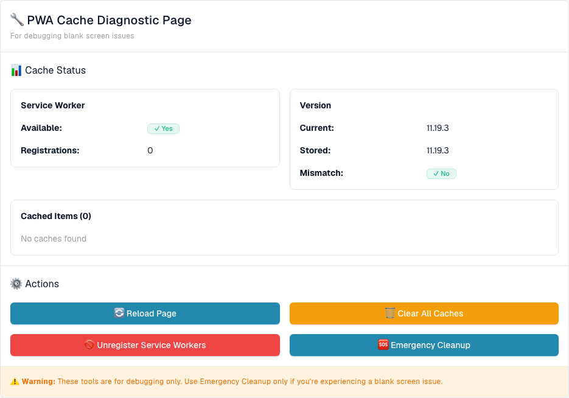

# PWA Cache Status

The **PWA Cache Status** page is a diagnostic tool for administrators investigating a **blank screen** or an app that loads outdated files. DocBits can use Service Workers and browser caches to load application files. This page shows the browser's current diagnostic snapshot and offers maintenance actions for cache-related problems. The snapshot alone does not establish the cause of a blank screen or prove that a PWA installation is healthy.

## How to access

The page is intended for administrators and is not linked in the sidebar. There are two ways to open it:

* Open the URL directly: `https://app.docbits.com/debug/pwa-cache-status`
* From the main application (for example the Dashboard), press <kbd>Ctrl</kbd> + <kbd>K</kbd> (or <kbd>Cmd</kbd> + <kbd>K</kbd> on macOS) to open [Global Quick Search](global-quick-search.md) and type "PWA Cache Status", then press <kbd>Enter</kbd> on that result.

<figure><figcaption>
The English PWA Cache Diagnostic page in an isolated Dev browser: status panels, all four actions and the debugging warning. Version values and registration/cache counts vary between browsers and environments.
</figcaption></figure>

## Reading the status panels

* **Service Worker** — **Available: Yes/No** reports whether the browser supports the Service Worker API. **Registrations** counts the registrations on the current browser origin. These values do not prove that DocBits is installed as a PWA, that a worker controls this page, or that the installation is healthy.
* **Version** — **Current** is the app version supplied by the loaded build. **Stored** is the baseline saved for this app bundle in the browser; it is not an inventory of the versions of all cached files. **Mismatch: Yes** appears only when both values are known and differ. An empty current version or **Stored: Not set** does not establish that caches are current, even if **Mismatch** shows *No*.
* **Cached Items** — lists the names of all CacheStorage caches on the current origin, rather than individual files or only DocBits caches. The count is the number of cache names. *No caches found* means this snapshot contains no CacheStorage cache names; it says nothing about other browser storage or the browser's ordinary HTTP cache.

Empty values or a zero count can also result from unavailable APIs or failed diagnostic reads; they do not prove that the browser has no cached resources.

An origin is the combination of protocol, host and port. These tools act on all caches and registrations on that origin, including those used by other application paths.

## The four actions

| Action | What it does |
|---|---|
| **Reload Page** | Performs a normal page reload. It does not explicitly clear caches or bypass a Service Worker. |
| **Clear All Caches** | Attempts to delete all CacheStorage caches on this origin and refreshes the diagnostic snapshot. Subsequent loads may need to fetch files again. |
| **Unregister Service Workers** | Attempts to unregister all Service Worker registrations on this origin and refreshes the diagnostic snapshot. Check the resulting status before assuming cleanup succeeded. |
| **Emergency Cleanup** | Attempts cache deletion and Service Worker unregistration together, then schedules a normal page reload. It attempts to save the current version baseline only after both cleanup steps report success and a current app version is available. A browser storage failure can still prevent the baseline from being saved. If either cleanup step fails, the previous baseline is retained. |

⚠️ **Warning:** These tools are for debugging only. Use **Emergency Cleanup** only for a blank screen issue. Cache deletion can remove cached data and offline resources for applications on the same origin; do not assume that caches contain only disposable app files. The next load may be slower or require a working network connection. A success notification or scheduled reload alone does not prove that every cleanup operation succeeded.

## Typical troubleshooting flow

1. Open the PWA Cache Status page and note **Current**, **Stored**, **Mismatch**, the registration count and the cache names. A mismatch is a diagnostic clue, not a complete diagnosis.
2. If appropriate for your troubleshooting session, try **Reload Page**. This is an ordinary reload and may still use cached responses.
3. If the screen stays blank, check the origin and the warning above before using **Clear All Caches**, then reload the page and inspect its status again.
4. Use **Emergency Cleanup** only for a continuing blank screen issue. It attempts both cleanup operations and schedules a reload; the baseline changes only under the success conditions described above. If cleanup fails, retain the previous baseline as a clue and contact support rather than assuming the problem is fixed.
5. If none of this helps, collect diagnostics with the **Debug Collector** (<kbd>Ctrl</kbd> + <kbd>Shift</kbd> + <kbd>P</kbd>) and send them to support — see [Debug Collector](technical-support-in-docbits/debug-collector.md). Review diagnostics for sensitive information before sharing them.
