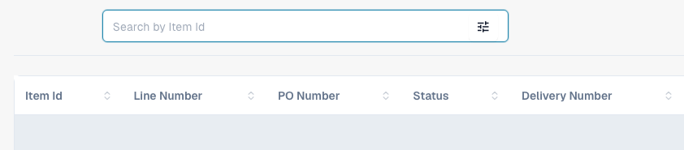
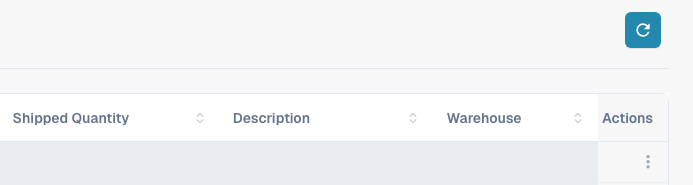
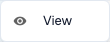

# Shipment Order Dashboard

The Shipment Order Dashboard lists shipment order lines available in DocBits, with their item, purchase order and delivery references, quantities, status and warehouse. Open it from the sidebar when it is available to your account (see [Activating the dashboard](shipment-order-dashboard.md#activating-the-dashboard) below). The table shows the current page of the list; the **All** counter reports the total available to the dashboard.

<figure><figcaption>
Search by Item Id and the first five column headers. Row values and the total counter are hidden.
</figcaption></figure>

<figure><figcaption>
Refresh and the remaining column headers. These adjacent details show the same dashboard; saved column order can vary.
</figcaption></figure>

## Table columns

| Column               | What it shows                                                                                                       |
| -------------------- | ------------------------------------------------------------------------------------------------------------------- |
| **Item Id**          | The item number of the ordered product.                                                                             |
| **Line Number**      | The line of the purchase order that this shipment belongs to.                                                       |
| **PO Number** | The purchase order number. Where the line has a linked purchase order, select the number to open its detail page. |
| **Status**           | The current shipping status, for example Reserved, Picking list printed, Delivered or Invoiced.                     |
| **Shipped Quantity** | How many units have been shipped for this line.                                                                     |
| **Delivery Number**  | The delivery note number the shipment was reported under.                                                           |
| **Description**      | A short description of the item.                                                                                    |
| **Warehouse**        | The warehouse or storage location the goods are shipped from.                                                       |
| **Actions**          | Opens the row action menu (see below).                                                                              |

## Search and filters

Enter an item ID in **Search by Item Id**, then press **Enter** to apply the search. The sliders icon opens additional filters for PO number, shipped quantity, delivery number, warehouse and status. **Clear filters** removes the search and filter selections and reloads the list.

**All** and the refresh button reset the list selections and return to the first page before reloading. Reloading the list alone does not confirm that an ERP import or synchronization has completed.

## Row actions: View

Open the three-dot menu in a row's **Actions** column and choose **View** when the line has a linked purchase order. Selecting the line or its linked PO number also opens that purchase order's detail page. A line without a linked purchase-order identifier does not navigate to a detail page. For more background, see [Purchase Order Matching Screen](purchase-order-matching.md).

<figure><figcaption>
View is available from the row's three-dot Actions menu.
</figcaption></figure>

## Sorting, column order and page size

Select a sortable column header to sort the list. Drag reorderable headers to change their order, and choose how many rows are shown per page at the bottom of the table (10, 20, 25 or 50). Column order and page size use your saved user preferences. Sorting applies to the current list.

## Activating the dashboard

An administrator configures the dashboard under **Settings** → **Module** → **Purchase Order**, using the **Shipment Order Dashboard** switch. The separate **PO Shipment Order** switch controls the delivery section inside the matching screen. Once the dashboard is enabled, eligible users can open it from the sidebar. Availability depends on the organization's configuration and the user's access. See [PO Shipment Order Setting](../../administration-and-setup/settings/document-processing/module/po-shipment-order-setting.md) for the related switches.

## Video: find shipment orders and check shipping data

In this English video, an administrator searches for an example line by item ID, compares the order and delivery references, and checks the shipped quantity, status and warehouse. He then clears the search and reloads the overview.



[Open the video with English captions and transcript](https://docbits-videos.fra1.cdn.digitaloceanspaces.com/settings-assistant/shipment-order-search-admin/v1/en.html).

The three lines use fictional example data created for this demonstration. Searching for **DEMO-INSERT-40** shows delivery **DEMO-9F2416-DL-102**, order reference **DEMO-9F2416-PO-202**, shipped quantity **600** and warehouse **DEMO-WH-9F2416**. The statuses come from the imported example data. A shipped quantity alone does not confirm complete receipt. The video demonstrates searching and checking existing shipping data; it does not create an ASN, open a linked purchase-order record or book goods receipt.
