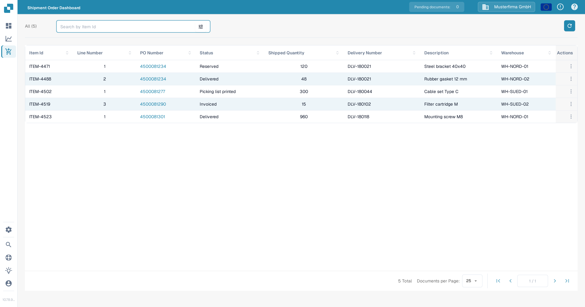

# Shipment Order Dashboard

The Shipment Order Dashboard shows all shipment order lines that DocBits has received from your ERP system, so you can follow at a glance what has been shipped for each purchase order. It is available from the sidebar once the feature is switched on (see [Activating the dashboard](#activating-the-dashboard) below).

<figure><figcaption>
The Shipment Order Dashboard with its table of shipment lines, the search bar and the row actions menu.
</figcaption></figure>

## Table columns

| Column | What it shows |
| --- | --- |
| **Item Id** | The item number of the ordered product. |
| **Line Number** | The line of the purchase order that this shipment belongs to. |
| **PO Number** | The purchase order number. Click it to open the purchase order detail page with all lines and matching information. |
| **Status** | The current shipping status, for example Reserved, Picking list printed, Delivered or Invoiced. |
| **Shipped Quantity** | How many units have been shipped for this line. |
| **Delivery Number** | The delivery note number the shipment was reported under. |
| **Description** | A short description of the item. |
| **Warehouse** | The warehouse or storage location the goods are shipped from. |
| **Actions** | Opens the row action menu (see below). |

## Search and filters

The search bar above the table filters the list by item ID as you type. The filter icon (sliders) next to it opens additional filters where you can narrow the list by PO number, shipped quantity, delivery number, warehouse and status. **Clear filters** removes the selected filter values. The refresh button next to the search bar reloads the list from your ERP system.

## Row actions: View

Click the three-dot menu in the **Actions** column of a row and choose **View** — or simply click anywhere in the row — to jump to the purchase order detail page for that PO number. There you can check the full purchase order, its lines and the current matching status. For more background, see [Purchase Order Matching Screen](purchase-order-matching/README.md).

## Sorting, column order and page size

You can sort the table by clicking a column header. Drag and drop the column headers to rearrange them, and choose how many rows are shown per page at the bottom of the table (10, 20, 25 or 50). Your sorting, column order and page size are saved per user, so the dashboard looks the same the next time you open it.

## Activating the dashboard

The Shipment Order Dashboard is disabled by default. An administrator switches it on under **Settings** → **Document Processing** → **Module** → **Purchase Order** with the **Shipment Order Dashboard** toggle. Once enabled, the menu entry appears in the sidebar for all users except suppliers. For the exact steps, see [PO Shipment Order Setting](../../administration-and-setup/settings/document-processing/module/po-shipment-order-setting.md).

## Video: find shipment orders and check shipping data

In this English video, an administrator searches for an example line by item ID, compares the order and delivery references, and checks the shipped quantity, status and warehouse. He then clears the search and reloads the overview.




[Open the video with English captions and transcript](https://docbits-videos.fra1.cdn.digitaloceanspaces.com/settings-assistant/shipment-order-search-admin/v1/en.html).

The three lines use fictional example data created for this demonstration. Searching for **DEMO-INSERT-40** shows delivery **DEMO-9F2416-DL-102**, order reference **DEMO-9F2416-PO-202**, shipped quantity **600** and warehouse **DEMO-WH-9F2416**. The statuses come from the imported example data. A shipped quantity alone does not confirm complete receipt. The video demonstrates searching and checking existing shipping data; it does not create an ASN, open a linked purchase-order record or book goods receipt.
