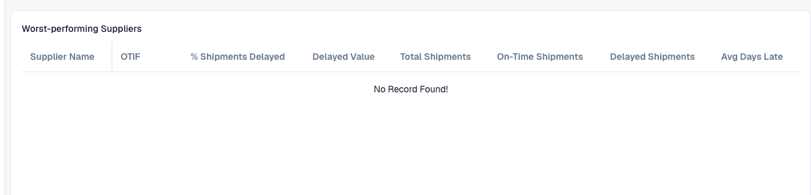
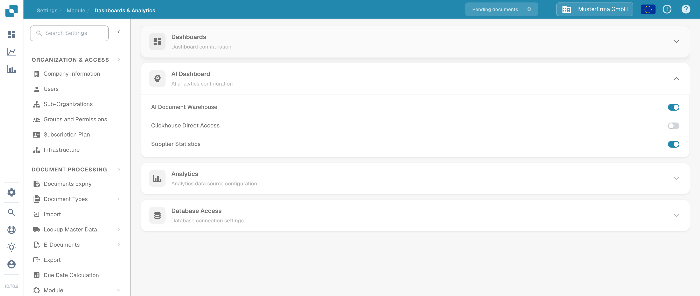
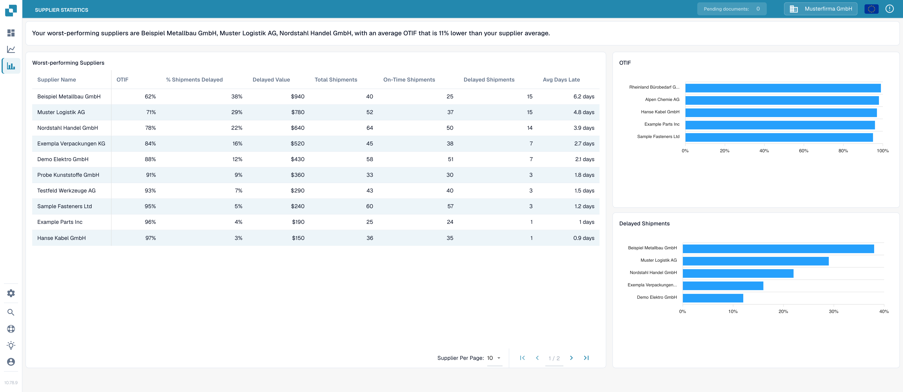

# Understand supplier delivery statistics

Use **Supplier Statistics** to identify delivery performance that needs investigation. Your administrator must enable the module and provide the relevant shipment data. The figures depend on the records supplied to your organization.

<figure><figcaption>
The delivery-statistics columns in an organization without shipment records. An empty table does not demonstrate good delivery performance.
</figcaption></figure>

## Before you start

Supplier Statistics is an optional module. An administrator must enable it first:

1. Go to **Settings → Module → Dashboards & Analytics** and open the **AI Dashboard** section.
2. Turn on **AI Document Warehouse**. A confirmation dialog appears because this feature uses a Clickhouse subscription — confirm it.
3. The **Supplier Statistics** toggle appears below **Clickhouse Direct Access**. Turn it on.

Once enabled, a **Supplier Statistics** entry appears in the main menu on the left. Click it to open the page.

## What the page shows

<figure><figcaption>
Supplier Statistics page with shipment data.
</figcaption></figure>

**AI summary** — at the top of the page a short sentence names your worst-performing suppliers and states how far their average OTIF is below (or above) the average of all your suppliers.

**Worst-performing Suppliers table** — lists the suppliers with the weakest delivery performance:

| Column | Meaning |
| --- | --- |
| **Supplier Name** | The supplier the row refers to. |
| **OTIF** | On Time In Full — the percentage of this supplier's deliveries that arrived both on time and complete. A higher percentage is better. |
| **% Shipments Delayed** | The percentage of this supplier's shipments that were delayed. |
| **Delayed Value** | The monetary value of the delayed shipments. |
| **Total Shipments** | The number of shipments counted for this supplier. |
| **On-Time Shipments** | The number of shipments that arrived on time. |
| **Avg Days Late** | The average number of days by which this supplier's deliveries were late. |

If no shipment data has been collected yet, the table shows **No Record Found!** until documents with supplier and delivery data are processed.

**OTIF and Delayed Shipments charts** — two bar charts on the right: **OTIF** shows the five suppliers with the highest OTIF percentages, **Delayed Shipments** the five with the highest percentage of delayed shipments.

**Pagination** — below the table, **Supplier Per Page** sets how many suppliers are shown at once (10, 20, 25 or 50). Use the page arrows to move between pages.

## Review a supplier

1. Open **Supplier Statistics**. If unavailable, ask your administrator to check the module and access.
2. Read **Worst-performing Suppliers** and identify the intended supplier.
3. Compare **Total Shipments**, **On-Time Shipments** and **Delayed Shipments** before judging percentages. Two shipments and two thousand are different sample sizes.
4. Review **OTIF**, **% Shipments Delayed**, **Delayed Value** and **Avg Days Late** together. OTIF means *On Time In Full*: on-time delivery alone does not establish delivery in full.
5. Compare the **OTIF** and **Delayed Shipments** charts. Use **Supplier Per Page** and the page controls to inspect further rows.
6. Trace an unusual result to actual shipments. Check promised/actual dates, delivered quantities, supplier identifiers and the currency behind monetary values before contacting the supplier.

## Interpret and investigate

Counts explain sample size; average days late explains duration; delayed value helps assess affected value. Do not infer OTIF from the on-time count alone or combine different currencies without an agreed conversion.

An empty table or zero chart is not proof of perfect delivery performance. Check data availability and synchronization. The summary sentence is a starting point, not an explanation of an individual shipment.

For a discrepancy, preserve the supplier identifier, relevant shipment records, dates and expected calculation. Ask your administrator to verify source data and metric inputs.

See the [Shipment Order Dashboard](shipment-order-dashboard.md) for the underlying shipment data, [Module](../../administration-and-setup/settings/document-processing/module/README.md) and [Data Synchronization](../../administration-and-setup/settings/log-settings/data-synchronization.md).
