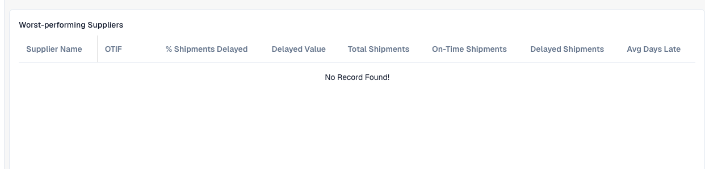

# Understand supplier delivery statistics

Use **Supplier Statistics** to identify delivery performance that needs investigation. Your administrator must enable the module and provide the relevant shipment data. The figures depend on the records supplied to your organization.

<figure><figcaption>
The delivery-statistics columns in an organization without shipment records. An empty table does not demonstrate good delivery performance.
</figcaption></figure>

## Review a supplier

1. Open **Supplier Statistics**. If unavailable, ask your administrator to check the module and access.
2. Read **Worst-performing Suppliers** and identify the intended supplier.
3. Compare **Total Shipments**, **On-Time Shipments** and **Delayed Shipments** before judging percentages. Two shipments and two thousand are different sample sizes.
4. Review **OTIF**, **% Shipments Delayed**, **Delayed Value** and **Avg Days Late** together. OTIF means *On Time In Full*: on-time delivery alone does not establish delivery in full.
5. Compare the **OTIF** and **Delayed Shipments** charts. Use **Supplier Per Page** and the page controls to inspect further rows.
6. Trace an unusual result to actual shipments. Check promised/actual dates, delivered quantities, supplier identifiers and the currency behind monetary values before contacting the supplier.

## Interpret and investigate

Counts explain sample size; average days late explains duration; delayed value helps assess affected value. Do not infer OTIF from the on-time count alone or combine different currencies without an agreed conversion.

An empty table or zero chart is not proof of perfect delivery performance. Check data availability and synchronization. The summary sentence is a starting point, not an explanation of an individual shipment.

For a discrepancy, preserve the supplier identifier, relevant shipment records, dates and expected calculation. Ask your administrator to verify source data and metric inputs.

See [Module](../../administration-and-setup/settings/document-processing/module/README.md) and [Data Synchronization](../../administration-and-setup/settings/log-settings/data-synchronization.md).
