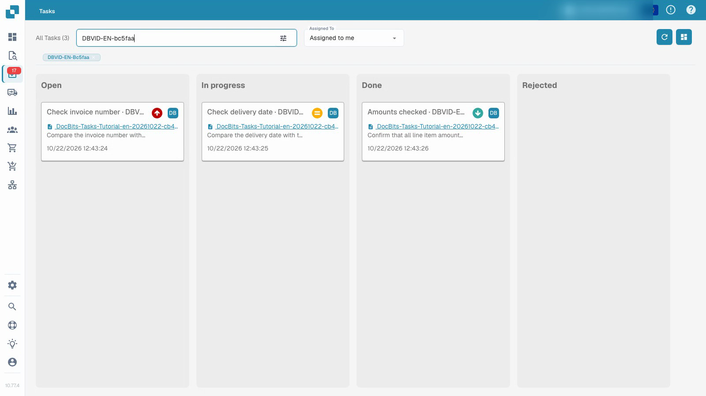
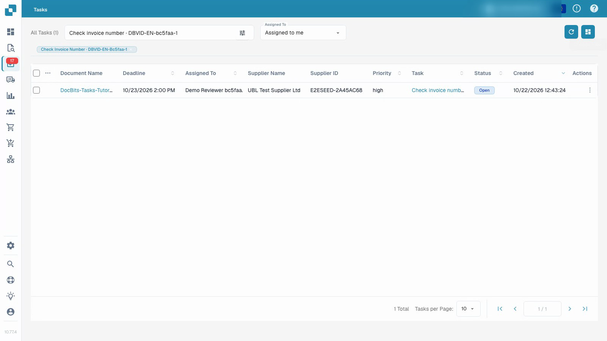

# Tasks

Follow an assigned task with an ordinary test account: inspect the document, record the result, complete the task, save and reload.


Tasks


[Watch with subtitles](https://docbits-videos.fra1.cdn.digitaloceanspaces.com/settings-assistant/document-tasks-customer/v1/en.html)

The recording shows the actual test interface. Configured values and technical labels retain their original meaning.

Use the task overview to find assigned work and follow its progress. The board groups tasks by status; the list provides more detail. Filter by assignment and use search to locate a particular task. Priority and deadline help plan the order of work.

## Work on an assigned document task

1. Open a task and read its description and assignment.
2. Inspect the linked original document. A task title alone does not prove that the document is correct.
3. Set the task to in progress and save while doing the work.
4. Record the result in the task description.
5. Complete the task, save it and reload to confirm the stored status and feedback. Check its position in the task overview.

The video uses an ordinary test user and synthetic documents. Completing a task is separate from approving or exporting its invoice. Available actions depend on the account's permissions.

<figure><figcaption>
Task board with synthetic demonstration data.
</figcaption></figure>

<figure><figcaption>
Task list with synthetic demonstration data.
</figcaption></figure>
