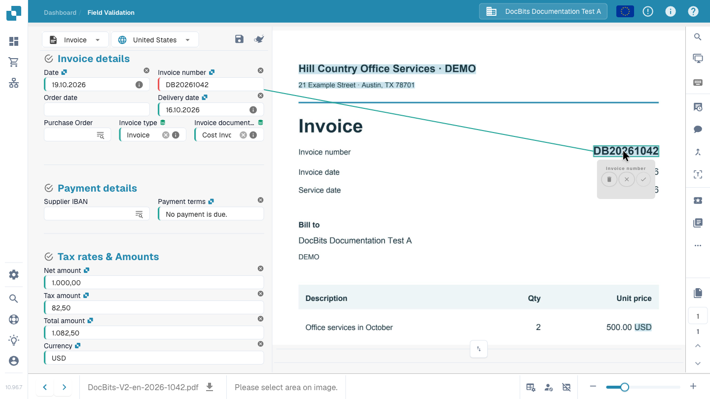

# Validation Screen

## Review and finish processing an invoice

Follow an invoice from the dashboard to handoff: compare the supplier, dates, invoice number, amounts and currency with the original and read a required-field warning. Select the invoice number directly on the document, confirm its mapping and store the extraction rule with Save Rules. In this example, the checked invoice is then submitted for approval. The available actions depend on your permissions and workflow.



## Open and navigate the validation screen

Open a document from the dashboard. In **Field Validation**, compare the editable fields with the original document alongside them. The document type and configured layout determine which fields, tables and action buttons appear. Drag the divider to give the fields or the document more room.

Use the page controls for a multi-page document and the zoom controls to read small text. The arrows at the bottom navigate between documents; they are separate from the page controls.

### Document Origin

Check **Document Origin** before reviewing dates and amounts. It determines how DocBits interprets date and number formats; it does not translate the document or change the interface language. Choose the origin that matches the document and compare the displayed values with the original.

## Correct a field and teach DocBits where to read it

For an invoice number that was not read correctly:

1. Select the **Invoice number** field.
2. Double-click the complete number on the original document, or select the area containing it.
3. Check the proposed field assignment and confirm it with the check mark when prompted.
4. Verify the value in the field and its highlighted source area on the document. Select the area again if the number is incomplete or belongs to another field.
5. Save the document. To retain the extraction training, also choose **Save Rules** and confirm the dialog.

<figure><figcaption>
The invoice number selected on the original, with its assignment to the Invoice number field. Confirm the assignment before saving the rule.
</figcaption></figure>


Typing a replacement value corrects this document; it does not create the source-area assignment needed for this extraction training. Select the value on the original, confirm the assignment and save the rule so DocBits can reuse it for matching documents from that supplier. Image-based training is unavailable for documents read directly as electronic-invoice data.


## Save, save rules and continue processing

| Action | What it does |
| --- | --- |
| **Save** — disk icon above the fields | Stores changes to the current document. It does not by itself approve or export it. |
| **Save Rules** | Stores extraction rules based on the document and its source assignments. This is separate from saving document values. |
| **Export**, approval or another configured action | Sends the document to the next configured processing step after the relevant checks. The action and resulting status depend on the workflow and your permissions. |

The video shows a workflow in which the reviewed invoice is submitted for approval. An **Export** label does not guarantee that the invoice has already arrived in the target ERP system. Check its new status on the dashboard and any reported processing errors.

## Required fields and validation messages

A red border or warning icon calls attention to a field. Read its information message to find out whether a required value is missing, extraction needs review, or a configured check failed. A visible value alone does not prove that the field is valid.

Compare supplier, invoice number, dates, amounts and currency with the original. For totals, check the relevant header values and any line items. Correct the cause described in the message before continuing. The checks depend on the document type and your organization's configuration; see [Automatic Checks](automatic-checks-on-the-validation-screen.md).

## Use the Assistant

The **Assistant** button above the fields shows open validation issues. Open it and use **Go to field** to inspect the affected field. AI questions and suggestions depend on whether the assistant is enabled for your organization and your access. If they are unavailable, read the notice in the panel. Suggestions change the form; review them and save the document to retain the changes.

## Select master data with a lookup

Fields with a configured lookup can search supplier, purchase-order or other master data. Open the lookup control, narrow the results and select the correct record. A selection can populate several related fields, so review those values too. These values come from master data and may differ from the printed wording. See [Fuzzy Data](fuzzy-data.md).

## Review line items

If the layout includes tables, compare the extracted rows, descriptions, quantities, prices and amounts with the document. **Extracted table** and **AI Extracted table** are different extraction views; which are available depends on the enabled extraction methods and the layout. An empty or missing tab does not by itself identify the cause of an extraction problem.

Correct individual cells and missing or duplicated rows using the available table controls. These edits correct the current document. Reusable table training, AI tags and header-field training are separate operations. See [AI Table Tags](../ai-table/ai-table-tags.md) and [Table Training](../../../administration-and-setup/setup/document-training/training-line-fields-table-training/README.md).

Read table warnings for required columns, line calculations and totals. Before applying a new AI extraction or re-extracting a table, read the confirmation: existing purchase-order matches may need to be removed and recreated.

## Document viewer and collaboration tools

Hover over a toolbar icon to read its label. Some tools are available only for certain modules, document types or permissions.

| Tool | Use |
| --- | --- |
| **Magnify Glass** and zoom | Inspect small details in the original. |
| **Open image in new window** | Show the same document image in a separate window, for example on another monitor. The interface identifies this as a Chrome feature. |
| **Keyboard shortcuts** | Open the shortcut help; see [Keyboard Shortcuts](keyboard-shortcuts.md). |
| **Tasks** | Create and follow internal work assigned to a person or group. |
| **Activity Stream** | Review recorded activity on the document. |
| **Approval History** | Review approval and rejection entries when this feature is enabled. |
| **Annotation mode** | Add notes on the document when annotations are enabled. |
| **Merge / add pages** | Combine documents or add missing pages using the available merge dialog. Check the selected pages before confirming. |
| **OCR view** | Inspect text already recognized from the document. Opening this view does not start a new OCR extraction. It is unavailable for some electronic documents. |
| **Create ticket** | Prepare a support request with document context and a description of the issue. Internal tasks are handled separately. |
| **Script Logs** | Inspect messages from document scripts when the scripting module is enabled. This is a log viewer, not a script editor. |

## More options and administrator settings

For invoices, **More options → Document Flow** opens the processing flow. Depending on access and configuration, the menu can also contain document splitting, a layout-template shortcut and supplier extraction preferences.

**Use E-Text if available**, **Use Structured Extraction (AI)** and **AI Model** are supplier extraction settings, not ordinary field corrections. Only authorized administrators can change them. Follow the restart confirmation when a change requires reprocessing. A layout template configures the validation form; it does not edit the invoice's printed layout. See [Supplier-Specific AI Model](supplier-specific-ai-model-for-field-and-table-extraction.md).

## If you cannot edit or continue

Read the displayed reason: the document may be locked, read-only, in another processing status or restricted by your role. Resolve validation messages and ask the responsible colleague or administrator about access or configuration. For an error that remains, use [Troubleshooting](troubleshooting/README.md) or prepare a support ticket with the document and the exact message.
