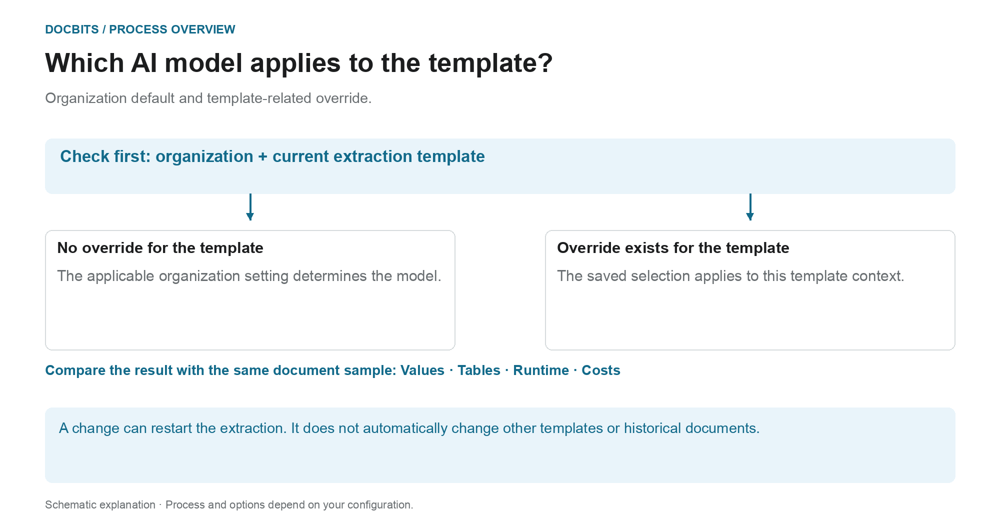

# Selecting a Supplier-Specific AI Model for Field and Table Extraction

## From organizational standard to effective model

<figure><figcaption>
Organization default and template-related override. The diagram is schematic; the active settings of your organization determine the actual behavior.
</figcaption></figure>

The entry in the validation screen is called the supplier-specific AI model. However, the **current extraction template context** is crucial: the override is saved per organization and template. A supplier can have multiple templates with different settings.

1. **Determine context:** Review the organization, document, and current extraction template before modifying a model.
2. **Check override:** If a model is stored for this template, this selection takes effect within its scope. If an override is missing, the applicable organization setting applies.
3. **Confirm the change deliberately:** Select only an option available in your environment. A change may require confirmation and trigger extraction again. Opening the menu alone does not change the selection.
4. **Compare results:** Check the field values, tables, runtime and costs with a fixed sample. A different model level does not guarantee better extraction, successful validation or PO matching.

**Example:** Supplier A uses the templates “Domestic invoice” and “Foreign invoice”. An override for “Domestic invoice” does not change all invoices from that supplier. For another document, check its template and effective setting again.

The graphic shows the selection hierarchy, not a recommendation for a specific model level. Information about the [Organizational standard and overrides](../../../administration-and-setup/settings/document-processing/classification-and-extraction/ai-model.md) and the [Which extraction path was used?](../../../overview-and-basics/faq/document-processing/which-extraction-path-was-used.md) diagnosis help to classify the actual result.

In the tools section of the **Validation screen**, you can choose the AI model used for **Field Extraction** and **Table Extraction**.\
This entry point changes the override for the current extraction-template context. The preference is stored by organization and template (`tfidf_id`); the supplier association does not guarantee that every template or historical document for that supplier changes. With no override, the applicable organization setting is used.

To change the model, open the options menu by clicking the **More options** (three dots) button on the right side of the screen, then choose one of the available models: 

The menu currently provides **Full**, **Fast**, **Nexus**, **Nexus Flash**, **Auto** and **Auto Nexus**. Check the current UI information and subscription terms for availability and charges. Do not assume that one option is always the most accurate or fastest, or that every organization defaults to Fast.

Selecting a different model can require confirmation and restart extraction. Check the document and scope before confirming. Opening the menu alone does not change the setting; no model was selected or confirmed for these illustrations.

<figure><figcaption>
Options menu for the illustrated extraction-template context, using a synthetic example invoice.
</figcaption></figure>

<figure><figcaption>
The AI Model dropdown with six options and a synthetic example invoice; no model change is shown.
</figcaption></figure>

If extraction results are unsatisfactory, compare other available models using approved test documents and check the extracted values, processing time and charges. A switch may reprocess a document and does not guarantee improvement.

To configure the **organization default** or review **template-specific overrides**, please refer to the corresponding documentation [**here**](../../../administration-and-setup/settings/document-processing/classification-and-extraction/ai-model.md).
