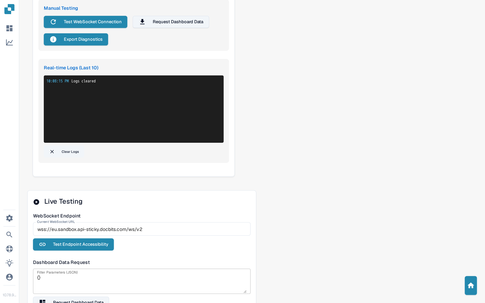

# WebSocket Debug Console

The WebSocket Debug Console is an administrator-only diagnostics page for DocBits' real-time connection. If live updates on the dashboard stop arriving — new documents not appearing, counters not refreshing, or the dashboard showing stale data — this console shows whether the underlying WebSocket connection is healthy and lets you test it manually.

It is a technical tool. You normally never need it; use it when support asks you to check the real-time connection, or to collect diagnostics before creating a support ticket.

## How to access

The console is available only to administrators. Open DocBits as an administrator and go to `/debug-websocket` — for example `https://sandbox.docbits.com/debug-websocket`. You can also find it by searching for **WebSocket Debug Console** in the quick search.

For general connection problems that are not related to real-time updates, the [Debug Collector](technical-support-in-docbits/debug-collector.md) captures a full session snapshot (network calls, errors, environment) that you can send to support in one step.

## What the console shows

<figure><figcaption>
The WebSocket Debug Console: connection diagnostics on the left, manual tests on the right.
</figcaption></figure>

### WebSocket Diagnostics

The left card, **WebSocket Diagnostics**, reports the current state of the real-time connection:

* **Connection Status** — shows whether the connection is **Connected**, still **Connecting...**, or in an **Error** state, together with the WebSocket address in use.
* **Authentication** — shows whether the connection is authenticated with your session, plus the token length. If it says *Not authenticated* while the status shows *Connected*, the socket is open but DocBits is not accepting your session on it — this is the typical signature of the "dashboard not updating" problem.
* **Dashboard Data Flow** — shows where the dashboard currently gets its data from (**WebSocket** or **HTTPS API**), when the last live update arrived, how many documents the dashboard holds, and the state of the dashboard data flag. When this section shows *HTTPS API*, the dashboard is falling back to regular requests instead of live updates.
* **Manual Testing** — buttons to re-test the connection, request dashboard data, and export the diagnostics (see below).
* **Real-time Logs (Last 10)** — the last ten WebSocket-related log messages, newest first. Each entry is color-coded: blue for information, green for success, orange for warnings, red for errors. Use **Clear Logs** to empty the list before reproducing a problem, so only the new entries remain.

### Live Testing

The right card, **Live Testing**, lets you actively exercise the connection:

* **WebSocket Endpoint** — shows the WebSocket URL the app is using. **Test Endpoint Accessibility** sends a regular web request to the server behind that URL and shows the answer in **Last Response**, so you can tell whether the server itself is reachable.
* **Dashboard Data Request** — sends a dashboard data request over the WebSocket connection. You can pass filter parameters as JSON (for example `{}` for no filter). The response in **Last Response** includes the number of documents returned — if this stays at zero while documents exist, real-time data delivery is broken.
* **Channel Subscription** — subscribes to or unsubscribes from a live channel (default: `dashboard`) with the **Subscribe** and **Unsubscribe** buttons. The dashboard listens on this channel; if subscribing fails, live updates cannot reach the dashboard.
* **Last Response** — shows the raw result of the most recent test as JSON, including timestamps and error messages. Copy this into your support ticket when asked.

## Diagnostics buttons

| Button | What it does |
| --- | --- |
| **Test WebSocket Connection** | Re-establishes the WebSocket connection and logs whether the attempt succeeds. |
| **Request Dashboard Data** | Asks the server for the dashboard data over the live connection and logs the answer. |
| **Export Diagnostics** | Downloads a JSON file with the connection status, recent logs, and data-flow state — attach this file to your support ticket. |
| **Clear Logs** | Empties the log list so a fresh reproduction starts clean. |

## Typical checks before contacting support

1. Open the console and look at **Connection Status**: is the connection *Connected*?
2. Check **Authentication**: does it say *Authenticated*?
3. Click **Test WebSocket Connection** and then **Request Dashboard Data**, and watch **Real-time Logs** for error entries.
4. Click **Export Diagnostics** and attach the downloaded file when you [create a support ticket](technical-support-in-docbits/create-a-ticket.md).

## Related pages

* [Debug Collector](technical-support-in-docbits/debug-collector.md) — capture a full session snapshot and open a support ticket from the same dialog.
* [Dashboard](dashboard/README.md) — the page whose live updates this console diagnoses.
* [Create a ticket](technical-support-in-docbits/create-a-ticket.md) — where to send the exported diagnostics.
