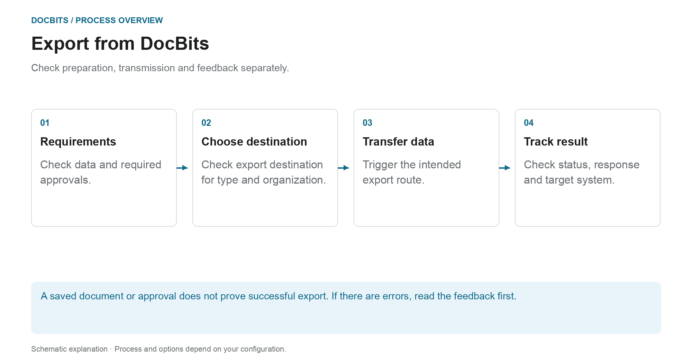

# Exporting in DocBits

## From the checked document to the target system

<figure><figcaption>
Check preparation, transmission and feedback separately. The diagram is schematic; the active settings of your organization determine the actual behavior.
</figcaption></figure>

When exporting, DocBits transfers documents and data to an established connection. Whether an export is offered or triggered automatically depends on the document type, status, workflow and export configuration.

1. **Check prerequisites:** Review the document data, open tasks and approvals required by your process. Successful PO matching does not replace these steps.
2. **Clarify export destination:** Check which configuration applies to the document type and organization or sub-organization. The export management supports Infor, Infor & IDM, Webhook and SFTP, among others. The actual scope of delivery depends on the connection set up.
3. **Trigger Transfer:** Use the intended document action or configured workflow. An alternative export is set up separately; its availability status is not the status to be set after export.
4. **Check feedback:** Check document status and available recipient responses. For an end-to-end check, you also check the associated process in the target system. For Infor, further processing steps can follow in ION and ERP.

### If export fails

Open the error details before exporting again. Repeated sending will not resolve an incorrect mapping or a rejection by the recipient. Use the response to check document values, mapping and target configuration, and check whether a transaction has already been created in the target system.

### Further instructions

- [Export module](export-module.md): Getting started with administration.
- [Export configuration](../../administration-and-setup/settings/document-processing/export/README.md): Connections and scopes.
- [Alternative export](alternate-export.md): separate export path per document type and status.
- [Export to Infor](../exporting-to-infor/README.md): downstream Infor processing.

A guide to exporting documents in DocBits.

