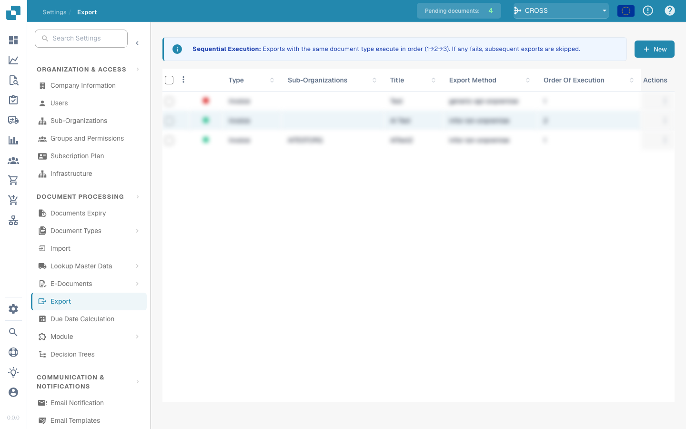
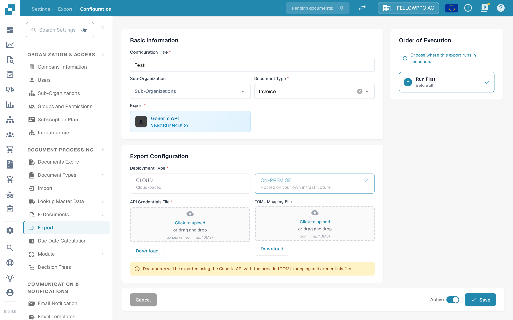

# Export Module

## Overview

The Export page displays all configured export setups, including whether they are active or inactive. From here, users can:

* View and manage existing export configurations
* Create new export connections (e.g., to **Infor**, **Infor & IDM**, **Webhook**, or **SFTP**)
* Edit or delete existing export configurations

## Where to Find It

You can find it under: **Settings** → **Document Processing** → **Export**

<figure><figcaption></figcaption></figure>

## Activate or deactivate

Each export configuration is either active (green dot) or inactive (red dot) in the list. You can change this from the options button of a configuration in the list, or on its edit screen.

### Activate on the edit screen

An existing configuration also has an **Active** switch in the footer of its edit screen, next to **Save**.

1. Open the configuration with **Edit**.
2. Set the **Active** switch to the state you want and select **Save**.

DocBits then activates or deactivates the configuration with the same check as the activate/deactivate action in the list: if another configuration for the same document type is already active, activating is rejected. Saving the form no longer changes the stored active state on its own, and the footer switch and a watcher's **Enabled** control always show the same state.

<figure><figcaption>
The Active switch next to Save on the export configuration edit screen.
</figcaption></figure>

For detailed instructions on how to configure each export type, including screenshots and field descriptions, visit the full guide:

[View Export Configuration Guide](../../administration-and-setup/settings/document-processing/export/)
