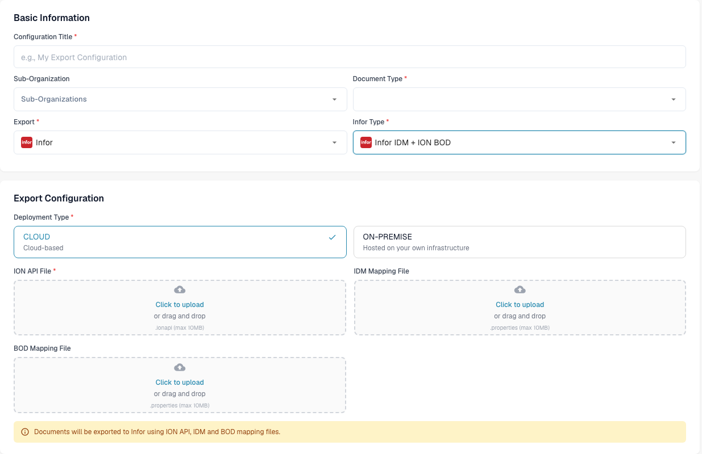

# Creating an ION API File

An `.ionapi` file holds authentication details for an Infor authorized application, including its client ID and secret. It is a **credential file**, separate from the `.properties` files used to map exported data. See [Infor's credential reference](https://docs.infor.com/inforos/2025.x/en-us/useradminlib_cloud/apigatewayag_cloud/wxo1761727799964.html). Keep the file secure and keep credential values out of screenshots, tickets and repositories.

## Obtaining existing/Creating new ION API File

Confirm the target Infor tenant, authorized app and authentication flow with your integration administrator.

1. In Infor OS, open **API Gateway → Authorized Apps**.
2. Open the app approved for your DocBits integration. If a new app is needed, have the Infor administrator choose its type and grant for that integration.
3. Select **Download Credentials** and save the `.ionapi` file securely. Infor describes this in [Downloading the backend service authorized app credentials](https://docs.infor.com/inforos/latest/en-us/useradminlib_cloud/apigatewayag_cloud/xih1761727483761.html).

**Issue Refresh Tokens** is not a universal setup requirement. Use the setting required by the approved app and flow. The [Infor API Gateway Administration Guide](https://docs.infor.com/inforos/2025.x/en-us/useradminlib_cloud/apigatewayag_cloud/ionapi_2025.x_apigatewayag_cloud_en-us.pdf#page=54) explains the app-specific options. Do not infer that an Infor grant is compatible with every DocBits export configuration.

## Uploading the file to DocBits

Open **Settings → Export** in the intended DocBits organization, then choose **New**. See [Export settings](../../administration-and-setup/settings/document-processing/export/README.md) for the wider configuration workflow.

<figure><figcaption>
The Export list header and New action. Configurations may already exist in your organization; this view shows the headings.
</figcaption></figure>

Enter a **Configuration Title**, select the relevant **Sub-Organization** when needed, and choose the **Document Type**. Select **Infor** in **Export**, then choose the **Infor Type** required by your integration.

The example below uses **Infor IDM + ION BOD**. Its **Deployment Type** offers **CLOUD** and **ON-PREMISE**. Use the deployment that matches the approved target, then provide the corresponding files:

- **ION API File**: the `.ionapi` credential file downloaded from Infor.
- **IDM Mapping File**: the approved `.properties` mapping for IDM.
- **BOD Mapping File**: the approved `.properties` mapping for BOD.

<figure><figcaption>
Unsaved Infor IDM + ION BOD example with three empty uploads. The .ionapi credential belongs in ION API File; the .properties mappings have separate IDM and BOD fields.
</figcaption></figure>

Other Infor types show different fields. Review the organization, document type, deployment and files before choosing **Save**. Saving a configuration alone does not verify connectivity or a successful export; use the agreed non-production acceptance process for the configured integration.
