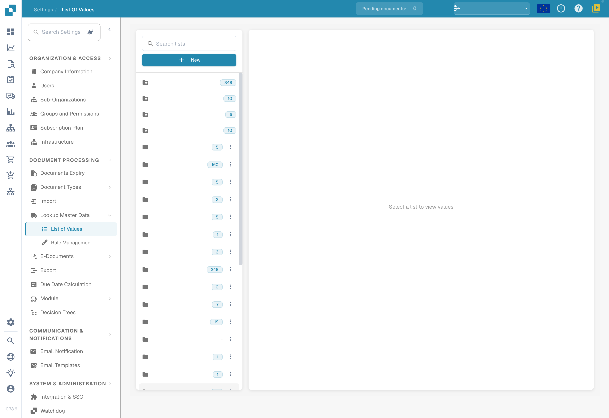
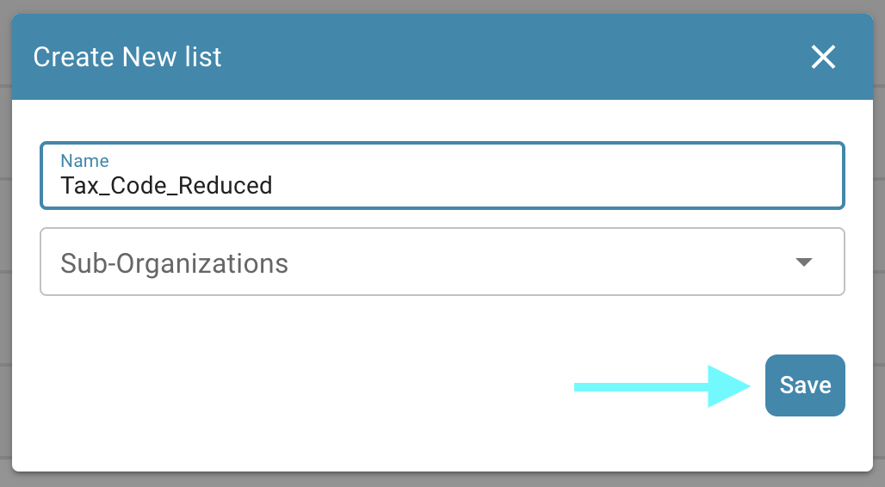
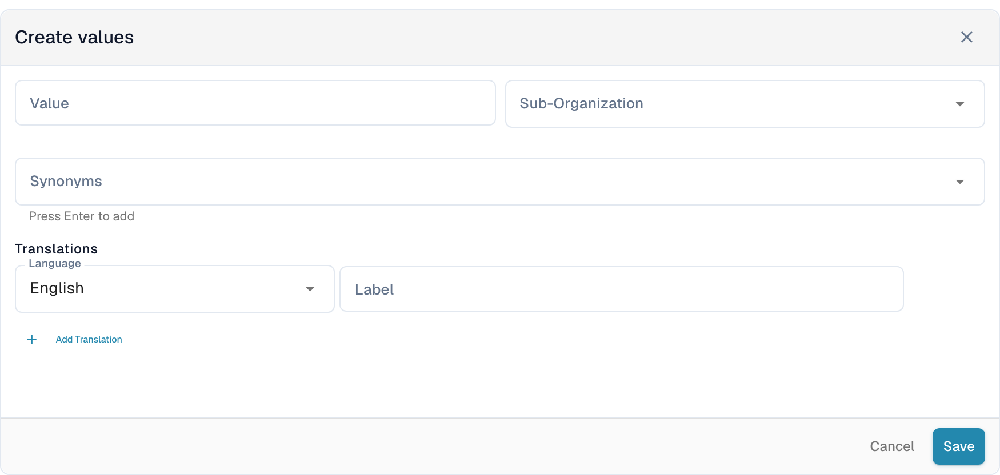
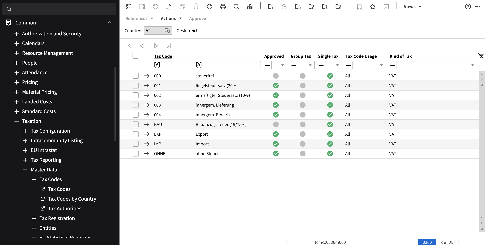
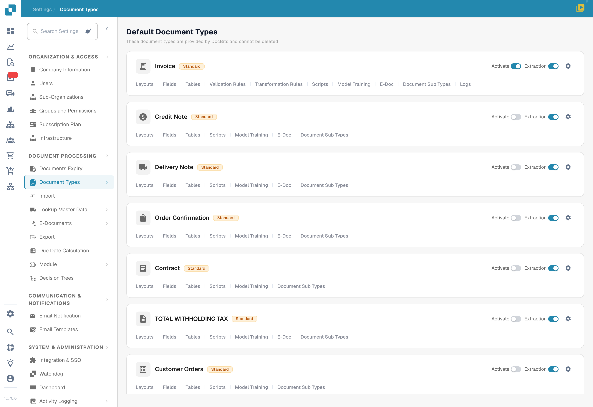
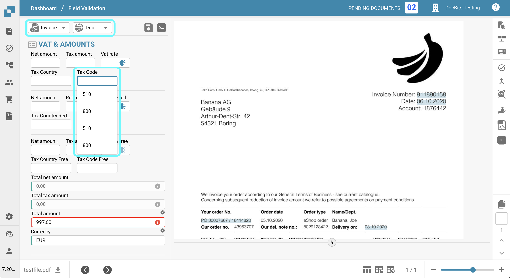
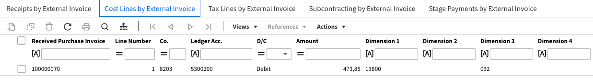

# Export Tax Codes to LN

## **Overview:**

\
This guide will walk you through the setup process to ensure tax codes are correctly exported from DocBits to LN.

## **Single Tax Codes**

### **Step 1: Set Up List of Values**

1.  Go to **Settings** -> **Document Processing** -> **List of Values**.

    <figure><figcaption>
Value lists in DocBits; organization-specific list names are hidden.
</figcaption></figure>
2.  Click **New**.

    <figure><figcaption></figcaption></figure>
3.  Create a list with the name `Tax_Country` and click **Save**.

    <figure><figcaption></figcaption></figure>
4.  Create the following three additional lists:

    * `Tax_Code_Full`
    * `Tax_Code_Reduced`
    * `Tax_Code_Free`

    
<figure><figcaption></figcaption></figure> <figure><figcaption></figcaption></figure> <figure><figcaption></figcaption></figure>

5.  Click on one of the newly created lists to open it. Then, press the **Add Row** button to add a new row.

    <figure><figcaption></figcaption></figure>
6.  Enter the desired respective values from **LN** and press **Save** to save the changes.

    * If you have multiple values, you can click **Add More Values** to add them.

    
<figure><figcaption></figcaption></figure> <figure><figcaption>
New-value form: suborganization, synonyms and translations. No value was entered or saved; the language choice concerns the value translation.
</figcaption></figure>

    * **NOTE:** You can find the Tax Codes in LN under: **Common** → **Taxation** → **Master Data** → **Tax Codes** → **Tax Codes by Country**

    <figure><figcaption></figcaption></figure>

### **Step 2: Add Fields in DocBits**

1.  Navigate to **Settings** -> **Global Settings** -> **Document Types**.

    <figure><figcaption>
Document types: select the fields for the relevant type. No switches were changed.
</figcaption></figure>
2.  Choose the **Fields** menu corresponding to the Document Type where you wish to add the fields.

    <figure><figcaption></figcaption></figure>
3.  Under **VAT & Amounts**, create six new fields as follows:

    <figure><figcaption></figcaption></figure>

<table data-header-hidden><thead><tr><th width="306"></th><th width="139"></th><th width="119"></th><th></th></tr></thead><tbody><tr><td><strong>Name</strong></td><td><strong>Title</strong></td><td><strong>Field Type</strong></td><td><strong>List of Values</strong></td></tr><tr><td><code>tax_country</code></td><td>Tax Country</td><td>Dropdown</td><td>Tax_Country</td></tr><tr><td><code>tax_country_2</code></td><td>Tax Country Reduced</td><td>Dropdown</td><td>Tax_Country</td></tr><tr><td><code>tax_country_3</code></td><td>Tax Country Free</td><td>Dropdown</td><td>Tax_Country</td></tr><tr><td><code>tax_code_without_country</code></td><td>Tax Code</td><td>Dropdown</td><td>Tax_Code_Full</td></tr><tr><td><code>tax_code_without_country_2</code></td><td>Tax Code Reduced</td><td>Dropdown</td><td>Tax_Code_Reduced</td></tr><tr><td><code>tax_code_without_country_3</code></td><td>Tax Code Free</td><td>Dropdown</td><td>Tax_Code_Free</td></tr></tbody></table>

<figure><figcaption></figcaption></figure> <figure><figcaption></figcaption></figure> <figure><figcaption></figcaption></figure>

<figure><figcaption></figcaption></figure> <figure><figcaption></figcaption></figure> <figure><figcaption></figcaption></figure>

4.  After saving each field, click on **Save Settings** to apply the changes.

    <figure><figcaption></figcaption></figure>

### **Step 3: Edit Layout**

1.  Go to **Settings** -> **Global Settings** -> **Document Types**.

    <figure><figcaption>
Document types: select the fields for the relevant type. No switches were changed.
</figcaption></figure>
2.  Open the **Edit Layout** menu for the Document Type you want to edit.

    <figure><figcaption></figcaption></figure>
3.  Select the appropriate **Document Origin** for which you want to apply the Tax Codes

    <figure><figcaption></figcaption></figure>
4.  Scroll down to the **Tax Details** section.

    <figure><figcaption></figcaption></figure>
5. Expand the **Form Elements** dropdown menu.
6.  In the **Tax Details** section, use the **Horizontal Separator Tool**. Drag and drop it between the sub-sections within the tax section to clearly separate them and reduce confusion.

    <figure><figcaption></figcaption></figure>
7. Expand the **Form Fields** dropdown menu.
8.  Search for **Tax Country** and drag and drop the field into its respective area.

    <figure><figcaption></figcaption></figure>
9.  Search for **Tax Code** and drag and drop the field into its corresponding area.

    <figure><figcaption></figcaption></figure>
10. Save the template.

    <figure><figcaption></figcaption></figure>

### Step 4: Verify that Everything Worked

After uploading a new document into DocBits with the correct document settings selected, you should now be able to select the tax codes you added to the lists in Step 1.

<figure><figcaption></figcaption></figure>

## Multi Tax Code

### **Step 1: Set Up List of Values**

1.  Go to **Settings** -> **Document Processing** -> **List of Values**.

    <figure><figcaption>
Value lists in DocBits; organization-specific list names are hidden.
</figcaption></figure>
2.  Click **New**.

    <figure><figcaption></figcaption></figure>
3.  Create a list with the name `Tax_Country` and click **Save**.

    <figure><figcaption></figcaption></figure>
4.  Create the following three additional lists:

    * `Tax_Code_Full`
    * `Tax_Code_Reduced`
    * `Tax_Code_Free`

    
<figure><figcaption></figcaption></figure> <figure><figcaption></figcaption></figure> <figure><figcaption></figcaption></figure>

5.  Click on one of the newly created lists to open it. Then, press the **Add Row** button to add a new row.

    <figure><figcaption></figcaption></figure>
6.  Enter the desired respective values from **LN** and press **Save** to save the changes.

    * If you have multiple values, you can click **Add More Values** to add them.

    
<figure><figcaption></figcaption></figure> <figure><figcaption>
New-value form: suborganization, synonyms and translations. No value was entered or saved; the language choice concerns the value translation.
</figcaption></figure>

    * **NOTE:** You can find the Tax Codes in LN under: **Common** → **Taxation** → **Master Data** → **Tax Codes** → **Tax Codes by Country**

    <figure><figcaption></figcaption></figure>

### **Step 2: Add Fields in DocBits**

1.  Navigate to **Settings** -> **Global Settings** -> **Document Types**.

    <figure><figcaption>
Document types: select the fields for the relevant type. No switches were changed.
</figcaption></figure>
2.  Choose the **Fields** menu corresponding to the Document Type where you wish to add the fields.

    <figure><figcaption></figcaption></figure>
3.  Under **VAT & Amounts**, create six new fields as follows:

    <figure><figcaption></figcaption></figure>

<table data-header-hidden><thead><tr><th width="306"></th><th width="139"></th><th width="119"></th><th></th></tr></thead><tbody><tr><td><strong>Name</strong></td><td><strong>Title</strong></td><td><strong>Field Type</strong></td><td><strong>Value</strong></td></tr><tr><td><code>tax_country</code></td><td>Tax Country</td><td>Dropdown</td><td>Tax_Country</td></tr><tr><td><code>tax_country_2</code></td><td>Tax Country Reduced</td><td>Dropdown</td><td>Tax_Country</td></tr><tr><td><code>tax_country_3</code></td><td>Tax Country Free</td><td>Dropdown</td><td>Tax_Country</td></tr><tr><td><code>tax_code_without_country</code></td><td>Tax Code</td><td>Dropdown</td><td>Tax_Code_Full</td></tr><tr><td><code>tax_code_without_country_2</code></td><td>Tax Code Reduced</td><td>Dropdown</td><td>Tax_Code_Reduced</td></tr><tr><td><code>tax_code_without_country_3</code></td><td>Tax Code Free</td><td>Dropdown</td><td>Tax_Code_Free</td></tr></tbody></table>

<figure><figcaption></figcaption></figure> <figure><figcaption></figcaption></figure> <figure><figcaption></figcaption></figure>

<figure><figcaption></figcaption></figure> <figure><figcaption></figcaption></figure> <figure><figcaption></figcaption></figure>

4.  After saving each field, click on **Save Settings** to apply the changes.

    <figure><figcaption></figcaption></figure>

### **Step 3: Edit Layout**

1.  Go to **Settings** -> **Global Settings** -> **Document Types**.

    <figure><figcaption>
Document types: select the fields for the relevant type. No switches were changed.
</figcaption></figure>
2.  Open the **Edit Layout** menu for the Document Type you want to edit.

    <figure><figcaption></figcaption></figure>
3.  Select the appropriate **Document Origin** for which you want to apply the Tax Codes

    <figure><figcaption></figcaption></figure>
4.  Scroll down to the **Tax Details** section.

    <figure><figcaption></figcaption></figure>
5. Expand the **Form Elements** dropdown menu.
6.  In the Tax Details section use the **Sub Group** Tool. Drag and Drop it next to an existing field

    <figure><figcaption></figcaption></figure>
7.  To name your subgroup, click on the subgroup and enter your desired name in the **Label** field.

    
<figure><figcaption></figcaption></figure> <figure><figcaption></figcaption></figure>

8.  Drag and drop the fields that correspond to this group into the **Sub Group** field.

    <figure><figcaption></figcaption></figure>
9. Expand the **Fields** dropdown menu.
10. Search for **Tax** and drag and drop the respective fields, such as **Tax Country** and **Tax Code**, into the corresponding subgroup.

    <figure><figcaption></figcaption></figure>
11. Repeat steps 5 through 10 2 times to reach the following state:

    <figure><figcaption></figcaption></figure>
12. Save the template.

    <figure><figcaption></figcaption></figure>

### Step 4: Verify that Everything Worked and resulting changes

After uploading a new document into DocBits with the correct document settings selected, you will be able to select the tax codes you added in Step 1 and add multiple tax codes configured in Step 3.

* The document will begin with three distinct sections: one for Tax Full amounts, one for Tax Reduced amounts, and one for Tax Free amounts.
* Clicking the plus button within a section will create a duplicate, allowing multiple submissions at the selected tax rate.

<figure><figcaption></figcaption></figure>

* Sections can be deleted by clicking the remove button.

<figure><figcaption></figcaption></figure>

* Total Amounts will be calculated as a sum of all sections
* Validation of Total Amount will be modified based on all tax-sections
* Scripts for new sections can only be applied once fields have been added to the view.

### Note for LN:

In **LN** USt Position will be filled out based on the position number from the Tax Code/Tax Country dropdown menu. Only the Position number will be sent to export.

<figure><figcaption></figcaption></figure>

<figure><figcaption></figcaption></figure>

#### **Export Mapping**

To link the Tax Line with the Cost Line:

1. Add `TaxLine` to the **InvoiceCostFields** list.
2. Add the following entry, following the example below:\
   `ICF_TaxLine = TF_position`

<figure><figcaption></figcaption></figure>
