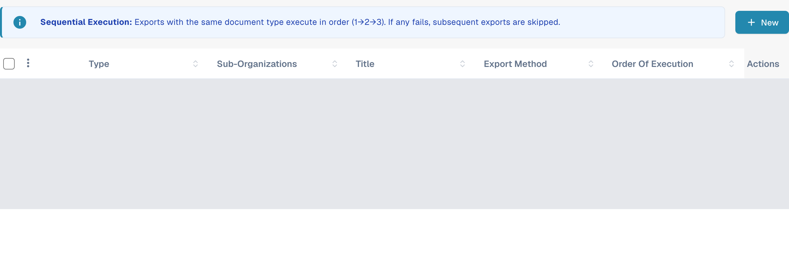
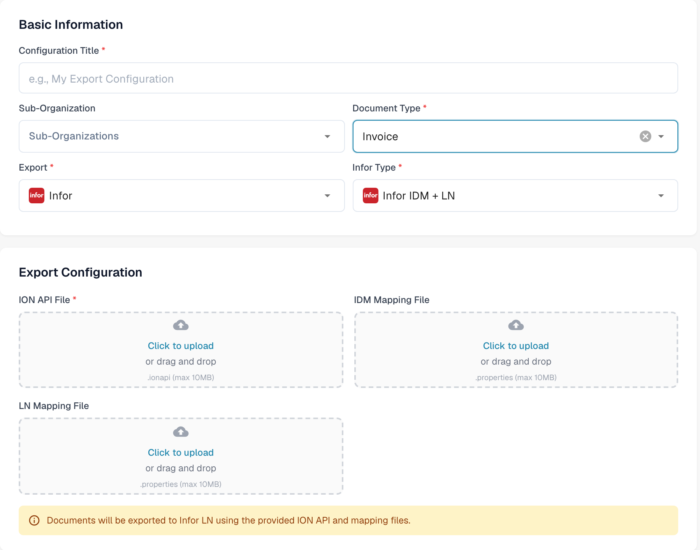

# LN Configuration

This guide combines historical Infor ION examples with the current DocBits LN export form. The Infor images illustrate the individual steps; their tenant names, mapping names and layout are examples. Check the connection points, mapping package and BOD permissions with your Infor administrator for your LN company before activating a flow. No Infor tenant connection or invoice export was tested for this documentation update.

## Prerequisites

You have created:

* An ION API Endpoint
* An ION API File
* A BOD Mapping File
* An IDM Mapping File

## Import Mapping Files

Before you set up the data flow, you need to import the mapping files into InforOS

In ION Desk → Connect and open Mappings

<figure><figcaption>
Historical example: iON Desk navigation with the Connect group expanded and the entries Data Flows, API Flows, Connection Points, File Templates and Enterprise Locations. Confirm the corresponding settings in your Infor tenant.
</figcaption></figure>

Click on the Import icon

<figure><figcaption>
Historical example: mappings toolbar in historical ION Desk with the import control circled. Confirm the corresponding settings in your Infor tenant.
</figcaption></figure>

* From here you need to select the various mapping files you will need which include: SyncCaptDoc\_SyncSuppInv, SyncSupplierInvoice\_LoadSupplierInvoice, and LoadSupplierInvoice\_ProcessSupplierInvoice.
* Once you have imported all the mappings files, make sure to approve each of them by clicking the tick icon within each of their squares on the Mapping dashboard.

## DocBits to LN

The next step is to setup the Data Flow in ION Desk, navigate to the ION Desk application and select Data Flow → + ADD → Document Flow like below

<figure><figcaption>
Historical example: data Flows page in ION Desk with the navigation on the left, the flow DF_SLTStAPI in the list and the menu entries Document Flow and Data Lake Flow. Confirm the corresponding settings in your Infor tenant.
</figcaption></figure>

Use this canvas to build the flow of information from DocBits to LN.

<figure><figcaption>
Historical example: new Document Flow with the empty properties panel and the messages Document flow name must be specified and The document flow has no activities. Confirm the corresponding settings in your Infor tenant.
</figcaption></figure>

An LN data flow will look similar to what is shown below (there are multiple paths due to each individual path being meant for a specific document type, for this explanation we will focus on the invoice data flow).

<figure><figcaption>
Historical example: data Flow canvas with several paths for different document types, each path built from a DocBits connection point, a mapping and an LN connection point. Confirm the corresponding settings in your Infor tenant.
</figcaption></figure>

All parts of the chain are dragged and dropped from the top section

In the chain, DocBits and LN are both Applications whereas in between them there are mappings that convert the data into a form that can be understood by the next section of the dataflow and “map” the information so that it goes to where it is needed or meant too.

<figure><figcaption>
Historical ION activity palette and flow: Application activities represent DocBits and LN, with Mapping activities between them. Confirm the corresponding settings in your Infor tenant.
</figcaption></figure>

### DocBits Application

Give it the appropriate name such as “DocBits” then select the plus sign and search for the connection point you created earlier such as DocBits\_Export or similar and click on it.

To create this connection point, go to ION Desk → Connect → Connection Points

<figure><figcaption>
Historical example: iON Desk navigation with the Connect group expanded and the entries Data Flows, API Flows, Mappings and Connection Points. Confirm the corresponding settings in your Infor tenant.
</figcaption></figure>

Click “+ Add”

<figure><figcaption>
Historical example: connection Points page in ION Desk with the Connect group open in the navigation. Confirm the corresponding settings in your Infor tenant.
</figcaption></figure>

Select “IMS via API Gateway” and fill in the following information

<figure><figcaption>
Historical IMS via API Gateway connection point with an example logical ID and a redacted ION API Client Id field. Confirm the corresponding settings in your Infor tenant.
</figcaption></figure>

The ION API client ID is the `ci` value in your `.ionapi` file. Obtain the tenant-specific file from your authorised Infor administrator. It contains credentials; keep it out of screenshots, tickets and Git. See the [Infor explanation of ION API credential fields](https://docs.infor.com/crm/9.4.x/en-us/webclient/upi1639111995644.html).

Switch to the document tab, and add the Sync.CaptureDocument BOD to the DocBits connection point like below.

<figure><figcaption>
Historical example: connection point DocBits-Sandbox-Export with the Documents tab open and the document Sync.CaptureDocument assigned. Confirm the corresponding settings in your Infor tenant.
</figcaption></figure>

Then save the connection point by pressing the disk icon in the upper-left corner.

Navigate back to the Dataflow section of ION Desk to access your dataflow. Your DocBits application should look similar to what is shown below.

<figure><figcaption>
Historical Application Activity Properties with the application name DocBits-Sandbox and its selected connection point DocBits-Sandbox-Export. Confirm the corresponding settings in your Infor tenant.
</figcaption></figure>

### Mapping 1

The first mapping node should look as follows

<figure><figcaption>
Historical first mapping properties: Capture2sync with the example mapping LN_CaptureDocumentToSupplierInvoice_1. Confirm the corresponding settings in your Infor tenant.
</figcaption></figure>

### Mapping 2

The second mapping node should look as follows

<figure><figcaption>
Historical second mapping properties: Load2Process with the example mapping LoadSupplierToProcessSupplierInvoice. Confirm the corresponding settings in your Infor tenant.
</figcaption></figure>

### LN Application

There should already be an LN or similarly named connection point (for the appropriate LN company) created in INFOR so, just like the DocBits Application you select it by clicking the “+” sign and it should look as follows

<figure><figcaption>
Historical LN Application Activity Properties with the example name LN-200 and the selected application connection In01_0200. Confirm the corresponding settings in your Infor tenant.
</figcaption></figure>

### BODs

<figure><figcaption>
Historical example: data Flow canvas with the nodes DocBits-DEV, MappingDeliver, Load Supplier, PurchaseOrder, SalesOrder and AdvancedShip above the entry End. Confirm the corresponding settings in your Infor tenant.
</figcaption></figure>

The following configurations should look as follows:

#### First

<figure><figcaption>
Historical Documents list for the first step showing Sync.CaptureDocument. Confirm the corresponding settings in your Infor tenant.
</figcaption></figure>

#### Second

<figure><figcaption>
Historical Documents list for the second step showing Load.SupplierInvoice. Confirm the corresponding settings in your Infor tenant.
</figcaption></figure>

#### Third

<figure><figcaption>
Historical Documents list for the third step showing Process.SupplierInvoice. Confirm the corresponding settings in your Infor tenant.
</figcaption></figure>

The last icon should be empty as it is not carrying any document or information.

After your Infor administrator has verified all nodes, mappings and document subscriptions, use the activation control for the intended flow. The historical screenshot below marks that control; its old flow name contains M3 and must not be used as the name or destination for your LN setup.

<figure><figcaption>
Historical Document Flow toolbar with the activation control circled. The legacy example is named DocBits-Export-M3; choose the correct LN flow in your tenant. Confirm the corresponding settings in your Infor tenant.
</figcaption></figure>

## Configure export in DocBits

Open **Settings → Export** in the intended DocBits organisation. The list shows existing export configurations; select **New** to prepare a new configuration.

<figure><figcaption>
New opens a configuration form. Existing rows are covered in this documentation image; no saved configuration was opened or changed.
</figcaption></figure>

Under **Basic Information**, enter a **Configuration Title**, select the **Document Type** (Invoice for the example), and select a **Sub-Organization** only if your setup requires one. Choose **Infor** for **Export**, then **Infor IDM + LN** for **Infor Type**.

Provide all three files required for a new LN configuration: the **ION API File** (`.ionapi`), **IDM Mapping File** (`.properties`) and **LN Mapping File** (`.properties`). Obtain the files for this tenant and LN company from the authorised Infor administrator. The screenshot deliberately leaves every upload empty and contains no credentials.

<figure><figcaption>
The current LN form separates the three upload fields. Basic Information identifies the destination type and document type; this example was canceled without files or a saved configuration. The existing execution-order panel is outside this detail view.
</figcaption></figure>

After your administrator has confirmed the ION flow and files, save the configuration and test one authorised non-production invoice. Check the result in DocBits, Infor ION and LN. A saved configuration alone does not prove that LN received an invoice. Cancel the form if you are only inspecting the available fields.

For the roles of connection points and document flows, see the [Infor ION explanation](https://docs.infor.com/ln/10.8/en-us/lnesolh/lnoshybridng/wxa1699288671147.html).
