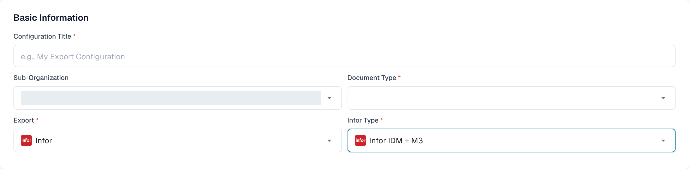
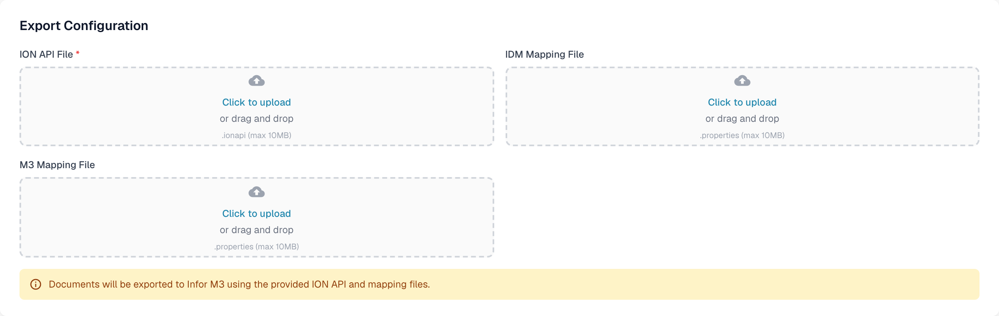

# Export to Infor M3

This page covers the Infor ION flow and the DocBits export configuration. The Infor screenshots below are historical examples; their menus and data-flow settings must be checked in your own tenant before activation. The DocBits section uses English Dev screenshots captured on 29 October 2026. No Infor connection or invoice export was tested for this update.

## Step 1: Create a connection point in Infor ION

1. Navigate to **OS > ION > Connect > Connection Points**
2. Click **Add** and select **IMS via API Gateway** as the connection type.
3. Configure the following settings:
   * **Name**: Set to `DocBits_Export`.
   * **Description**: Set to `DocBits_Export`.
   * **Uncheck**: _Application has IMS End Point_.
   * **ION API Client ID**:
     * Open the ION API file.
     * Search for `"ci"` within the file.
     * Copy the `ci` client ID value. Keep the full `.ionapi` file private because it also contains credentials. Infor explains the [file fields](https://docs.infor.com/crm/9.4.x/en-us/webclient/upi1639111995644.html).

<figure><figcaption>
Historical connection-point example. The Connection tab is selected; use the client ID from your own private ION API file.
</figcaption></figure>

4. Under **Documents**, add `Sync.CaptureDocument`.

<figure><figcaption>
Historical Documents tab: Sync.CaptureDocument is enabled for Send from Application.
</figcaption></figure>

5. Click **Save** to finalize the configuration.

## Step 2: Upload Mappings



1. Download the example M3 mapping XML above. Have your integration administrator review it for your tenant before importing it.
2. Navigate to **Infor** > **OS** > **ION** > **Connect** > **Mappings**.
3. Click **Import** and select the appropriate mapping file for **M3**.

<figure><figcaption>
Historical mapping import action. The cyan arrow marks the Import icon.
</figcaption></figure>

4. Review the imported mapping and its source and target BODs, then use **Approve** according to your tenant's change process.

<figure><figcaption>
Historical mapping example: confirm the source and target BODs before using Approve.
</figcaption></figure>

## Step 3: Create the Data Flow

1. Navigate to **OS** -> **ION** -> **Connect** -> **Data Flows**.
2. Click **Add** and select **Document Flow**.
3. Fill in the details:
   * **Name**: `DocBits_Export_to_M3`
4. Add nodes to the flow:

#### Application Node

1. Add an **Application Node** to the flow.
   * **Name**: `DocBits` or `DocBits-Export`.
2. Click **Add** and select the **Connection Point** created in Step 1.

<figure><figcaption>
Historical DocBits application node. Select the connection point created for your own tenant; the demo name is an example.
</figcaption></figure>

3. Click on the **Document Icon** next to the application node.
   * Click **Add** and select `Sync.CaptureDocument`.

<figure><figcaption>
Historical Documents panel for the DocBits node: Sync.CaptureDocument.
</figcaption></figure>

#### Mapping Node

1. Add a **Mapping Node** to the right of the application node.
   * **Name**: `Capt2process`.
   * **Mapping**: Select the imported mapping from `Sync.CaptureDocument` to `Process.SupplierInvoice`. Its displayed name may differ from the downloaded XML filename; the historical example below uses `SyncCaptDoc_SyncSuppInv`.

<figure><figcaption>
Historical mapping node. SyncCaptDoc_SyncSuppInv is the mapping name in this example; your imported mapping may have a different name.
</figcaption></figure>

#### Application Node

1. Add an **Application Node** to the right of the previous mapping node.
   * **Name**: `M3`.
2. Click **Add** and select the **M3 Application** from the customer.

<figure><figcaption>
Historical M3 application node. Select the M3 connection point supplied for your tenant.
</figcaption></figure>

3. Click on the **Document Icon** next to the application node.
   * Click **Add** and select `Acknowledge.SupplierInvoice`.

<figure><figcaption>
Historical Documents panel for the M3 node: Acknowledge.SupplierInvoice.
</figcaption></figure>

#### API Node

1. Add an **API Node** to the right of the application node.
   * **Name**: `DocBits-Error`.
   * **ION API Connector**: `DocBits_Import`.
   * If your import connector does not exist, review the [M3 import and API connection guide](../../importing-customer-master-data/m3/import-from-infor-m3-to-docbits-via-api.md) and have your Infor administrator verify it before activation.

<figure><figcaption>
Historical error-handling API node. The selected demo connector is an example; use your own import connector.
</figcaption></figure>

#### Save and Activate the Flow

* Once all nodes are added and configured, click **Save**.
* Activate the flow to complete the setup.

<figure><figcaption>
Historical activation toolbar. The cyan arrow marks the activation action; this crop does not show the complete flow.
</figcaption></figure>

## Step 4: Configure export in DocBits

In the correct DocBits organisation, open **Settings → Export** and choose **New**. This opens an unsaved export configuration.

<figure><figcaption>
Choose New on the Export page to open a configuration draft.
</figcaption></figure>

In **Basic Information**, enter a meaningful **Configuration Title**, choose the **Document Type** (for this invoice flow, Invoice), and select a **Sub-Organization** only if needed. Set **Export** to **Infor**. The **Infor Type** field then appears. The choices observed in Dev on 29 October 2026 include **Infor IDM + ION BOD**, **Infor IDM + M3**, and **Infor IDM + M3 (TOML)**. Choose the type that matches the connection and mapping files supplied by your integration administrator; the older label “Infor IDM + M3 (API)” is no longer shown in this screen.

For **Infor IDM + M3**, the form asks for an **ION API File** (`.ionapi`, required), **IDM Mapping File** (`.properties`) and **M3 Mapping File** (`.properties`). The TOML and ION BOD variants have different fields; do not substitute one file for another. Obtain tenant-specific files from the authorised Infor administrator. The `.ionapi` file contains credentials and must not appear in screenshots, tickets or the Git repository.

<figure><figcaption>
Unsaved Dev example with Infor IDM + M3 selected. The sub-organization value is masked; the document type is blank.
</figcaption></figure>

<figure><figcaption>
Infor IDM + M3 file fields in Dev. No files were uploaded and the configuration was not saved.
</figcaption></figure>

Review the document type, organisation and file names before **Save**. After the Infor flow is active, test with a single non-production invoice and confirm its status in DocBits, Infor ION and M3. Do not consider a saved configuration proof that an invoice reached M3.

### Infor review required

The eleven Infor screenshots in steps 1–3 are retained as annotated examples. They were not refreshed because no authorised Infor tenant was available. Ask the Infor administrator to compare connection points, document flow, mapping names and permissions against the tenant's current UI. Infor's [connection point and document-flow explanation](https://docs.infor.com/ln/10.8/en-us/lnesolh/lnoshybridng/wxa1699288671147.html) describes how these pieces relate.
