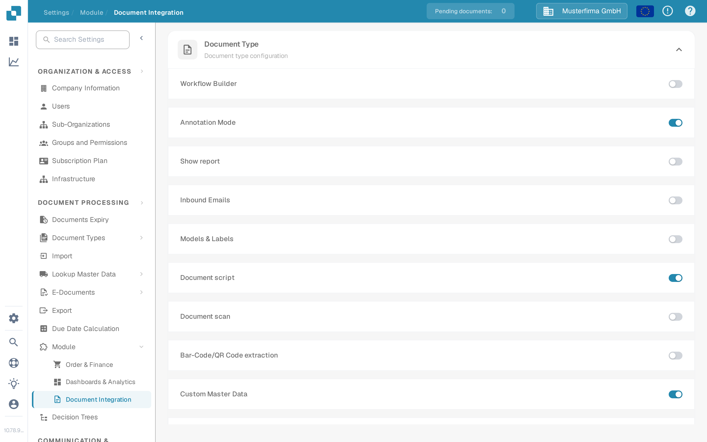
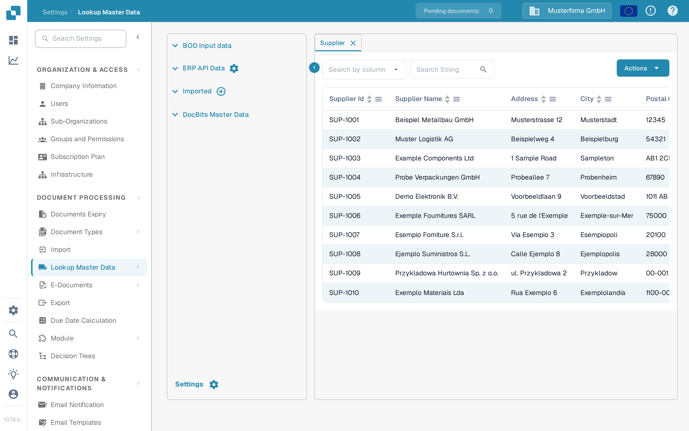
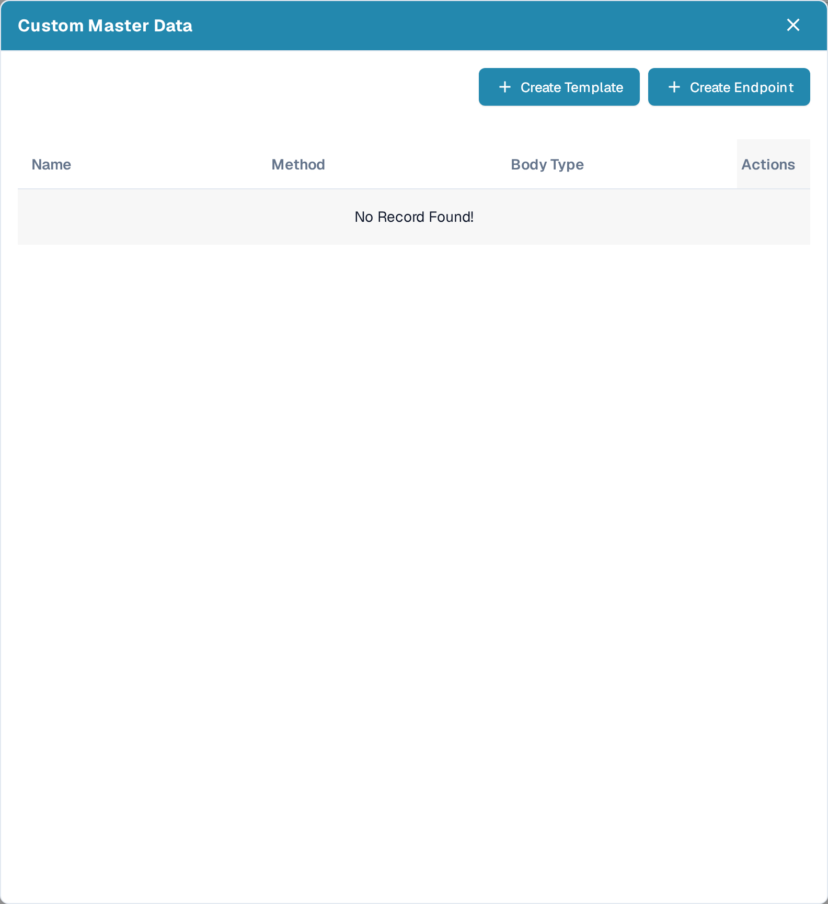
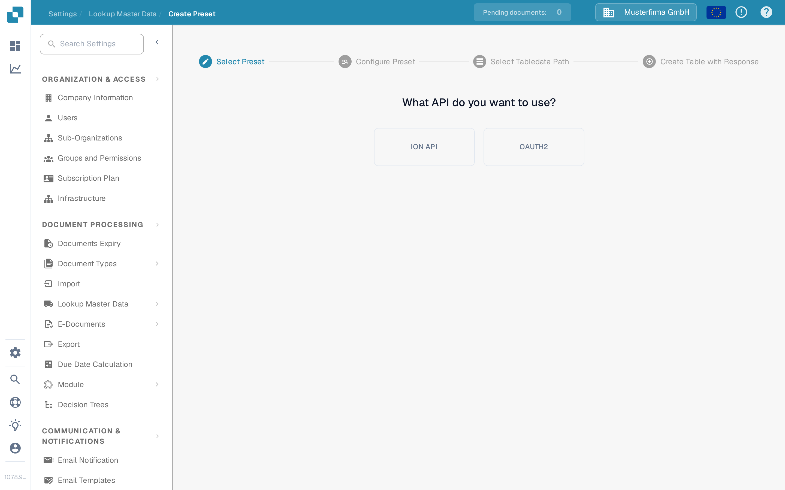
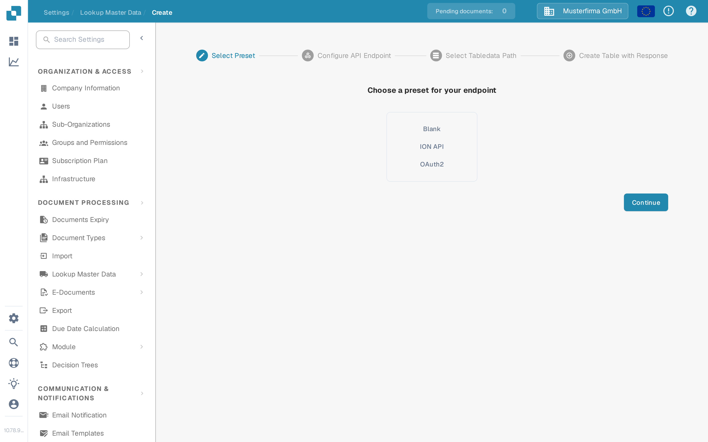
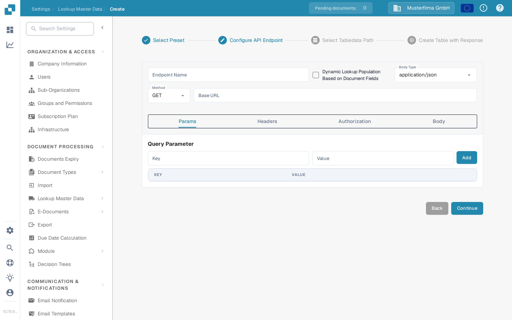

# Custom Master Data

Custom Master Data lets you connect DocBits to one of your own API endpoints and use the data it returns as master data — for example your own supplier or article table — alongside the data DocBits maintains for you.

## Activating Custom Master Data

Custom Master Data is a module. To switch it on, go to **Settings → DOCUMENT PROCESSING → Module → Document Integration** and activate the **Custom Master Data** toggle in the **Document type configuration** section.

<figure><figcaption>
The Custom Master Data toggle in the Document type configuration section of Document Integration
</figcaption></figure>

For more about modules, see [Module](../../administration-and-setup/settings/document-processing/module/README.md).

## Opening the Custom Master Data dialog

Once the module is active, go to **Settings → DOCUMENT PROCESSING → Lookup Master Data**. In the list of master data groups on the left, click the **settings** icon next to **ERP API Data** to open the **Custom Master Data** dialog.

<figure><figcaption>
Lookup Master Data — the settings icon next to ERP API Data opens the Custom Master Data dialog
</figcaption></figure>

The dialog lists your custom master data tables with their **Name**, **Method**, and **Body Type**, and offers two ways to add a new one:

- **Create Template** — define a reusable preset that you can pick when creating endpoints.
- **Create Endpoint** — connect a master data table that DocBits fills from your API.

<figure><figcaption>
The Custom Master Data dialog with Create Template and Create Endpoint
</figcaption></figure>

Existing entries can be opened, refreshed, or removed with the row actions in the **Actions** column. Refreshing runs the API call immediately instead of waiting for the next automatic lookup. Deleting removes the table from DocBits; the data source on your side is left unchanged.

## Creating a Template

Click **Create Template** to define a preset that you can reuse across several endpoints. Templates are managed on the **Create Preset** page (**Settings → Lookup Master Data → Create Preset**).

The first step is **Select Preset**: choose whether the preset should use your organization's **ION API** file or **OAUTH2**. With ION API you upload the organization's ION API JSON file in the next screen; with OAUTH2 you enter the credentials when configuring the preset.

<figure><figcaption>
Create Preset — Select Preset: ION API or OAUTH2
</figcaption></figure>

In the **Configure Preset** step, give the preset a name without spaces, choose the body type and the request method, and enter the base URL and the URL of the API call. The remaining tabs describe the call itself:

- **Params** — query parameters as key/value pairs.
- **Headers** — HTTP header fields as key/value pairs.
- **Authorization** — the authentication type and its JSON data; the upload field accepts an authentication JSON file.
- **Body** — the request body, sent for methods that use one.

Continue with **Select Tabledata Path** and **Create Table with Response** as described for an endpoint below, and finish with **Done**. The saved preset then appears in the **Select Preset** step of the endpoint wizard.

## Creating an Endpoint

Click **Create Endpoint** to connect a master data table. The wizard has four steps.

### Step 1 — Select Preset

Choose the starting point: **Blank** to configure everything yourself, **ION API** to prefill the authentication from your organization's ION API file, **OAUTH2** to prefill OAuth2 authentication, or one of your saved templates.

<figure><figcaption>
Create Endpoint — Select Preset: Blank, ION API, OAuth2, or a saved template
</figcaption></figure>

### Step 2 — Configure API Endpoint

Enter an **Endpoint Name** without spaces; this name becomes the name of your master data table.

Activate **Dynamic Lookup Population Based on Document Fields** if the lookup should depend on the document being processed. DocBits then fills placeholders in the API call — in the URL, the query parameters, or the headers — with values taken from the current document, so the call can return data that matches that document.

Select the **Body Type** and the **Method** of the call, and enter the **Base URL**. The tabs below describe the call:

- **Params** — query parameters as key/value pairs; with dynamic lookup population the values can come from document fields.
- **Headers** — HTTP header fields as key/value pairs, added with **Add New**.
- **Authorization** — the authentication type and its JSON data. The available types depend on the selected preset.
- **Body** — the request body for methods that send one. **Beautify** formats the JSON for easier reading.

<figure><figcaption>
Create Endpoint — Configure API Endpoint
</figcaption></figure>

Use **Continue** to move on; **Back** returns to the previous step without losing your entries.

### Step 3 — Select Tabledata Path

Enter the **JSON path**, in dot notation, of the field in the API response that holds the table data. The page shows the API response next to the extracted data so that you can check whether the path selects the right entries. For more about dot notation, see [Writing JSONPath expressions](https://docs.hevodata.com/sources/engg-analytics/streaming/rest-api/writing-jsonpath-expressions/).

### Step 4 — Create Table with Response

Map the response values to the columns you would like to create: enter a name for the column and the matching value from the response, then click **Add**. Use **Test Extraction** to verify that DocBits reads the values you expect before you save.

Lastly, click **Done** for your new master data table to be created and populated.
