# How to import all suppliers

The Infor M3 screenshots below are retained as historical examples. Screens, permissions and menu labels can differ in your environment. Before creating or running an initial-load job, confirm the company, division and supplier selection for the intended transfer.

* [ ] Log yourself into the Infor OS environment and go to the M3 application. Recommendation: Make sure you have admin rights in order to be able to run all the programs.

<figure>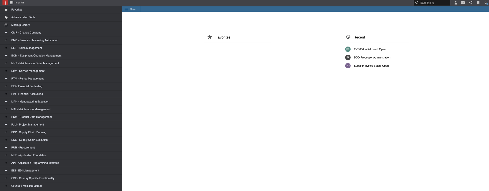<figcaption>
Historical Infor M3 start screen with EVS006 Initial Load, BOD Processor Administration in the Recent list.
</figcaption></figure>

* [ ] Run the program _**evs006**_. Press command + R and you will see the open tab to search and start.

<figure>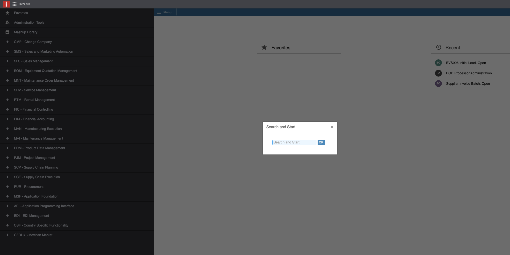<figcaption>
Historical Infor M3 Search and Start dialog with its input field and OK button.
</figcaption></figure>

* [ ] When _**evs006**_ is open you will see an empty table. Please fill the columns of “BOD noun” and “Table”. For “BOD noun” introduce “SupplierPartyMaster” and for “Table” we are going to use the M3 supplier table called “CIDMAS”.

<figure>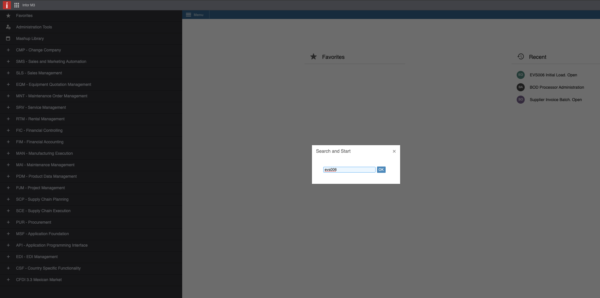<figcaption>
Historical Search and Start example with EVS006 entered in the input field.
</figcaption></figure>

<figure>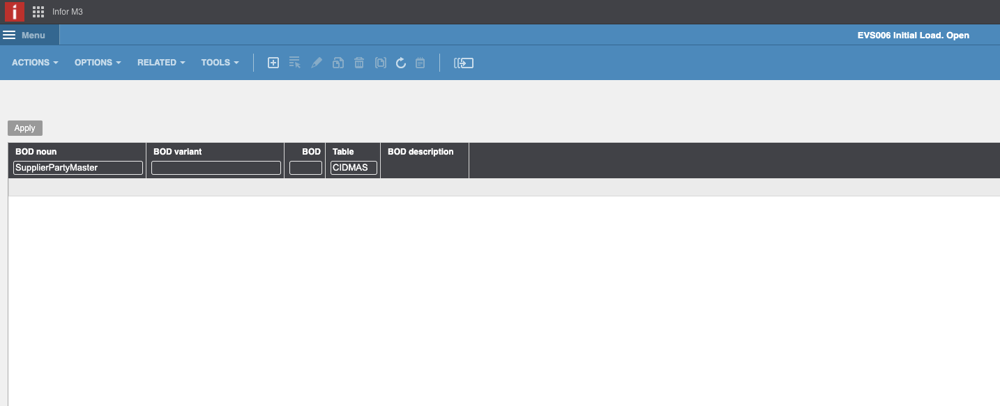<figcaption>
Historical EVS006 Initial Load list with SupplierPartyMaster as the BOD noun and CIDMAS as the table.
</figcaption></figure>

* [ ] When you have filled these columns, just click on CREATE button (on the upper bar side of the screen). You will come to following screen.

<figure>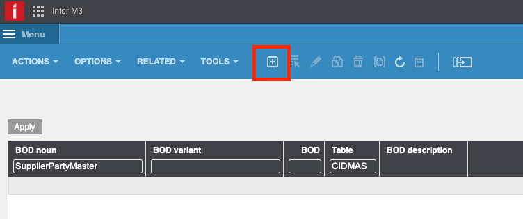<figcaption>
Historical EVS006 list with the Create toolbar button highlighted.
</figcaption></figure>

<figure>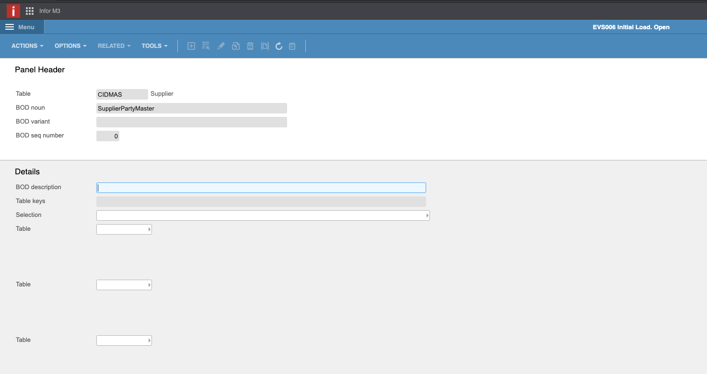<figcaption>
Historical EVS006 create panel for CIDMAS with the BOD description field still empty.
</figcaption></figure>

* [ ] Fill the “BOD Description” with SupplierPartyMaster.

<figure>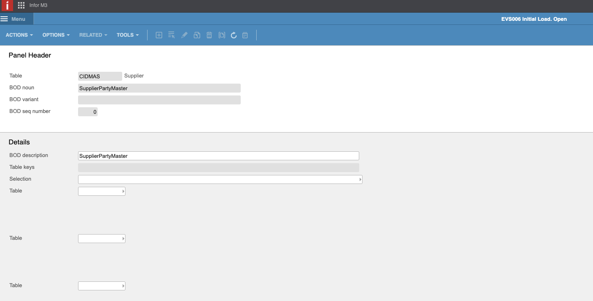<figcaption>
Historical EVS006 create panel with SupplierPartyMaster entered as the BOD description.
</figcaption></figure>

* [ ] Click on Next at the bottom right of the panel shown below.

<figure>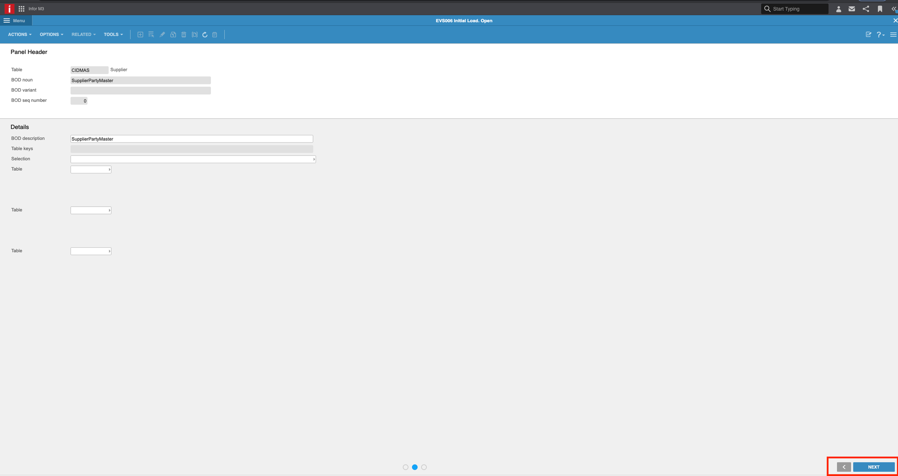<figcaption>
Historical EVS006 create panel with the Next button highlighted.
</figcaption></figure>

* [ ] Click Next in this window.

<figure>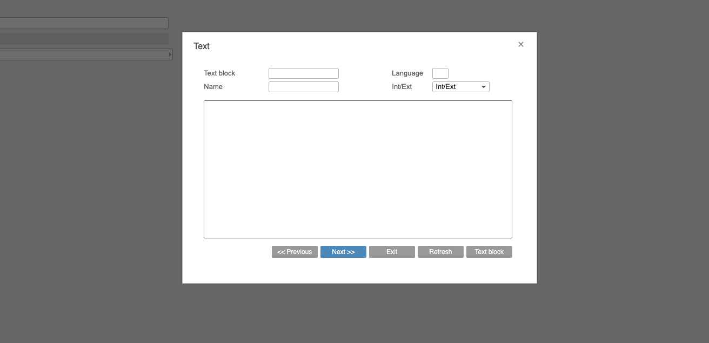<figcaption>
Historical EVS006 Text dialog with text-block fields and a Next button.
</figcaption></figure>

* [ ] Now when you see this screen with the filled table with the BOD SupplierPartyMaster make right click on the BOD and choose Related > Run.

<figure>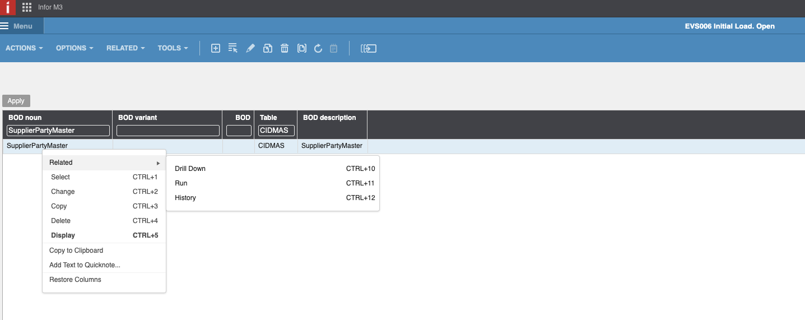 Run"><figcaption>
Historical EVS006 list with the Related → Run menu open on the SupplierPartyMaster row.
</figcaption></figure>

* [ ] In this next window select “Sync” and next.

<figure>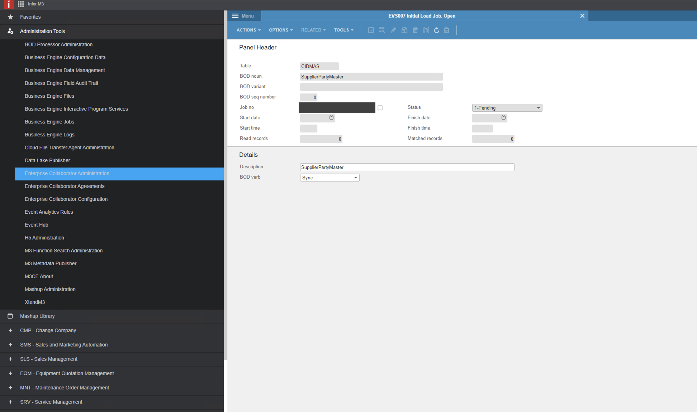<figcaption>
Historical EVS007 Initial Load Job showing CIDMAS, SupplierPartyMaster, Sync and status 1-Pending. The job identifier is masked; the pending status does not prove a completed import.
</figcaption></figure>

The historical screens illustrate an initial-load setup; they do not prove that a transfer into DocBits has completed. Check the EVS006 run history and the ION routing for the intended company, division and supplier scope, then search for representative suppliers in DocBits. A supplier shown in an existing screenshot is not evidence that this M3 import ran successfully.

### Check the DocBits search view

In Supplier Management, the English search control is labelled “Search by Name, Number”. This current view shows the available search control only. It does not establish that M3 supplier master data has arrived or that a transfer completed; verify the intended records in the appropriate destination for your configured integration.

<figure><figcaption>
Current English Supplier Management search control. Existing supplier rows, names, totals and account details are outside the crop. No search or M3 import was performed for this image.
</figcaption></figure>
