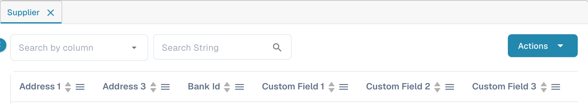
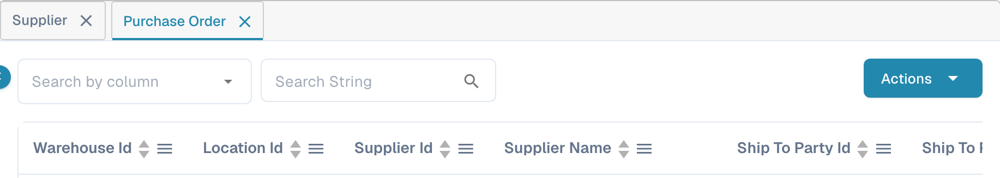

# Suppliers and Purchase Orders from Infor M3

This example connects M3 supplier and purchase-order BODs to DocBits through Infor ION. The fifteen Infor images below are historical tenant examples, not current validation of your M3 setup. Ask the Infor administrator to confirm the BOD names, source tables, company, division, API call names and target environment before running a job. No M3 initial load or DocBits import was executed for this update.

Infor's [initial-load guide](https://docs.infor.com/m3udi/16.x/en-us/m3beud/appfoundhs/spl1567531742751.html) explains EVS006 definitions, the EVS007 verb and selection, submission, and history. Use a limited selection first; an unrestricted run can generate many events.

## **Connection Point**

You will need to create the DocBits API connection point in order to create the data flow later.

In InforOS, navigate to ION Desk → Connect → Connection Points

<figure><figcaption>
Historical navigation: ION Desk → Connect → Connection Points.
</figcaption></figure>

Once here, you will need to create a new connection point.

<figure><figcaption>
Historical Add action for creating a connection point.
</figcaption></figure>

**Select API**

Give the connection point a name and description that describes its nature and its environment. Under the Connection tab, import the service account you created for the environment you are working with.

<figure><figcaption>
Historical Connection tab. The displayed names refer to the example environment; use your own service account.
</figcaption></figure>

Next, switch to the Documents tab. You will need to add the following BODs to the connection point, not all are necessary for the supplier and purchase order master data but will be useful when other features such as Auto Accounting need to be implemented.

<figure><figcaption>
Historical received-document list. The supplier BOD shown is Sync.RemitToPartyMaster, without a Data suffix.
</figcaption></figure>

This historical setup uses Sync.RemitToPartyMaster, Sync.SupplierPartyMaster and Sync.PurchaseOrder. Confirm the required BODs for your DocBits mapping; the setup can vary by tenant and feature.

* Sync.RemitToPartyMaster and Sync.SupplierPartyMaster

The following historical image shows Sync.SupplierPartyMaster. Configure each required supplier BOD with the API call name and receiving operation confirmed for your environment; the second supplier route is not pictured.

<figure><figcaption>
Historical SupplierPartyMaster route. The image shows one supplier route; confirm the receiving operation separately for each required BOD.
</figcaption></figure>

* Sync.PurchaseOrder

The following historical image shows one purchase-order receiving operation. Confirm its current endpoint and request format for your environment.

<figure><figcaption>
Historical PurchaseOrder route. The old API Gateway proxy path is an example, not a universal DocBits address.
</figcaption></figure>

Once these BODs are configured, you can save the connection point by pressing the icon located right to the back button.

## **Data Flow**

This historical data flow is one possible design; check its routes and receiving organisation in your own tenant.

<figure><figcaption>
Historical flow. The No branch ends before the API nodes; the Yes branch reaches the four example environments.
</figcaption></figure>

The multiple DocBits API nodes represent separate environments in this example. Your design may differ; check that test messages cannot reach production.

Four environments are shown only as an example.

### **M3**

The start of the data flow consists of your M3 application

### **Filter**

Configuration of the filter looks as follows

<figure><figcaption>
Historical filter name and description. The name Division alone does not establish which records are filtered.
</figcaption></figure>

<figure><figcaption>
Historical attributes: each BOD has an AccountingEntityID path. Review the path for each document in your tenant.
</figcaption></figure>

<figure><figcaption>
Historical Conditions example. Used Condition reads Not Filtered even though an expression is listed; check the selected condition and its effect instead of assuming that the expression is active.
</figcaption></figure>

(The accounting entity ID of course being unique to your organization)

### **DocBits API**

Here you will add an application and select the DocBits API(s) you created earlier

### **Documents**

Select the documents assigned to the M3 source and receiving nodes. Confirm that the filter attributes and receiving routes cover every required document.

<figure><figcaption>
Historical document selection for the M3 flow. This is a BOD document list, not a file-node configuration.
</figcaption></figure>

## **M3 BOD Triggering**

Navigate to the Infor M3 application

Open the M3 **Search and Start** control, enter **EVS006**, and confirm the program. Use the navigation supported by your M3 client.

<figure><figcaption>
Historical program search: enter EVS006 in Search and Start.
</figcaption></figure>

In EVS006, define the BOD nouns required for your approved mapping. The historical example uses SupplierPartyMaster, RemitToPartyMaster and PurchaseOrder. Confirm their M3 table names in your version before creating an initial-load definition.

BOD noun: SupplierPartyMaster

Table: CIDMAS

BOD noun: RemitToPartyMaster

Table: CIDMAS

BOD noun: PurchaseOrder

Table: MPHEAD

Use the add action for each approved definition. Check company and division before continuing.

<figure><figcaption>
Historical Add action in EVS006. This crop does not show completed initial-load definitions.
</figcaption></figure>

After you have added each of the BODs, right click on the BOD noun of the BOD and select Related → Run

<figure><figcaption>
Historical Related → Run action. Use History later to inspect the initial-load result.
</figcaption></figure>

The related **Run** action opens EVS007. Choose **Sync** only when the receiving ION flow expects it. Inspect the selection and filters before the final submission; moving to the next screen is not proof of delivery.

<figure><figcaption>
Historical EVS007 verb selection before execution. The image shows a pending job and an annotated Sync option; it does not prove that Sync was selected or that data was imported.
</figcaption></figure>

A submission notification confirms that the job was requested. In EVS006 **History**, inspect the processed count and errors. Then check the message and target in Infor ION.

## Verify in DocBits

Open **Settings → Document Processing → Lookup Master Data → BOD Input data → Supplier** in the intended DocBits organisation. Choose the identifier field in **Search by column**, enter a known supplier number or name in **Search String**, and use the magnifier to search. Then open **Purchase Order** and search for a known purchase-order number; check **Purchase Order Header** if your mapping separates header and line data. Compare identifiers and company with the M3 source. A successful EVS007 request alone does not establish that all records arrived.

<figure><figcaption>
Supplier verification view in Dev. Search for a known test identifier and compare it with M3 and ION.
</figcaption></figure>

<figure><figcaption>
Purchase Order verification view in Dev. The record rows are outside this image; this is not evidence of an M3 import.
</figcaption></figure>

The English Dev views were inspected on 29 October 2026 without running an M3 job, importing a file or changing master data. Record rows are excluded from the images; the images demonstrate where to check, not a completed transfer. If an expected record is missing, check EVS006 history, ION routing, the BOD mapping and the DocBits organisation before rerunning.
