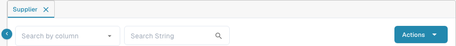

# M3\_OLD

**Archived guide.** The connection-point template previously offered here contains a DocBits development-specific logical ID. It is not a reusable customer or production setup template.

## Legacy connection template {#importing-an-api-connection-template-in-infor-m3}

Use an integration configuration approved for the intended Infor tenant and DocBits organization. This archived page does not provide an import procedure or verify an M3 connection.

### Retired template {#download-the-template}

The previous development template is no longer offered for download on this page. Do not use it as a production setup template; ask your integration administrator for the configuration approved for your environment.

### Current M3 guides {#importing-template}

Choose the current guide for the task:

* [M3 integration overview](m3/README.md)
* [Suppliers and Purchase Order](m3/suppliers-and-purchase-orders.md)
* [How to import all suppliers](m3/how-to-import-all-suppliers.md)
* [Auto Accounting](m3/auto-accounting.md)
* [Table Extraction for costing element](m3/table-extraction-for-costing-element.md)

#### Check the Supplier view {#steps-to-import-a-connection-template}

After your integration team has independently confirmed delivery, open **Settings → Lookup Master Data** in the intended DocBits organization and select **Supplier**. To look for an expected supplier, choose a field in **Search by column**, enter its identifier in **Search String**, and use the search icon. Compare the returned record with your approved source; a record appearing here alone does not prove which integration created it.

<figure><figcaption>
Current English Supplier search controls. Existing record rows are outside this cropped view; the image does not demonstrate an M3 connection or import.
</figcaption></figure>
