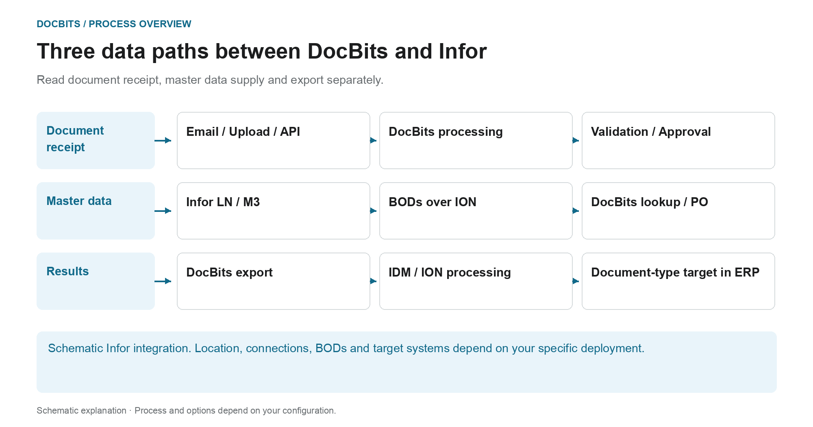

# Architecture

## The architecture as three separate data paths

<figure><figcaption>
Read document receipt, master data supply and export separately. The diagram is schematic; the active settings of your organization determine the actual behavior.
</figcaption></figure>

The architecture contains several data flows with different purposes. Documents are imported for processing; master data comes from the ERP integration; recognized and reviewed results are returned through the configured export path. These paths are separate connections and should be traced separately during diagnosis.

| Data path | Direction and purpose | Checkpoint |
| --- | --- | --- |
| **Document receipt** | Email, upload or interface → DocBits. Documents are sent to the intended processing process. | Did the right document reach the right organization? |
| **Master data supply** | LN/M3 → BODs and ION data flow → DocBits. Suppliers and orders are made available for identification and reconciliation. | Has the required data set been transferred and accepted by DocBits? |
| **Result export** | DocBits → configured Infor connection → IDM or ION and ERP. Document and business data can take different downstream paths. | Are the transfer and the respective processing in the destination proven? |

In the Infor export described here, the PDF and its attributes are sent to IDM, and `Sync.CaptureDocument` is sent to ION Desk. ION transforms it into the required target BODs according to the document type. Acceptance by LN or M3 must be verified in the respective target system; a DocBits step alone does not prove every downstream processing step.

**Use the overview to investigate errors:** If a document is missing, start with import. If suppliers or purchase order lines are missing, follow the master data path. If the return transfer fails, check the export configuration, recipient response and ION/ERP processing. The architecture diagrams below add deployment and component details to this process overview.

Further: [Import documents](../../end-user-and-partner-section/end-user-section/how-to-import-documents/README.md), [Import customer master data](../../infor-integration-and-configuration/importing-customer-master-data/README.md) and [Export from DocBits](../../infor-integration-and-configuration/exporting-in-docbits/README.md).

## **DocBits Cloud customer**

<figure><figcaption></figcaption></figure>

## DocBits On premise

<figure><figcaption></figcaption></figure>

Doc**Bits** seamlessly integrates with Infor LN/M3 through ION API, ION Desk, and Infor Standard BODs. Our API integration allows us to export data to Infor and perform master data validation in Doc**Bits**.

## **DocBits Operator Architecture**

All connections between components are secured using industry-standard encryption protocols. SSH, HTTPS, and other secure channels ensure data integrity and confidentiality throughout the system.

**On Premise:**&#x20;

<figure><figcaption></figcaption></figure>


[prefect-local-setup-requirements.md](prefect-local-setup-requirements.md)


**Cloud**:

<figure><figcaption></figcaption></figure>

## Exporting Data to Infor

We use the ION API to send the PDF with attributes to IDM and the BOD Sync.CaptureDocument to ION Desk. In ION Desk, we transform the [Sync.CaptureDocument](../../infor-integration-and-configuration/exporting-in-docbits/) to the desired target BODs based on the document type being processed. These transformed Infor BODs are then automatically imported to LN or M3.


Export to [Infor](../../infor-integration-and-configuration/exporting-to-infor/)


## Master Data Validation in DocBits

To identify the supplier or compare/match purchase order lines, we activate a trigger in LN/M3 that sends the Sync.RemitToPartyMaster, Sync.SupplierPartyMaster, and Sync.PurchaseOrder BODs to Doc**Bits**. We configure this process in ION Desk by defining the dataflow to a specific connection point to Doc**Bits**.

<figure><figcaption></figcaption></figure>


[Master Data Validation](../../infor-integration-and-configuration/importing-customer-master-data/)


## Email Import OAuth Office365

<figure><figcaption></figcaption></figure>