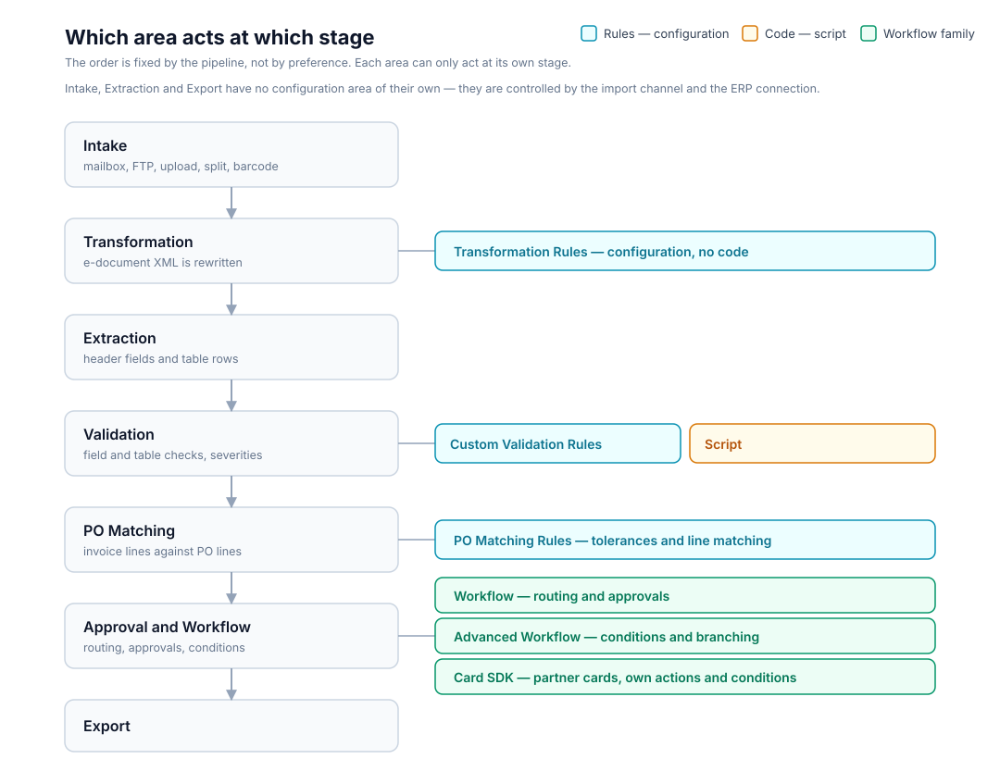

# When to use rules, workflows, or scripts

DocBits has seven places where you can influence how a document is processed: **transformation rules**, **custom validation rules**, **PO matching rules**, **Script**, **Workflow**, **Advanced Workflow** and the **Card SDK**. Each one has its own page — this page answers the question that comes first: *which one do I need?*

The short answer is that **the order is fixed by the pipeline, not by preference**. Every area can only act at its own stage. Choosing an area from the wrong stage is the usual reason a requirement seems impossible to configure.

<figure><figcaption>
Each configuration area acts at exactly one stage. Transformation rules run before extraction, validation rules and scripts run inside validation, PO matching rules compare lines, and the workflow family runs after validation.
</figcaption></figure>

## Choose an area by stage

| Area | Runs at | Use it when | Do not use it when | Page |
| --- | --- | --- | --- | --- |
| **Transformation Rules** | Before extraction & validation | A value must *always* be corrected or reshaped before anything downstream reads it — trim, uppercase, add a prefix, map a supplier's unit codes, collapse lines into one total | You want to *reject* a document, or route it for approval | [Transformation Rules](../administration-and-setup/settings/global-settings/document-types/transformation-rules.md) |
| **Custom Validation Rules** | Inside validation | The extracted data must be *checked* against your own rule — required, pattern, range, list, comparison, sum — and the user should see a message on the validation screen | You want to correct a value rather than flag it | [Custom Validation Rules](../administration-and-setup/settings/global-settings/document-types/custom-validation-rules.md) |
| **PO Matching Rules** | At PO matching | Invoice lines must be matched to PO lines, with your own tolerances and line-matching logic | You only need to compare two extracted fields — that is a validation rule | [Purchase Order Matching Rules](../administration-and-setup/settings/global-settings/document-types/more-settings/purchase-order/purchase-order-matching-rules.md) |
| **Script** | Inside validation | The check needs free logic that no built-in rule expresses — a loop over rows, an external lookup, an arithmetic that must also *write* a value | A validation rule already expresses the check; rules are simpler and survive product updates | [Script](../administration-and-setup/settings/global-settings/document-types/script/README.md) |
| **Workflow** | After validation | The document must be *routed* — send for approval, notify, export, branch on amount or supplier | You want to change or check a field's value | [Workflow](../administration-and-setup/workflow/README.md) |
| **Advanced Workflow** | After validation | The routing needs branching, parallel paths or loop-back that the linear When/And/Then builder cannot express | A simple trigger → condition → action is enough | [Advanced Workflow](../administration-and-setup/workflow/advanced-workflow-builder/README.md) |
| **Card SDK** | After validation | You are a partner or developer and need a card that DocBits does not ship — your own action or condition, reusable across organisations | A built-in card already does the job | [Card SDK](../administration-and-setup/workflow/card-sdk.md) |

## The areas in short

### Transformation Rules

Transformation rules rewrite extracted data **automatically**, every time a document is processed and every time it is saved. A rule reads a value, sends it through a short pipeline of steps, and writes the result back. They run **before** validation, scripts and PO matching, so everything downstream already sees the corrected values.

**Choose them when** the requirement is "this value is always wrong in this shape" — a supplier that omits a prefix, a unit code that must be mapped, lines that must be merged into a total. **They cannot** reject a document or route it anywhere; that is a check or a workflow.

### Custom Validation Rules

Custom validation rules let an administrator define their own **checks** on the extracted data — without a script and without a product change. When a check fails, DocBits marks the field or cell on the validation screen and shows your message, exactly like a built-in check. The severity decides whether the document is blocked (**Error**) or merely flagged (**Warning**).

**Choose them when** the requirement is "this must be true" — required, pattern, range, list, comparison, sum. **They cannot** fix the value; if a value is systematically wrong, correct it earlier with a transformation rule.

### PO Matching Rules

PO matching rules define **how** PO line items are matched to the incoming document. They are only used when **PO match server side** is switched on for the document type; with the switch off, DocBits matches with its built-in matcher and ignores the rule set.

**Choose them when** the requirement is about matching lines and tolerances. **Do not reach for them** to compare two extracted fields — that is a custom validation rule.

### Script

A script runs a piece of Python logic during processing, inside validation. It can compute, loop over table rows, consult data outside the document and write a value back.

**Choose a script only when** no validation rule expresses the check. Scripts are the most flexible area and therefore the hardest to maintain: they are code, they must be tested, and a product change can affect them. A validation rule that expresses the same check is always the better choice.

### Workflow and Advanced Workflow

Workflow automates what happens **to the document** after validation. The standard builder is built on a single rule — *When* something happens, *And* a condition holds, *Then* do an action — which covers routing, approvals, notifications and export triggers. The **Advanced Workflow** builder is a node-graph editor for the cases that need branching, parallel paths and flow control beyond that linear shape.

**Choose Workflow when** the requirement is about *where the document goes*. **Choose Advanced Workflow when** a simple trigger–condition–action is not enough.

### Card SDK

The Card SDK lets partners and developers build **custom workflow cards** for DocFlow, package them as a partner app and upload them (or import them from GitHub). Once a card is validated and accepted, it appears in the **Add Card** library alongside the built-in cards.

**Choose the Card SDK when** you need a card DocBits does not ship, and you want it reusable. **Do not** use a card to do something a configuration area already does — cards run at the workflow stage, so they cannot correct or check extracted data earlier.

## Getting a custom card accepted

The Card SDK is the one area where "when to use it" is inseparable from "how you get one". The process has five steps, and a card is not usable until all five are done:

1. **Create the card.** Download the SDK template and build the card from the expected structure — a `app.json` manifest and a `.docflowcompose/flow/` folder with the card definitions. Supply the card's Python source and a test for it.
2. **Upload and validate.** Upload the package as a ZIP (maximum 10 MB) or import it from GitHub. Upload & Validate runs the five validation stages: structure, static analysis, dependencies, tests, and behaviour.
3. **Admin approval.** A validated card stays pending until an organisation administrator approves it. Approval activates the card for use.
4. **Enable.** The approved card appears in the card library and can be added to a workflow.
5. **Use it in a workflow.** From then on the card behaves like any built-in card — it runs at the workflow stage.

For the full manifest shape, the card-role flags (`is_when`, `is_and`, `is_then`) and the validation report, see [Card SDK](../administration-and-setup/workflow/card-sdk.md).

## Choosing between neighbours

Two pairs get confused most often:

* **Transformation Rules vs. Script** — both can write a value. Transformation rules are a form with a live preview and no code, and they run earlier. Use a script only for logic the rule pipeline cannot express.
* **Custom Validation Rules vs. Script** — both can run inside validation. A validation rule is declarative: it shows a message and respects severity, with no code to maintain. A script is free logic, and the right choice only when the rule vocabulary genuinely cannot express the check.

In both cases the tie-breaker is the same: **start with the declarative area, and move to code only when the declarative area cannot do it.** Declarative configuration survives product updates; code has to be kept working.
